<p align="center"></p>

<p align="center">
  <a href="README.md">🇬🇧 English</a> · <b>🇩🇪 Deutsch</b> · <a href="README.tr.md">🇹🇷 Türkçe</a>
</p>

---

Erreichen und steuern Sie einen **PC oder Server**, den Sie laufen lassen, von Ihrem Smartphone oder Tablet aus – auch aus einem ganz anderen Netz: Terminal, Agenten, Bildschirm, Dateien und der Live-Systemzustand. Das Smartphone wird **einmal** gekoppelt; danach verbindet es sich ohne Passwort, und Sie können die Verbindung jederzeit an der Maschine trennen.

Die App gibt es auf **Deutsch, Englisch und Türkisch**. Sie können die Sprache jederzeit wechseln (siehe [Sprache](#sprache)).

🔒 **Sicherheit ist das Grundprinzip.** Ihr PC wird nie ins Internet geöffnet (mit Tailscale erreichen ihn nur Ihre eigenen Geräte). Jedes Gerät wird am PC gekoppelt, PIN-Sperre und Angriffsschutz sind immer aktiv, und jede Aktion wird protokolliert. Details unten unter [Sicherheitsebenen](#sicherheit).

## Inhalt

- [Download](#download)
- [Was die App kann](#funktionen)
- [So funktioniert es](#so-funktioniert-es)
- [Wofür sie nützlich ist](#einsatz)
- [Installation](#installation)
- [Smartphone koppeln](#koppeln)
- [Sprache](#sprache)
- [Sicherheitsebenen](#sicherheit)
- [Was geschützt ist – und was nicht](#grenzen)
- [macOS und Linux](#macos-linux)
- [Sperrbildschirm und Server-Überwachung](#sperrbildschirm)
- [Gut zu wissen](#gut-zu-wissen)

<a id="download"></a>

## ⬇️ Download

| Gerät | Datei | Hinweis |
|---|---|---|
| 🪟 **Windows 10/11** (PC) | [**Sabreza-View-Windows-x64-Setup.exe**](https://github.com/beyzakararti/sabreza-view-international/releases/latest/download/Sabreza-View-Windows-x64-Setup.exe) | Empfohlen, im täglichen Einsatz |
| 🤖 **Android** (Smartphone) | [**Sabreza-View-Android.apk**](https://github.com/beyzakararti/sabreza-view-international/releases/latest/download/Sabreza-View-Android.apk) | Im täglichen Einsatz |
| 🍏 **iPhone / iPad** | *Keine Datei nötig* | Die Web-App wird über Safari zum Home-Bildschirm hinzugefügt ([so geht's](#iphone)) |
| 🍎 **macOS** Apple Silicon (PC) | [Sabreza-View-macOS-AppleSilicon.dmg](https://github.com/beyzakararti/sabreza-view-international/releases/latest/download/Sabreza-View-macOS-AppleSilicon.dmg) | Experimentell ([Details](#macos-linux)) |
| 🍎 **macOS** Intel (PC) | [Sabreza-View-macOS-Intel.dmg](https://github.com/beyzakararti/sabreza-view-international/releases/latest/download/Sabreza-View-macOS-Intel.dmg) | Experimentell |
| 🐧 **Linux** (PC) | [.deb](https://github.com/beyzakararti/sabreza-view-international/releases/latest/download/Sabreza-View-Linux-amd64.deb) · [.rpm](https://github.com/beyzakararti/sabreza-view-international/releases/latest/download/Sabreza-View-Linux-x86_64.rpm) | Nur Terminal und Agenten, keine Bildschirmfreigabe |

Alle Versionen, Versionshinweise und Prüfsummen: **[Releases](https://github.com/beyzakararti/sabreza-view-international/releases)**. Sie können die Dateien vor der Installation [überprüfen](#pruefen).

<a id="funktionen"></a>

## Was die App kann

| Tab | Funktion |
|---|---|
| 🤖 **Agent** | Startet einen **Claude-Code**- oder **Codex**-Agenten auf dem PC oder setzt ihn fort. Ihre eigenen Einstellungen, MCP-Server und CLAUDE.md-/AGENTS.md-Dateien werden geladen. Sie können **Bilder, PDFs und Dokumente** vom Smartphone hochladen oder **Dateien vom PC** anhängen. |
| 🔐 **Freigaben** | Will ein Agent einen Befehl ausführen, eine Datei ändern oder Ihnen eine Frage stellen, erscheint eine Karte auf dem Smartphone: *Zulassen / Immer zulassen / Ablehnen (+ Hinweis)*. Das Smartphone **meldet sich akustisch** (hartnäckiger Piepton bei Freigaben, eine ca. 3 Sekunden lange Melodie, wenn eine Aufgabe erledigt ist, optional Vorlesen und Vibration). Push-Benachrichtigungen kommen auch bei geschlossener App an. |
| ⌨ **Terminal** | Echte Terminals auf dem PC. Das Menü **AI ▾** startet jede installierte Terminal-KI (Claude Code, Codex, Gemini CLI, Copilot, Aider, …) im gewählten Ordner. |
| 🖥 **Bildschirm** | Live-Bild des PC-Bildschirms. Ist **🖱 Steuern** an, wird Tippen zum Mausklick: tippen = Klick, zweimal tippen = Doppelklick, halten = Rechtsklick, ziehen = mit der Maus ziehen, zwei Finger = Mausrad, **auseinander-/zusammenziehen = Zoom** (bis 6-fach). **⌨ Tastatur** öffnet die Smartphone-Tastatur, jeder Buchstabe geht sofort an den PC (auch Umlaute und Sonderzeichen). Strg/Alt/Umschalt-Kombinationen und Tastenkürzel stehen bereit. **Vollbild quer** dreht das Smartphone, blendet die Browserleisten aus und füllt das ganze Display mit dem PC-Bild; das Display bleibt an. **Externe Tastaturen und Mäuse** (Bluetooth oder USB) funktionieren direkt. **🔇 PC-Ton** spielt den Ton des PCs auf dem Smartphone ab (Windows). |
| 📊 **System** | **Live-Zustand** des PCs: CPU und Arbeitsspeicher mit kurzem Verlaufsdiagramm, Grafikkarte (Auslastung, Temperatur, Grafikspeicher, Leistung), Temperaturen, Laufwerke, Netzwerkgeschwindigkeit, Akku und die Programme mit der höchsten CPU- und Speicherlast. Server, die Sie am PC hinzufügen, erscheinen als eigene Tabs. |
| 📁 **Dateien** | Dateien auf dem PC durchsuchen, ansehen und herunterladen, vom Smartphone auf den PC hochladen, eine Datei an einen Agenten anhängen. |
| 🧩 **Sitzungen** | Live-Status der Claude-Code-Sitzungen in VS Code und der **gesamte Claude-Code- und Codex-Verlauf** auf dem PC (Desktop-App, VS Code, CLI). Jede Sitzung lässt sich auf dem Smartphone fortsetzen – oder am PC öffnen. |
| ⚙ **Einstellungen** | Sprache, Abwesenheitsmodus, Fernsteuerung, akustische Hinweise, **Nutzungslimits** (5-Stunden- und Wochenlimits von Claude und Codex mit Prozentanzeige und Zeitpunkt der Zurücksetzung), Push-Benachrichtigungen, gekoppelte Geräte, Sicherheitsprotokoll, Notstopp. |

**Jede KI kann Ihr Smartphone nutzen (MCP).** Die App kann den KI-Tools auf Ihrem PC (Claude Code, Codex, Gemini CLI, Qwen, Cursor, Windsurf) einen kleinen MCP-Server hinzufügen. Dann kann jeder Agent Sie mit `phone_notify` benachrichtigen („Aufgabe erledigt“), mit `phone_ask` etwas fragen und auf die Antwort warten oder mit `phone_approve` vor einem riskanten Schritt Ihre Zustimmung einholen. Siehe [Schritt 5 der Installation](#ki-hooks).

<a id="so-funktioniert-es"></a>

## So funktioniert es

Diese kleine Simulation (30-Sekunden-Schleife) zeigt das System und seine Sicherheitsebenen: Die Anfrage vom Smartphone passiert vier Tore, Angreifer sehen den PC nicht, fremde Konten und Scanner werden abgewiesen, ein gestohlenes Smartphone wird beim Versuch ohne PIN entfernt, das Smartphone piept, wenn ein Agent eine Freigabe braucht, und spielt eine Melodie, wenn die Arbeit erledigt ist.



<a id="einsatz"></a>

## Wofür sie nützlich ist

| Situation | So hilft die App |
|---|---|
| **Eine lange KI-Aufgabe läuft** (großes Refactoring, Tests reparieren, Projekt einrichten) | Aufgabe geben und gehen. Ist sie fertig, spielt das Smartphone eine Melodie; Sie lesen das Ergebnis und geben die nächste Anweisung vom Smartphone aus. |
| **Ihr Nutzungslimit ist (fast) ausgeschöpft** (Claude/Codex 5-Stunden-Sitzung, wöchentlich) | Die Einstellungen zeigen Prozentsatz und Zeitpunkt der Zurücksetzung. Bei 90 % und 100 % kommt eine Warnung, und **sobald es zurückgesetzt ist**, die Meldung „✅ Limit zurückgesetzt“. |
| **Der Agent will einen Befehl ausführen** | Die Freigabekarte erscheint mit hartnäckigem Piepton auf dem Smartphone. Sie sehen den Befehl und lassen ihn mit einem Tippen zu oder lehnen ihn ab. Der Agent wartet auf Sie. |
| **Sie sind unterwegs, im Café, in der Vorlesung** | Befehle im Terminal des PCs zu Hause ausführen, Logs lesen, einem Fehler nachgehen, dem Agenten sagen „repariere das“. |
| **Sie nutzen mehrere KIs** | Claude Code und Codex über den Chat, weitere Terminal-KIs (Gemini CLI, Aider, …) über das gemeinsame Terminal. Dank der MCP-Brücke können alle Ihnen Benachrichtigungen, Fragen und Freigabeanfragen schicken. |
| **Am PC hängt etwas** (eingefrorenes Fenster, offener Dialog) | Im Tab „Bildschirm“ den PC live sehen, ins Vollbild wechseln und per Tippen klicken oder mit der Tastatur schreiben. |
| **Sie brauchen eine Datei oder wollen eine an den PC schicken** | Dokumente im Tab „Dateien“ herunterladen, Fotos und PDFs vom Smartphone hochladen oder direkt an den Agenten anhängen. |

<a id="installation"></a>

## Installation

Jeder verbindet sich mit **seinem eigenen PC über sein eigenes Tailscale-Konto**. Sie brauchen kein fremdes Konto, und niemand braucht Ihres: Das Tailscale-Konto ist der Schlüssel zum privaten Netz Ihrer Geräte.

### 1. Tailscale (PC und Smartphone)

1. Installieren Sie [Tailscale](https://tailscale.com/download) auf dem PC **und** auf dem Smartphone und melden Sie sich auf beiden mit **demselben Konto** an (Google, Microsoft, Apple oder GitHub – wie Sie möchten).
2. Aktivieren Sie in der Tailscale-Verwaltung **DNS → HTTPS Certificates** (MagicDNS muss an sein).

> Tailscale ist für den privaten Gebrauch kostenlos (aktuelle Bedingungen prüfen). Die App selbst braucht kein Abo; Sie benötigen nur Konten für die KI-Tools, die Sie nutzen.

### 2. PC (Windows)

1. Laden Sie **Sabreza-View-Windows-x64-Setup.exe** herunter und starten Sie die Datei. Zeigt Windows eine Warnung „Unbekannter Herausgeber“, wählen Sie **Weitere Informationen → Trotzdem ausführen** (das Installationsprogramm ist noch nicht code-signiert).
2. Beim ersten Start öffnet die App den **Einrichtungsassistenten** (oben rechts: Sprache). Wählen Sie **Tailscale**, fahren Sie fort, sobald alle Prüfungen grün sind, und legen Sie eine **PIN** fest. Der Zugriff wird automatisch auf Ihr Tailscale-Konto beschränkt.
3. Die App läuft im **Infobereich** (unten rechts) weiter, auch wenn Sie das Fenster schließen, und startet mit Windows. Ein Rechtsklick auf das Symbol bietet *öffnen*, *Panel dieses PCs (Smartphone koppeln)*, *bei der Anmeldung starten* und *beenden*.

### 3. Smartphone

- **Android:** Installieren Sie **Sabreza-View-Android.apk** (erlauben Sie bei Nachfrage die Installation aus dieser Quelle). Öffnen Sie die App, tippen Sie auf **QR-Code scannen**, scannen Sie den QR-Code aus dem Assistenten und geben Sie Ihre PIN ein. Für Benachrichtigungen bei geschlossener App installieren Sie **[ntfy](https://ntfy.sh/)** (UnifiedPush) – das funktioniert auch auf Smartphones ohne Google-Dienste.
- <a id="iphone"></a>**iPhone / iPad (iOS 16.4+):** Keine App nötig. Öffnen Sie die Adresse des PCs in **Safari** (sie steht im Assistenten und im PC-Panel, z. B. `https://mein-pc.….ts.net`) → Teilen → **Zum Home-Bildschirm**. Öffnen Sie die App über das Symbol auf dem Home-Bildschirm, geben Sie den 8-stelligen Code aus dem Assistenten und dann Ihre PIN ein, anschließend Einstellungen → **Benachrichtigungen einschalten**.

### 4. Fertig

Sie können den Assistenten jetzt schließen. Im PC-Panel (**http://localhost:7373/admin**, nur am PC selbst) erstellen Sie neue Kopplungscodes, ändern PIN und Sperrzeit, sehen und trennen Geräte und heben Sperren auf.

<a id="ki-hooks"></a>

### 5. Benachrichtigungen von Claude Code / Codex (optional)

Damit Claude-Code-Sitzungen in VS Code live auf dem Smartphone erscheinen (und Codex erledigte Aufgaben meldet) und jedes KI-Tool Ihrem Smartphone über MCP schreiben kann, führen Sie einmalig in PowerShell am PC aus (Standard-Installationsordner ist `%LOCALAPPDATA%\sabreza-view-apps`):

```powershell
$app = "$env:LOCALAPPDATA\sabreza-view-apps"
& "$app\bundle\node\node.exe" "$app\bundle\app\bin\install-hooks.js"
& "$app\bundle\node\node.exe" "$app\bundle\app\bin\install-mcp.js"
```

Beide sichern die Einstellungsdateien, die sie ändern. Starten Sie offene Claude-Code-/Codex-Sitzungen danach neu.

### Aktualisieren

Installieren Sie die neue `…-Setup.exe` über die alte; Einstellungen, PIN und gekoppelte Smartphones bleiben erhalten. Wählen Sie vorher im Infobereich **Beenden** und schließen Sie Claude-Code-/Codex-/Gemini-Fenster (solange sie laufen, nutzen sie die `node.exe` der App, und das Installationsprogramm kann sie nicht ersetzen). Unter Android installieren Sie die neue APK über die alte; auf dem iPhone aktualisiert sich die Web-App selbst.

<a id="pruefen"></a>

### Download überprüfen (empfohlen)

Jedes Release enthält `SHA256SUMS.txt`. Vergleichen Sie die Prüfsumme der heruntergeladenen Datei:

```powershell
Get-FileHash .\Sabreza-View-Windows-x64-Setup.exe -Algorithm SHA256
```

```bash
shasum -a 256 Sabreza-View-macOS-AppleSilicon.dmg   # macOS / Linux: sha256sum
```

Weicht der Wert von dem in `SHA256SUMS.txt` ab, installieren Sie die Datei nicht.

<a id="koppeln"></a>

## Smartphone koppeln (einmalig)

1. Öffnen Sie am PC **http://localhost:7373/admin** (oder im Infobereich → *Panel dieses PCs*) und erstellen Sie einen Kopplungscode.
2. Scannen Sie den QR-Code mit dem Smartphone (Android-App: **QR-Code scannen**). Klappt das Scannen nicht, tippen Sie den 8-stelligen Code ein.
3. Benachrichtigungen einrichten: Einstellungen → **Benachrichtigungen einschalten** → **Test**.

Danach wird kein Passwort mehr verlangt. Zum **Trennen** eines Geräts klicken Sie im PC-Panel daneben auf „Trennen“ – auch seine offene Verbindung wird sofort geschlossen.

> Eine Beschränkung über die MAC-Adresse ist über das Internet nicht möglich: Die MAC-Adresse ist nur im selben lokalen Netz sichtbar. Die Kopplung erledigt dasselbe sicherer – auf dem Smartphone wird ein nicht erratbarer 256-Bit-Geräteschlüssel gespeichert.

<a id="sprache"></a>

## 🌐 Sprache

Die Smartphone-App, die PC-Seiten, Push-Benachrichtigungen und das Menü im Infobereich gibt es auf **Deutsch, English (Englisch) und Türkçe (Türkisch)**.

- **Auf dem Smartphone:** Einstellungen → **🌐 Sprache**. Auch der Kopplungs- und der PIN-Bildschirm haben oben eine Sprachauswahl.
- **Am PC:** das Sprachmenü oben rechts im Panel und im Einrichtungsassistenten.
- Eine Auswahl gilt für die ganze Installation: Smartphone, PC-Seiten, Benachrichtigungen und Menü wechseln gemeinsam.
- Eine neue Installation startet in der Sprache Ihres Betriebssystems (Englisch, wenn es weder Deutsch noch Türkisch ist).

<a id="sicherheit"></a>

## 🔒 Sicherheitsebenen

Die App gibt Fernzugriff auf Terminal, Bildschirm und Dateien Ihres PCs – deshalb ist Sicherheit ihr Grundprinzip. Sie verlässt sich nie auf einen einzelnen Schutz; die folgenden Ebenen arbeiten übereinander, und wer eine überwindet, stößt auf die nächste.

1. **Netzwerk – der PC wird nie geöffnet.** Im Tailscale-Modus (empfohlen) ist die App aus dem Internet unsichtbar; nur Geräte, die bei Ihrem Tailscale-Konto angemeldet sind, können sich verbinden, und der Verkehr zwischen Smartphone und PC ist Ende-zu-Ende verschlüsselt (WireGuard). Die öffentliche Freigabe von Tailscale (Funnel) bleibt aus. Der Server lauscht nur auf `127.0.0.1` – am Router wird kein Port geöffnet, und auch aus dem lokalen Netz ist er nicht direkt erreichbar.
2. **Kontosperre.** Jede Anfrage trägt die Identität, die Tailscale hinzufügt. Konten, die nicht freigegeben sind, werden abgewiesen – selbst wenn jemand Ihrem Tailscale-Netz hinzugefügt oder ein Gerät mit ihm geteilt wird.
3. **App-Firewall.** Antwortet nur auf bekannte Hostnamen (blockt DNS-Rebinding); sperrt Angriffswerkzeuge (sqlmap, nikto, nmap …) und Testpfade wie `/.env`, `/.git`, `/wp-login` sofort **für 1 Stunde**; sperrt eine IP automatisch nach 20 verdächtigen Anfragen in 10 Minuten; begrenzt Anfragen und WebSocket-Nachrichten; blockt fehlerhafte Pfade. Sperren erscheinen im PC-Panel und lassen sich dort aufheben, jede Sperre löst einen Alarm auf dem Smartphone aus. Im Tailscale-Modus werden Ihre eigenen Geräte nie gesperrt.
4. **Bedrohungsdaten.** Täglich lädt die App offizielle, öffentliche Listen schädlicher Adressen herunter – **USOM** (türkische Behörde für Cybersicherheit), **Spamhaus DROP** und **abuse.ch Feodo Tracker**. Anfragen von gelisteten IPs werden direkt abgewiesen; alle 5 Minuten werden die offenen Verbindungen des PCs (unter Windows auch der DNS-Cache) mit den Listen abgeglichen, und verbindet sich ein Programm auf dem PC mit einer gelisteten Adresse, erhalten Sie einen Alarm mit hoher Priorität samt Programmnamen. Die App lädt nur die Listen herunter; Ihre Verbindungsdaten werden nirgendwohin gesendet.
5. **Geräteidentität.** Ein neues Gerät kann sich nur mit einem einmaligen Code koppeln, der am PC erstellt wird (10 Minuten gültig; 5 Fehlversuche pro IP oder 20 insgesamt sperren die Kopplung für 15 Minuten). Das Smartphone speichert einen nicht erratbaren 256-Bit-Schlüssel; der Server behält nur dessen SHA-256-Hash, in einem `HttpOnly`-, `Secure`-, `SameSite=Strict`-Cookie. Der Schlüssel ist an Betriebssystem und Browserfamilie gebunden, auf denen er entstanden ist – wird er anderswo benutzt, wird die Kopplung gelöscht und Sie erhalten einen Alarm. Das PC-Panel lässt sich nur am PC selbst öffnen.
6. **App-PIN.** Wird nur am PC festgelegt und nur als scrypt-Hash gespeichert. Ein gekoppeltes Smartphone sperrt sich nach der gewählten Leerlaufzeit (standardmäßig 10 Minuten; wählbar 30 Min., 1, 4 oder 24 Stunden) – ohne PIN gibt der Server keinerlei Zugriff. Die PIN allein nützt ohne den gekoppelten Geräteschlüssel nichts, und **nach 5 Fehlversuchen wird die Kopplung automatisch gelöscht**. Auf dem Smartphone gibt es „Jetzt sperren“.
7. **Grenzen dessen, was möglich ist.** Dateizugriff ist auf die eingestellten Ordner beschränkt (kein Ausbruch mit `..` oder symbolischen Links). Sensible Orte wie `.ssh`, `AppData` (Browser-Passwörter und -Cookies), Anmeldetokens von Claude, Codex und GitHub und der Datenordner der App sind ausgeblendet; `.env`, private Schlüssel und Passwort-Tresore werden angezeigt, lassen sich aber nicht öffnen. **Maus-/Tastatur-Fernsteuerung ist standardmäßig aus.** Im Modus „Alles nachfragen“ wird nichts ohne Ihre Zustimmung ausgeführt.
8. **Überwachung und Alarme.** Neue Kopplungen, falsche PINs, gesperrte IPs und Versuche mit gestohlenen Cookies alarmieren Ihre anderen Geräte. Jede Anmeldung, jeder Befehl, jede Freigabe-Entscheidung und jeder Dateizugriff landet in einem **manipulationssicheren Protokoll** (jede Zeile enthält den Hash der vorherigen). **Private Benachrichtigungen** (standardmäßig an) blenden Befehle, Pfade und Agenten-Antworten auf dem Sperrbildschirm aus. Der 🚨 **Notstopp** meldet alle Geräte ab und beendet Terminals und Agenten.

<a id="grenzen"></a>

## Was geschützt ist – und was nicht

**Geschützt ist Ihr PC vor:**
- Angreifern aus dem Internet, Scan-Bots und anderen Geräten im selben WLAN (der PC ist von außen unsichtbar).
- einem verlorenen oder gestohlenen Smartphone: PIN, Entfernen nach 5 Fehlversuchen, Trennen mit einem Klick am PC.
- der Nutzung eines gestohlenen Cookies auf einem anderen Gerät, nachträglichen Änderungen am Protokoll und dem Durchsickern von Geheimnissen.

**Nicht geschützt – bitte beachten:**
- **Schadsoftware, die schon auf dem PC ist.** Davor kann keine App schützen. Halten Sie Betriebssystem und Virenschutz aktuell.
- **Ihr Tailscale-Konto ist der Schlüssel.** Ist es mit GitHub oder Google verknüpft, aktivieren Sie dort die Zwei-Faktor-Authentifizierung, und schalten Sie in der Tailscale-Verwaltung die *Gerätefreigabe* (device approval) ein. Wer das Konto übernimmt, könnte ein Gerät hinzufügen – käme ohne Kopplungscode und PIN aber trotzdem nicht hinein.
- **Nutzen Sie eine Bildschirmsperre auf dem Smartphone.** Die App-PIN greift erst nach der Leerlaufzeit; bis dahin ist ein entsperrtes Smartphone benutzbar. Tippen Sie auf „Jetzt sperren“, wenn Sie es weglegen.
- **Maus-/Tastatur-Fernsteuerung und „Immer zulassen“ sind mächtig.** Lassen Sie die Fernsteuerung aus, wenn Sie sie nicht brauchen, und belassen Sie den Freigabemodus auf „Alles nachfragen“ – „Nie nachfragen“ erlaubt einem Agenten Befehle ohne Zustimmung.
- **Der Koordinationsserver von Tailscale** kennt Ihre Gerätenamen, IPs und Online-Zeiten, kann den Verkehr aber nicht sehen.
- **Im Cloudflare-Modus** (optional, einfacher, aber weniger sicher) endet die Verschlüsselung auf den Servern von Cloudflare. Für höchste Sicherheit nutzen Sie Tailscale.

**Hinweis:** Diese App öffnet Terminal, Dateien und Bildschirm Ihres PCs für Ihr Smartphone; für die Nutzung ist verantwortlich, wer sie installiert. Öffnen Sie Ihren PC nicht für andere – wer ein fremdes Smartphone mit Ihrem Panel koppelt, gibt ihm vollen Zugriff auf Ihren PC.

<a id="macos-linux"></a>

## macOS und Linux

Die Smartphone-Oberfläche ist überall gleich; Tastenkürzel und Shell-Liste passen sich automatisch an den PC an.

| Funktion | Windows | macOS | Linux |
|---|---|---|---|
| Agenten (Claude Code, Codex), Verlauf, Freigabekarten | ✅ | ✅ | ✅ |
| Terminal | PowerShell, cmd, Git Bash | zsh, bash | bash, sh |
| Dateien, PIN, Firewall, Limit-Hinweise, MCP | ✅ | ✅ | ✅ |
| Bildschirm ansehen | ✅ | ✅ (braucht die Berechtigung **Bildschirmaufnahme**) | – |
| Maus und Tastatur steuern | ✅ | ✅ (braucht `cliclick` und die Berechtigung **Bedienungshilfen**) | – |
| PC-Ton auf dem Smartphone | ✅ | – | – |
| Start bei der Anmeldung | ✅ | ✅ | ✅ |

**macOS (experimentell):** Die macOS-Teile wurden geschrieben und per Simulation getestet, aber noch nicht vollständig auf einem echten Mac. Die `.dmg` ist nicht notarisiert: Ziehen Sie die App in *Programme* und öffnen Sie sie beim ersten Mal per Rechtsklick → **Öffnen** (oder `xattr -dr com.apple.quarantine "/Applications/sabreza-view-apps.app"`). Für Maus/Tastatur installieren Sie `cliclick` (`brew install cliclick`) und fügen die App unter Systemeinstellungen → Datenschutz & Sicherheit → **Bildschirm- & System-Audioaufnahme** und **Bedienungshilfen** hinzu. Ein MacBook schläft bei geschlossenem Deckel – lassen Sie ihn offen und dimmen Sie das Display, oder nutzen Sie Netzteil und externen Monitor.

**Linux:** Terminal, Agenten, Dateien und Benachrichtigungen funktionieren; eine Bildschirmfreigabe gibt es nicht.

<a id="sperrbildschirm"></a>

## Sperrbildschirm und Server-Überwachung

### Windows-Passwort vom Smartphone eingeben, während der PC gesperrt ist (Win+L)

Der Windows-Sperrbildschirm läuft auf einem geschützten Desktop, den normale Programme nicht sehen. Installieren Sie den kleinen Helfer **einmalig** in PowerShell (Windows fragt nach Administratorrechten):

```powershell
$app = "$env:LOCALAPPDATA\sabreza-view-apps"
& "$app\bundle\node\node.exe" "$app\bundle\app\bin\lockscreen.js"
```

Ist der PC gesperrt, zeigt der Tab **Bildschirm** dann den Sperrbildschirm; geben Sie PIN oder Passwort über **🖱 Steuern → ⌨** ein und drücken Sie Enter. Mit `status` bzw. `remove` am Ende des Befehls prüfen bzw. entfernen Sie ihn. Der Helfer nimmt nur Befehle an, wenn der PC wirklich gesperrt ist, rührt UAC-Abfragen nie an, und einzelne Zeichen (Ihr Passwort) werden nie protokolliert.

### Server zum Tab „System“ hinzufügen

Auf dem Server brauchen Sie nur Node.js 20+ und zwei Dateien aus dem Installationsordner der App, in derselben Struktur: `bundle\app\bin\monitor-agent.js` und `bundle\app\server\sysinfo.js`. Starten Sie:

```
node bin/monitor-agent.js --port 7430
```

Der Agent gibt einen **Token** aus. Tragen Sie im PC-Panel (**http://localhost:7373/admin → Überwachte Server**) die Adresse des Servers (z. B. `http://100.x.y.z:7430`) und den Token ein. Server lassen sich nur am PC hinzufügen und entfernen, damit ein gestohlenes Smartphone Ihren PC nicht auf andere Adressen lenken kann. Nutzen Sie ein privates Netz wie Tailscale; stellen Sie den Agenten nicht ohne HTTPS ins Internet.

**CPU-Temperatur unter Windows:** Windows liefert sie nicht von selbst. Öffnen Sie [LibreHardwareMonitor](https://github.com/LibreHardwareMonitor/LibreHardwareMonitor) und wählen Sie *Options → Remote Web Server → Run* – der Tab „System“ übernimmt sie automatisch (Port 8085 nicht in der Windows-Firewall freigeben).

<a id="gut-zu-wissen"></a>

## Gut zu wissen

- Der PC muss **eingeschaltet, wach und online** sein. Solange die App läuft, geht Windows nicht in den Ruhezustand; damit ein Laptop bei geschlossenem Deckel wach bleibt, stellen Sie *Energieoptionen → Zuklappen des Computers: Nichts unternehmen* ein. Nach einem Neustart durch Windows Update läuft die App erst wieder, wenn Sie sich anmelden.
- Das Abfragen der Nutzungslimits **verbraucht keine Tokens**. Limits werden nur bei Abos angezeigt (claude.ai- / ChatGPT-Konto); bei Nutzung per API-Schlüssel gibt es keine Planlimits.
- Ist die Maus-/Tastatursteuerung an, geht jede Taste im Tab „Bildschirm“ an den PC – auch Browser-Kürzel wie F5 oder Strg+R. Schalten Sie die Steuerung mit 🖱 aus, wenn Sie sie nicht nutzen.
- Smartphone und Tablet können gleichzeitig mit demselben PC verbunden sein.
