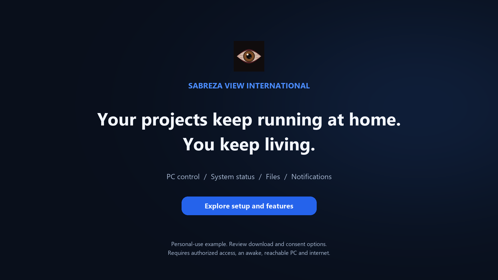
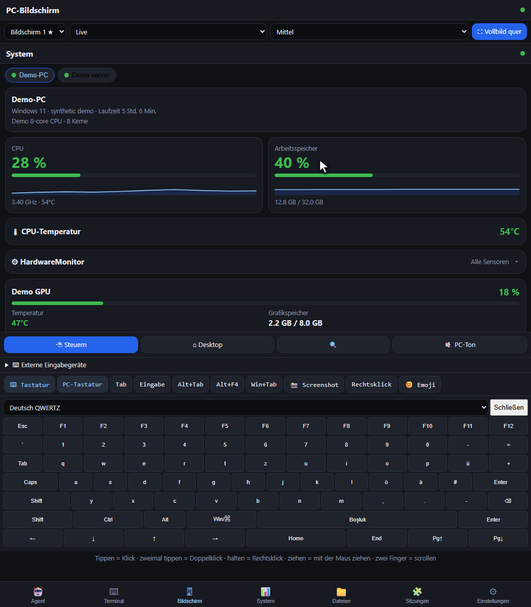
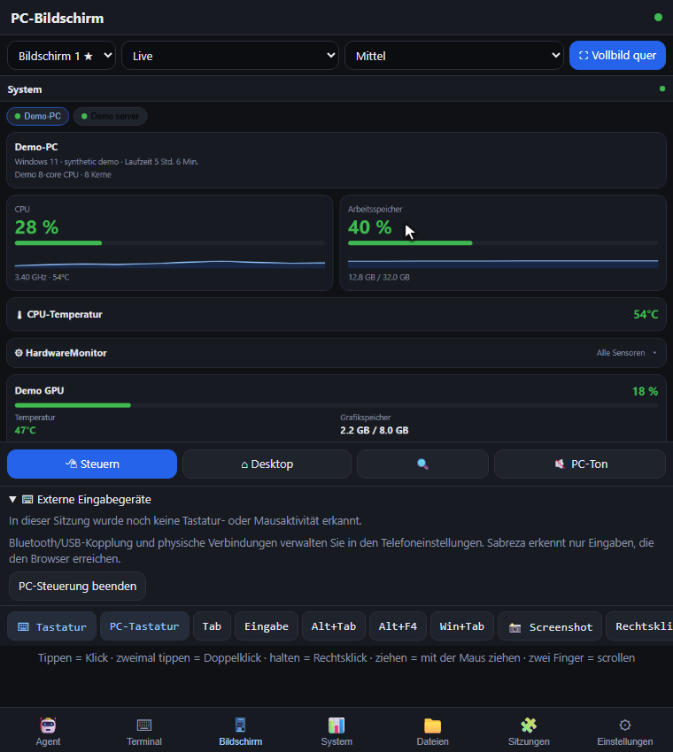
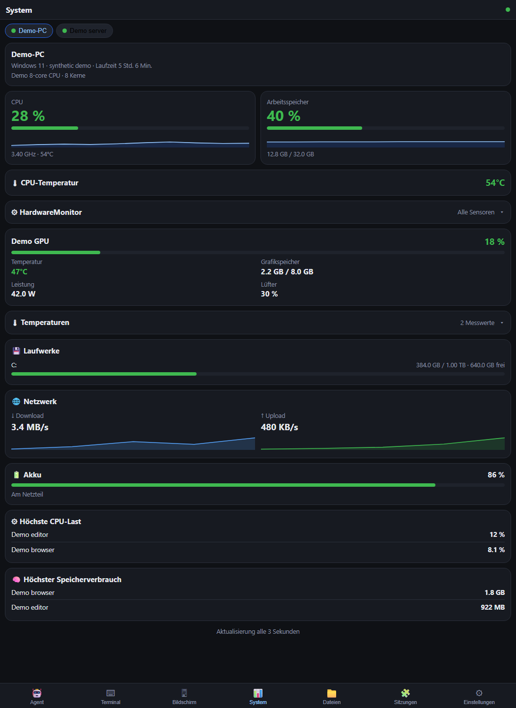
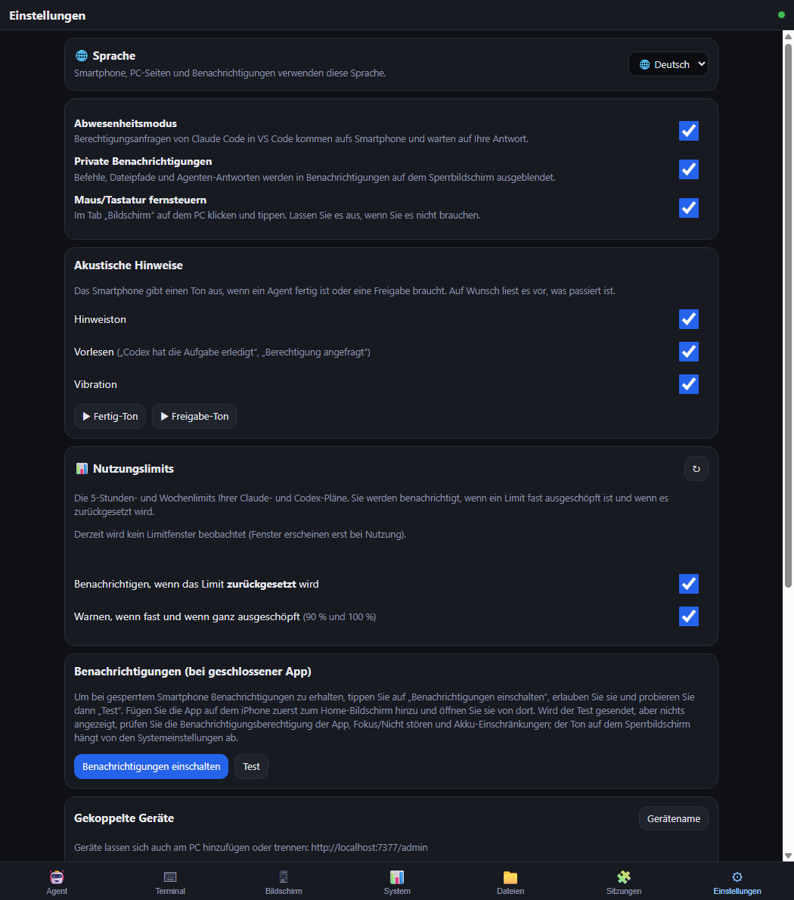
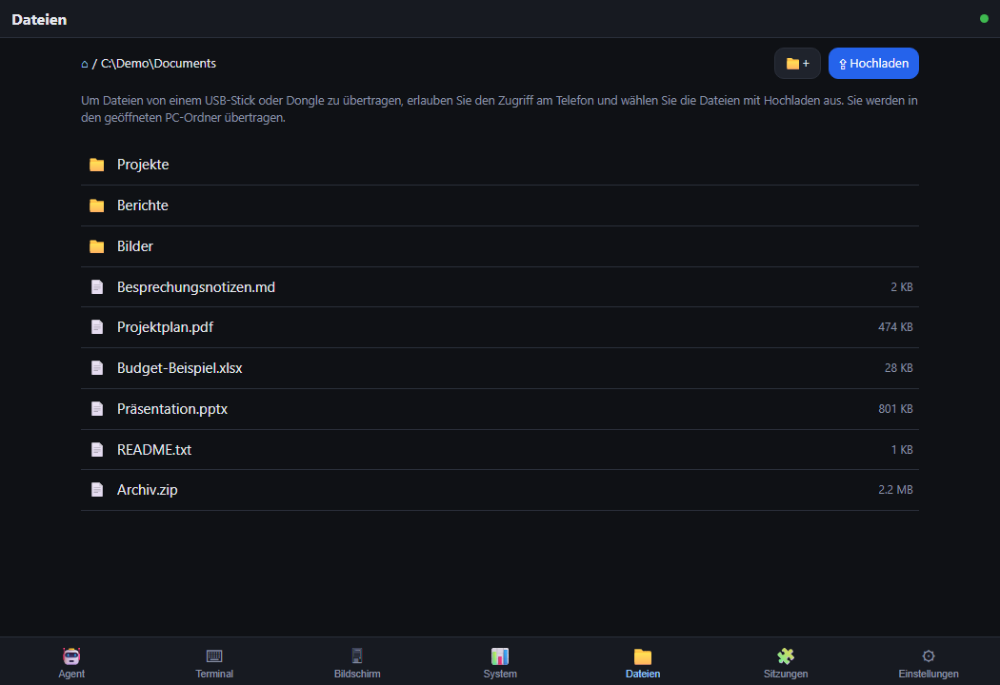

[English](README.md) · [Deutsch](README.de.md) · [Türkçe](README.tr.md)

## Ihr leistungsstarker Arbeitsplatz begleitet Sie

Lassen Sie Ihren PC, Ihre Projekte und Server zu Hause weiterarbeiten und bleiben Sie über Telefon oder Tablet verbunden. Prüfen Sie im Café den Systemzustand, lesen Sie am Meer das Ergebnis einer fertigen Aufgabe, holen Sie unterwegs eine Datei und arbeiten Sie dort weiter, wo Sie aufgehört haben. Ihre eingerichtete Entwicklungsumgebung bleibt erreichbar, ohne das Projekt auf ein anderes Gerät umzuziehen, die Umgebung neu einzurichten oder den gesamten Arbeitsplatz mitzunehmen.

**Sabreza View International** verbindet Bildschirmsteuerung, Terminals, Dateien, Systemmesswerte und Benachrichtigungen für autorisierten Fernzugriff. Mit externer Tastatur und Maus wird das Tablet zu einem bequemeren Arbeitsgerät. Der PC muss eingeschaltet, wach und erreichbar bleiben; beide Seiten benötigen eine geeignete Verbindung und die erforderlichen Berechtigungen.

**Betriebsart beachten:** Die aktuellen Desktop-Downloads dieses Repositories sind betreiberverwaltete Installationen. Eine gesonderte Zustimmung gewährt dem genannten Betreiber Zugriff. Das persönliche Arbeitsszenario unten beschreibt den separat eingerichteten persönlichen/manuellen Zugriff auf Ihre eigenen autorisierten Geräte. Lesen Sie vor dem Download [Installation und Zustimmung](#installation-und-zustimmung).

[Funktionsübersicht mit Screenshots](#funktionsuebersicht) · [Downloads](#download) · [Persönliche Einrichtung](MANUAL-MODE.de.md)

## Sabreza View in 35 Sekunden

**[Film ansehen / herunterladen · 1080p · 35 Sekunden](https://github.com/beyzakararti/sabreza-view-international/raw/refs/heads/main/docs/media/sabreza-view-promo-tr.mp4)**

Lass die letzten Aufgaben zu Hause laufen, prüfe unterwegs den Projektstand und verbinde dich bei Bedarf mit deinem autorisierten Arbeitsplatz. Der Film verbindet fiktive KI-generierte Alltagsszenen mit der echten Anwendungsoberfläche und Beispieldaten. Er zeigt persönliche Nutzung; die Zugriffs- und Zustimmungsbedingungen der Downloads stehen unten. Türkische Einblendungen; [Untertiteldateien und Website-Einbindung](docs/media/README.md) liegen bei.

## Im Dezember: v0.3.14

Die vollständige Version v0.3.14 (Windows, macOS, Linux und Android) ist für **Dezember 2026** geplant. Eine [Vorabversion nur für Windows](https://github.com/beyzakararti/sabreza-view-international/releases/tag/v0.3.14) ist bereits verfügbar; bis zur vollständigen Version bleibt v0.3.13 die aktuelle stabile Version.

- **Geräte finden:** Die lokale Seite `/admin` zeigt den zuletzt freigegebenen Standort eines gekoppelten Telefons oder Tablets mit Zeit und Genauigkeitsradius und kann das Gerät klingeln lassen. Auf Telefon oder Tablet schaltet Einstellungen → Geräte finden die Standortfreigabe ein und zeigt den zuletzt geteilten PC-Standort.
- **PC offline:** Das Telefon speichert eine lokale Kopie des letzten PC-Standorts und zeigt sie bei ausgeschaltetem PC mit Zeit, Genauigkeit und Kartenlink an. Keine Live-Ortung; beim Beenden der Freigabe wird der Servereintrag gelöscht. Eine Offline-Kopie auf dem Telefon wird bei erneuter Verbindung entfernt.

Der Standort erfordert Browser- und Systemberechtigung und wird nur aktualisiert, solange die Seite läuft.

## Neu in v0.3.13

- Schnelltasten für **Tab** und **Eingabe** in Bildschirm- und Flottensteuerung; im Querformat lässt sich die linke Tastengruppe über die rechte Werkzeugleiste zu einem schmalen Streifen einklappen.
- Virtuelle PC-Tastatur mit Türkisch Q, Englisch QWERTY und Deutsch QWERTZ, Funktionstasten und Navigation.
- Bereits am Telefon über Bluetooth oder USB gekoppelte Tastatur und Maus können den PC bedienen. Die Anzeige zeigt nur Eingaben, die der Browser empfängt, und kann die PC-Steuerung beenden. Kopplung und physische Trennung erfolgen in den Telefoneinstellungen; dies ist keine vollständige Geräteliste.
- Über **Dateien → Hochladen** lassen sich ausgewählte Dateien von einem USB-Stick in den geöffneten PC-Ordner übertragen, wenn der Stick in der Dateiauswahl des Telefons erscheint.

[Versionsdetails v0.3.13](docs/release-v0.3.13.md) · [Vereinbarung in v0.3.12](docs/release-v0.3.12.md). Ausdrückliche Zustimmung, Ablehnung und Trennung bleiben verfügbar.

## Vor dem Download lesen

**Die Desktop-Installer v0.3.13 verbinden sich erst nach Ihrer ausdrücklichen Zustimmung zum Fernzugriff mit dem Betreiber „beyzakararti — Kararti is Watching“.** Das unterscheidet sich von älteren Downloads für den persönlichen Gebrauch. Download, Installation oder frühere allgemeine Vertragsannahme sind keine Zustimmung zur Überwachung.

Wenn Sie die Erklärung in der App akzeptieren, kann der Betreiber im Rahmen der unterstützten Funktionen Ihren Bildschirm sehen und aufzeichnen, Maus und Tastatur steuern, auf Dateien zugreifen, Terminalbefehle ausführen und Systeminformationen einsehen. Während die Anwendung läuft, kann der Zugriff bis zum Trennen bestehen bleiben. Stimmen Sie nur zu, wenn Sie den Computer verwalten dürfen und diesen Zugriff wünschen.

**Bei Ablehnung erfolgt keine Registrierung beim Betreiber. Über „Verbindung trennen“ auf der Zustimmungsseite können Sie jederzeit widerrufen.** Der Hinweis am Infobereich-Symbol zeigt die Überwachung an. Beim Trennen wird der Zugriffsschlüssel lokal widerrufen, auch wenn die Zentrale nicht erreichbar ist.

## Download

| Platform | Download |
|---|---|
| Windows 10/11 (x64) | [Sabreza-View-Windows-x64-Setup.exe](https://github.com/beyzakararti/sabreza-view-international/releases/latest/download/Sabreza-View-Windows-x64-Setup.exe) |
| macOS Apple Silicon | [Sabreza-View-macOS-AppleSilicon.dmg](https://github.com/beyzakararti/sabreza-view-international/releases/latest/download/Sabreza-View-macOS-AppleSilicon.dmg) |
| macOS Intel | [Sabreza-View-macOS-Intel.dmg](https://github.com/beyzakararti/sabreza-view-international/releases/latest/download/Sabreza-View-macOS-Intel.dmg) |
| Linux Debian/Ubuntu | [Sabreza-View-Linux-amd64.deb](https://github.com/beyzakararti/sabreza-view-international/releases/latest/download/Sabreza-View-Linux-amd64.deb) |
| Linux RPM | [Sabreza-View-Linux-x86_64.rpm](https://github.com/beyzakararti/sabreza-view-international/releases/latest/download/Sabreza-View-Linux-x86_64.rpm) |
| Android (ARM64) | [Sabreza-View-Android.apk](https://github.com/beyzakararti/sabreza-view-international/releases/latest/download/Sabreza-View-Android.apk) |

**Android:** Der Smartphone-Client wurde als v0.3.13 mit dem International-Namen und einer eigenen App-Identität neu gebaut.

[Versionen](https://github.com/beyzakararti/sabreza-view-international/releases) · [SHA256-Prüfsummen](https://github.com/beyzakararti/sabreza-view-international/releases/latest/download/SHA256SUMS.txt)

**Sabreza View International** ist die Version für Endnutzer. Sie übernimmt weder Zustimmung noch Kopplung aus der persönlichen Installation. Windows ist das primäre Desktop-Ziel. macOS ist experimentell und benötigt zusätzliche macOS-Freigaben für Bildschirmaufnahme / Bedienungshilfen. **Linux unterstützt keine Bildschirmfreigabe. Android ist ein Smartphone-Client, kein Installer zur Überwachung des Telefons.**

## Installation und Zustimmung

1. Laden Sie das passende Paket herunter und vergleichen Sie SHA-256 mit [SHA256SUMS.txt](https://github.com/beyzakararti/sabreza-view-international/releases/latest/download/SHA256SUMS.txt).
2. Installieren und öffnen Sie die App. Lesen Sie Betreibername, Zugriffsrechte und die Anleitung zum Trennen.
3. Wählen Sie bewusst **Akzeptieren** oder **Ablehnen**. Für diese Registrierung benötigen Sie keinen Beitrittsschlüssel, keine Kopplungs-PIN und kein Tailscale- oder Cloudflare-Konto.
4. Nach Zustimmung und erfolgreicher Verbindung erscheint der Computer in der Zentrale. Beide Computer benötigen Internet; die Zentrale muss laufen. Bei einem Fehler versuchen Sie es erneut, sobald die Verbindung wieder funktioniert.
5. Öffnen Sie zum Beenden die Zustimmungsseite auf dem installierten Computer (`http://127.0.0.1:7377/consent`) und wählen Sie **Verbindung trennen**. Nur das Fenster zu schließen widerruft die Zustimmung nicht.

## Aktualisierte Installationsbedingungen — noch nicht veröffentlicht

Der nächste Windows-Installer ist dafür konfiguriert, allgemeine Nutzungsbedingungen im nativen Installationsassistenten als kompakten, lesbaren und scrollbar dargestellten Text anzuzeigen. Der Text beginnt mit Softwarenutzung, Nutzerpflichten und Leistungsgrenzen. Ein späterer Abschnitt erläutert den verwalteten Zugriff über Kararti is Watching, dessen Umfang und den Widerruf der Zustimmung.

Die Annahme der Installationsbedingungen registriert den Computer nicht und erlaubt keinen Fernzugriff. Bei verwalteten Installationen bleibt eine gesonderte ausdrückliche Entscheidung beim ersten Start erforderlich, einschließlich **Ablehnen** und **Verbindung trennen**. Das Kontrollkästchen ist zunächst nicht aktiviert. Die persönliche Edition bleibt getrennt.

Dies ist eine Quellcodeänderung; dafür wurde noch kein neuer Installer gebaut oder veröffentlicht. Die Downloads oben behalten das Verhalten ihrer bestehenden Versionen. Vor Veröffentlichung müssen der echte Windows-Installationsablauf und die Zustimmung beim ersten Start geprüft werden. Die früheren Zustimmungsbilder aus v0.3.12 wurden aus dieser aktuellen Anleitung entfernt, da sie den kommenden Assistenten nicht zeigen. Siehe [Übergabe zur Veröffentlichung](docs/release-handoff.md).

## Verbindung und Datenschutz

Das Verbindungsprogramm ist enthalten und wird beim Build anhand einer Prüfsumme kontrolliert. Desktop-Verkehr läuft über einen ausgehenden Cloudflare Tunnel; die Registrierung erreicht das Tailscale-Funnel-Gateway des Betreibers. Diese Dienste transportieren den Verbindungsverkehr. Die Verwaltungsoberfläche der Zentrale wird nicht über das Registrierungsgateway veröffentlicht.

Kein gemeinsamer geheimer Beitrittsschlüssel der Zentrale wird im Installer verteilt. Jedes Gerät erzeugt eigene Zugangsdaten automatisch. Technische Schlüssel ersetzen keine ausdrückliche Zustimmung. Geben Sie keine Geräteschlüssel, Kontopasswörter oder persönlichen Konfigurationsdateien weiter.

Ältere Installationen werden nicht heimlich registriert oder migriert. Eine neue Zentrale oder Adresse kann aktualisierte Client-Einstellungen erfordern. Die Zustimmung in der App ersetzt keine Betriebssystemberechtigungen.

## So funktioniert die Verbindung

Keine Betreiber-Registrierung ohne Zustimmung. Trennen ist jederzeit möglich.

## Verwendete Technologien

| Ebene | Technologie |
|---|---|
| Server / Weboberfläche | JavaScript · Node.js · HTML · CSS |
| Desktop | Rust · Tauri |
| Android (ARM64) | Kotlin |
| Windows-Integration | PowerShell |
| Verbindung | Cloudflare Tunnel · Tailscale Funnel · HTTPS |

## Andere Betriebsarten

Die bisherige Anleitung für persönliche Nutzung bleibt unter [MANUAL-MODE.de.md](MANUAL-MODE.de.md) erhalten. Ihre Angaben zu privatem Tailscale-Netz, manueller Kopplung und PIN beschreiben diesen separaten Modus und gelten nicht als Zusicherung für die oben angebotenen betreiberverwalteten Downloads.

## Ihr Arbeitsplatz im Screenshot-Rundgang

Diese Übersicht beschreibt einen persönlich/manuell eingerichteten Arbeitsplatz, auf den Sie berechtigt zugreifen. Die Einrichtung unterscheidet sich von den aktuellen betreiberverwalteten Downloads. Die Bilder zeigen die **echte HTML/CSS/JavaScript-Oberfläche** des aktuellen Quellstands in einem isolierten Browser. Messwerte, Dateien und Geräte sind Beispiele; auch der Bildschirmbereich verwendet ein Beispielbild der Anwendung statt einer Live-Übertragung. Telefon- und Tabletgrößen werden im Browser simuliert. [Herkunft und Umfang der Screenshots](docs/screenshots/README.md).

### PC-Steuerung: dort weiterarbeiten, wo Sie aufgehört haben

Ändern Sie eine Einstellung, bedienen Sie ein geöffnetes Programm oder prüfen Sie ein Ergebnis, ohne vor dem PC zu sitzen. Auf unterstützten Systemen zeigt der Bildschirm-Reiter den Desktop. Bei aktivierter Fernsteuerung werden Berührungen sowie Maus- und Tastatureingaben weitergeleitet. Querformat, Vollbild, Zoom und Schnelltasten erleichtern die Arbeit auf kleineren Displays. Tab, Eingabe, Ctrl-Kombinationen und die virtuelle PC-Tastatur helfen bei Formularen und Desktop-Anwendungen.

Terminals und Projektsitzungen bleiben auf demselben Computer. Starten Sie Befehle in Ihrer vorbereiteten Umgebung, lesen Sie Ausgaben und verfolgen Sie längere Aufgaben. So können Sie im Café Testergebnisse prüfen und an einer Korrektur weiterarbeiten, während der PC zu Hause die Rechenleistung bereitstellt. Schalten Sie die Maus-/Tastatursteuerung aus, wenn Sie sie nicht benötigen.

*Die Bedienelemente stammen aus der Anwendung; der Bildschirminhalt ist sicheres Demomaterial. Windows ist die Hauptplattform. macOS ist experimentell und benötigt Bildschirmaufnahme- und Bedienungshilfen-Berechtigungen. Linux-Bildschirmfreigabe wird nicht unterstützt.*

### Bequemer arbeiten mit Tablet, Tastatur und Maus

Verbinden Sie Bluetooth-Tastatur und -Maus mit dem Tablet oder verwenden Sie einen kompatiblen USB-C-Hub/Dongle. Aktivieren Sie anschließend die Fernsteuerung. Unterstützte Tasten, Klicks und Scrollbewegungen, die der Browser empfängt, können an den PC weitergegeben werden. Das erleichtert längere Texte, Terminalarbeit und die Bedienung des Desktops. Ein leichtes Tablet mit wenigen Zubehörteilen erschließt so Ihre bereits eingerichtete Arbeitsumgebung.

Physische Geräte koppeln Sie in den Systemeinstellungen des Telefons oder Tablets. Das Eingabepanel zeigt die vom Browser erfasste Tastatur-/Mausaktivität und kann die PC-Steuerung beenden. Es ist kein Geräteverzeichnis aller Bluetooth- oder USB-Geräte. Bestimmte Tastenkombinationen können vom Betriebssystem oder Browser reserviert sein.

### PC- und Serverzustand an einem Ort prüfen

Warum wird ein Build langsamer? Wird der Arbeitsspeicher knapp? Ist noch Platz auf dem Datenträger? Der System-Reiter zeigt unter anderem CPU-Auslastung, belegten/gesamten RAM, Datenträger, Netzwerkverkehr, Laufzeit und ressourcenintensive Prozesse. Diagramme machen Veränderungen sichtbar. Unterstützte Hardware kann zusätzlich GPU-Daten und Temperaturen liefern. So lässt sich auch unterwegs einschätzen, wie eine anspruchsvolle Aufgabe den PC belastet.

Eingerichtete Server lassen sich im selben Bereich gesondert auswählen. Dafür sind der Überwachungsagent auf dem Server, eine erreichbare Adresse und die Zugriffskonfiguration erforderlich. **Der Gesundheitsagent liefert nur Messwerte:** Er gewährt allein keinen Zugriff auf Serverdesktop, Terminal oder Dateien. Diese Funktionen benötigen einen separat eingerichteten und autorisierten Fernzugriffsdienst.

*Die Werte dienen der Darstellung und sind kein Leistungstest. Temperatur-, GPU-, Lüfter- und weitere Sensorwerte hängen von Hardware und Betriebssystem ab. Unter Windows benötigt die CPU-Temperatur einen eingerichteten lokalen Webserver von LibreHardwareMonitor/OpenHardwareMonitor; separate NVIDIA-GPU-Messwerte verwenden `nvidia-smi`. Linux-Server verwenden vorhandene Systemsensoren. Der macOS-Sampler dieser Anwendung liefert keine Temperaturwerte. Fehlende Sensoren werden nicht durch erfundene Messungen ersetzt.*

### Akustische Benachrichtigungen statt ständigem Nachsehen

Verfolgen Sie längere Aufgaben, ohne ununterbrochen auf den Bildschirm zu schauen. Erhalten Sie Hinweise, wenn eine Aufgabe endet oder eine unterstützte Aktion eine Erlaubnis benötigt. Lesen Sie das Ergebnis und antworten Sie bei Bedarf vom Telefon aus. In den Einstellungen steuern Sie **Benachrichtigungston, Sprachausgabe und Vibration getrennt** und testen Abschluss- und Erlaubnistöne. Im ruhigen Café lassen Sie den Ton innerhalb der Anwendung aus; in passender Umgebung können Sie Ansagen aktivieren. Dieser Schalter schaltet Hintergrund-Push-Töne nicht stumm; diese verwalten Sie in den Systembenachrichtigungen des Telefons. Abschluss- und Erlaubnismeldungen externer Entwicklungssitzungen benötigen die entsprechenden Integrationen; beliebige Programmaufgaben werden nicht automatisch überwacht.

Private Benachrichtigungen helfen, Befehle, Dateipfade und Antwortdetails vom Sperrbildschirm fernzuhalten. Für Hinweise bei geschlossener Anwendung aktivieren und testen Sie Push gesondert. Zustellung und Sperrbildschirmton hängen von Berechtigungen, Stumm-/Fokusmodus, Energiesparregeln und Verbindung ab. Auf dem iPhone muss die Web-App zuerst zum Home-Bildschirm hinzugefügt und von dort gestartet werden. Sprachausgabe in der geöffneten Anwendung bedeutet nicht, dass jede Hintergrundmeldung vorgelesen wird.

### Dateien in beide Richtungen übertragen

Laden Sie ein Dokument vom heimischen PC auf das Telefon herunter oder übertragen Sie eine auf dem Tablet erstellte Datei in den geöffneten PC-Ordner. Im Dateien-Reiter können Sie erlaubte Verzeichnisse durchsuchen, Dateien ansehen und verfügbare Dateiaktionen nutzen. So holen Sie ein Projektergebnis oder ergänzen Ihre Arbeitsumgebung, ohne zum Rechner zurückzukehren.

**Beispiel mit USB-Speicher/Dongle:** Schließen Sie den Speicher über einen geeigneten OTG-Adapter oder Hub an Telefon oder Tablet an. Wenn die Dateiauswahl des Betriebssystems das Laufwerk anbietet, wählen Sie über **Dateien → Hochladen** eine Datei und übertragen sie in den geöffneten, erlaubten PC-Ordner. Für die Gegenrichtung laden Sie die PC-Datei herunter und speichern oder verschieben sie auf den USB-Speicher, soweit die Datei-App dies unterstützt. Auch ein am PC angeschlossenes Laufwerk muss über einen erlaubten, erreichbaren Pfad verfügbar sein.

*USB-Speicherunterstützung hängt von Gerät, Adapter, Dateisystem und Betriebssystem ab. Dies ist Dateiübertragung innerhalb erlaubter Pfade, keine rohe USB-Weiterleitung und kein Fernzugriff auf jedes USB-Gerät.*

### Geräte finden: Standort mit Zeit und Genauigkeit

**Geräte finden** in der Windows-Vorabversion v0.3.14 kann nach gesonderter Freigabe den zuletzt geteilten Standort eines gekoppelten Telefons/Tablets am PC und den letzten PC-Standort am Telefon anzeigen. Messzeit und Genauigkeitsradius gehören dazu. Ist der PC offline, bleibt auf dem Telefon eine frühere Messung erhalten; das ist keine Live-Ortung. Aktualisierungen erfolgen nur bei aktivierter Freigabe und laufender zugehöriger Seite.

Der Standort ist nicht immer präzise, insbesondere bei Desktop-PCs. Der Server-Gesundheitsagent meldet keinen geografischen Standort. Die Funktion richtet sich an gekoppelte Geräte des Eigentümers; betreiberverwaltete Sitzungen erhalten damit keine Standortüberwachung sämtlicher registrierter Geräte. Gesundheitsmesswerte und optionale Standortfreigabe erfüllen unterschiedliche Aufgaben.

### Schutz mit Unterstützung durch Bedrohungsinformationen

Leistungsfähiger Zugriff braucht Kontrolle darüber, wer ihn nutzt. Je nach Verbindungsart kombiniert Sabreza View Identitäts- und Geräteprüfungen, Sitzungs-/PIN-Schutz, Anfragelimits, Origin-Prüfungen, erlaubte Dateipfade und Sicherheitsprotokolle. In der lokalen Verwaltung prüfen Sie Zugriffe, entfernen Geräte und nutzen bei Bedarf den Notstopp. Das persönliche Tailscale-Netz und die betreiberverwaltete Cloudflare-Distribution verwenden unterschiedliche Verbindungsmodelle.

Bei aktivierter Bedrohungsanalyse ergänzen bekannte schädliche Adressen von **USOM, Spamhaus DROP und abuse.ch Feodo Tracker** diese Kontrollen. Listen werden regelmäßig aktualisiert; eingehende Anwendungsanfragen werden geprüft und passende schädliche Adressen entsprechend den Regeln gesperrt. Auf unterstützten Systemen können offene TCP-Verbindungen sowie unter Windows zusätzlich der DNS-Cache mit den Listen verglichen werden, um Warnungen auszulösen. Das hilft, Auffälligkeiten auch unterwegs früher zu bemerken.

Diese Ebenen verringern das Risiko unberechtigter Zugriffe, garantieren aber nicht den Ausschluss jeder schädlichen Verbindung. Die Prüfung ausgehender Verbindungen erkennt und meldet; sie beendet keine Prozesse automatisch und ersetzt keinen Virenschutz oder Filter für den gesamten PC-Verkehr. Updates, sichere Konten, passende Berechtigungen und Sicherungen bleiben erforderlich.

### So passt es in Ihren Alltag

| Ihr Aufenthaltsort | Möglichkeiten mit Telefon oder Tablet |
|---|---|
| Kurze Pause im Café | Aufgabenergebnis lesen, eine Erlaubnisanfrage prüfen und PC-Auslastung ansehen. |
| Mit leichtem Gepäck unterwegs | Mit Tablet, Tastatur und Maus in der vorbereiteten Terminal- oder Desktop-Umgebung weiterarbeiten. |
| Erholung am Meer | Bei geeigneter Verbindung und Benachrichtigungsfreigabe das Arbeitsende erfahren und bei Bedarf eine Datei holen. |
| Fern vom Heimlabor | RAM, Datenträger, Netzwerk und unterstützte Temperaturen eingerichteter Server prüfen. |

Beginnen Sie mit der [persönlichen/manuellen Anleitung](MANUAL-MODE.de.md). Testen Sie Verbindung, Steuerung, Dateiübertragung und Benachrichtigungen zunächst im eigenen Netz, bevor Sie sich unterwegs darauf verlassen. Das Telefon wird zur mobilen Bedienoberfläche, während der Rechner zu Hause Ihre Arbeitsumgebung bleibt.

## Zugang zum Quellcode

Wenn Sie Zugang zum Quellcode dieser Anwendung wünschen, kontaktieren Sie mich bitte über die folgenden Kontaktdaten.

- Telefon: [+49 15253371943](tel:+4915253371943)
- E-Mail: [beyza.kararti@outlook.com](mailto:beyza.kararti@outlook.com)

This project is licensed under CC BY-NC-ND 4.0. See [LICENSE](LICENSE).
