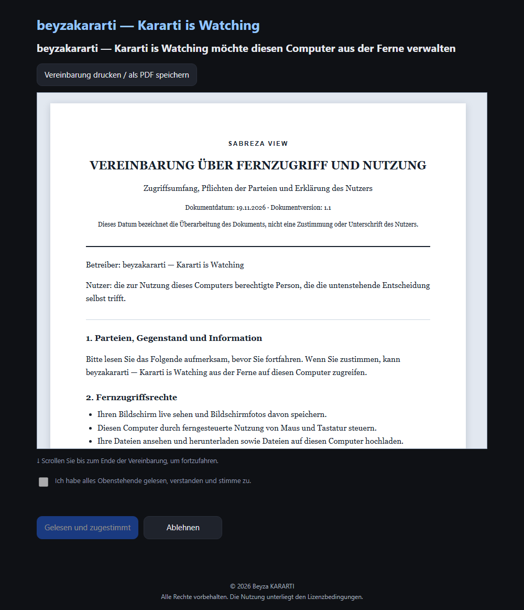
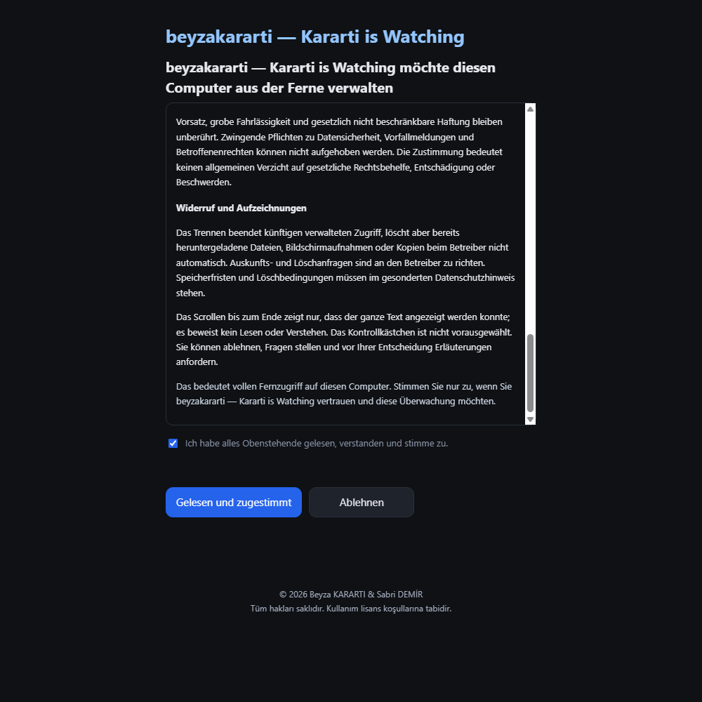
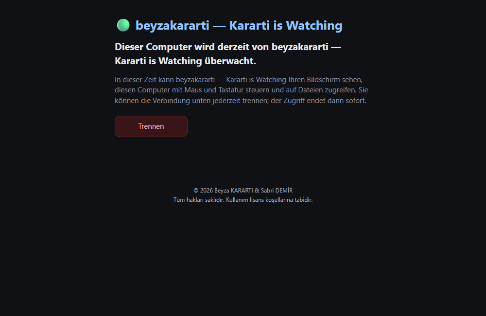
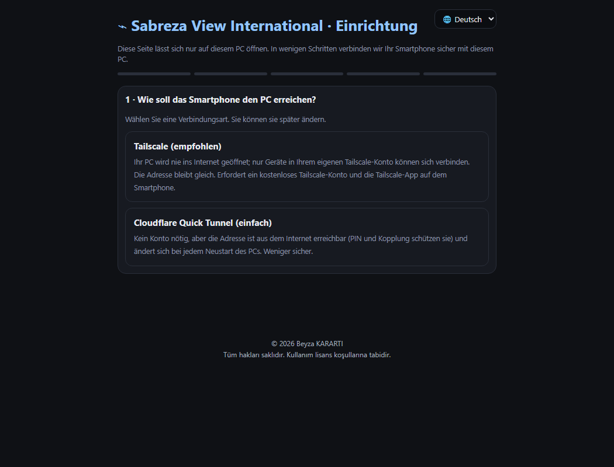
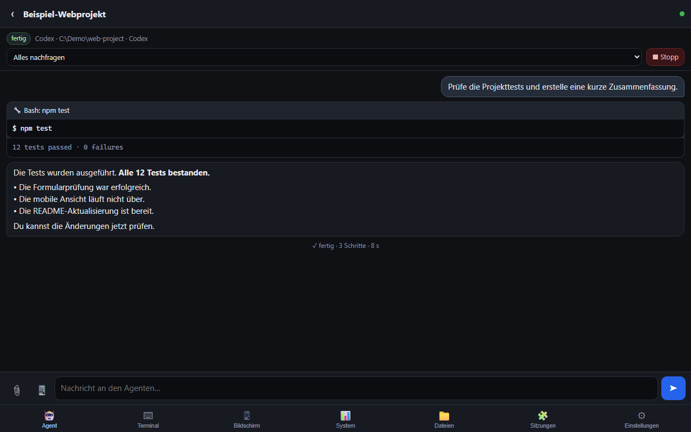
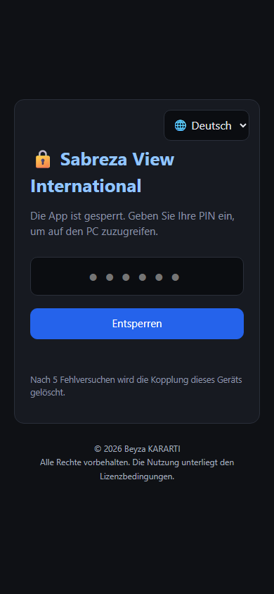
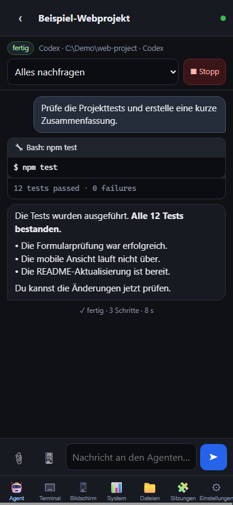

[English](README.md) · [Deutsch](README.de.md) · [Türkçe](README.tr.md)

## Neu in v0.3.11

Sabreza View International besitzt jetzt einen eigenen Installer-Namen und eine eigene App-Identität. Smartphone- und PC-Startseiten zeigen einen mehrsprachigen Urheberrechtshinweis. Diese Version wird getrennt von früheren Versionen installiert; Einrichtung und Zustimmung erneut abschließen. [Versionsdetails](docs/release-v0.3.11.md).

## Vor dem Download lesen

**Die Desktop-Installer v0.3.11 verbinden sich erst nach Ihrer ausdrücklichen Zustimmung zum Fernzugriff mit dem Betreiber „beyzakararti — Kararti is Watching“.** Das unterscheidet sich von älteren Downloads für den persönlichen Gebrauch. Download, Installation oder frühere allgemeine Vertragsannahme sind keine Zustimmung zur Überwachung.

Wenn Sie die Erklärung in der App akzeptieren, kann der Betreiber im Rahmen der unterstützten Funktionen Ihren Bildschirm sehen und aufzeichnen, Maus und Tastatur steuern, auf Dateien zugreifen, Terminalbefehle ausführen und Systeminformationen einsehen. Während die Anwendung läuft, kann der Zugriff bis zum Trennen bestehen bleiben. Stimmen Sie nur zu, wenn Sie den Computer verwalten dürfen und diesen Zugriff wünschen.

**Bei Ablehnung erfolgt keine Registrierung beim Betreiber. Über „Verbindung trennen“ auf der Zustimmungsseite können Sie jederzeit widerrufen.** Der Hinweis am Infobereich-Symbol zeigt die Überwachung an. Beim Trennen wird der Zugriffsschlüssel lokal widerrufen, auch wenn die Zentrale nicht erreichbar ist.

## Download

| Platform | Download |
|---|---|
| Windows 10/11 (x64) | [Sabreza-View-Windows-x64-Setup.exe](https://github.com/beyzakararti/sabreza-view-international/releases/latest/download/Sabreza-View-Windows-x64-Setup.exe) |
| macOS Apple Silicon | [Sabreza-View-macOS-AppleSilicon.dmg](https://github.com/beyzakararti/sabreza-view-international/releases/latest/download/Sabreza-View-macOS-AppleSilicon.dmg) |
| macOS Intel | [Sabreza-View-macOS-Intel.dmg](https://github.com/beyzakararti/sabreza-view-international/releases/latest/download/Sabreza-View-macOS-Intel.dmg) |
| Linux Debian/Ubuntu | [Sabreza-View-Linux-amd64.deb](https://github.com/beyzakararti/sabreza-view-international/releases/latest/download/Sabreza-View-Linux-amd64.deb) |
| Linux RPM | [Sabreza-View-Linux-x86_64.rpm](https://github.com/beyzakararti/sabreza-view-international/releases/latest/download/Sabreza-View-Linux-x86_64.rpm) |
| Android (ARM64) | [Sabreza-View-Android.apk](https://github.com/beyzakararti/sabreza-view-international/releases/latest/download/Sabreza-View-Android.apk) |

**Android:** Der Smartphone-Client wurde als v0.3.11 mit dem International-Namen und einer eigenen App-Identität neu gebaut.

[Versionen](https://github.com/beyzakararti/sabreza-view-international/releases) · [SHA256-Prüfsummen](https://github.com/beyzakararti/sabreza-view-international/releases/latest/download/SHA256SUMS.txt)

**Sabreza View International** ist die Version für Endnutzer. Sie übernimmt weder Zustimmung noch Kopplung aus der persönlichen Installation. Windows ist das primäre Desktop-Ziel. macOS ist experimentell und benötigt zusätzliche macOS-Freigaben für Bildschirmaufnahme / Bedienungshilfen. **Linux unterstützt keine Bildschirmfreigabe. Android ist ein Smartphone-Client, kein Installer zur Überwachung des Telefons.**

## Installation und Zustimmung

1. Laden Sie das passende Paket herunter und vergleichen Sie SHA-256 mit [SHA256SUMS.txt](https://github.com/beyzakararti/sabreza-view-international/releases/latest/download/SHA256SUMS.txt).
2. Installieren und öffnen Sie die App. Lesen Sie Betreibername, Zugriffsrechte und die Anleitung zum Trennen.
3. Wählen Sie bewusst **Akzeptieren** oder **Ablehnen**. Für diese Registrierung benötigen Sie keinen Beitrittsschlüssel, keine Kopplungs-PIN und kein Tailscale- oder Cloudflare-Konto.
4. Nach Zustimmung und erfolgreicher Verbindung erscheint der Computer in der Zentrale. Beide Computer benötigen Internet; die Zentrale muss laufen. Bei einem Fehler versuchen Sie es erneut, sobald die Verbindung wieder funktioniert.
5. Öffnen Sie zum Beenden die Zustimmungsseite auf dem installierten Computer (`http://127.0.0.1:7377/consent`) und wählen Sie **Verbindung trennen**. Nur das Fenster zu schließen widerruft die Zustimmung nicht.

## Einrichtung in Bildern

Die Bilder zeigen die tatsächliche Oberfläche von v0.3.11 mit Beispieldaten. Abgebildet sind die Bildschirme nach dem Öffnen der Anwendung, nicht die Installationsfenster des Betriebssystems.

### 1. Den Zugriffsumfang lesen

Prüfen Sie beim Öffnen die Betreiberangaben, den Zugriffsumfang und den Zustimmungstext. Das Kontrollkästchen ist anfangs nicht aktiviert.

### 2. Ihre Entscheidung treffen

Aktivieren Sie nach dem Lesen bis zum Textende das Kästchen und stimmen Sie nur zu, wenn Sie den beschriebenen Zugriff wünschen. Sie können auch ablehnen. Das markierte Kästchen im Bild zeigt eine beispielhafte Benutzerentscheidung.

### 3. Verbindung prüfen und bei Bedarf trennen

Nach erfolgreicher Verbindung erscheint die Statusanzeige. Über die Schaltfläche zum Trennen können Sie den Zugriff beenden.

## Verbindung und Datenschutz

Das Verbindungsprogramm ist enthalten und wird beim Build anhand einer Prüfsumme kontrolliert. Desktop-Verkehr läuft über einen ausgehenden Cloudflare Tunnel; die Registrierung erreicht das Tailscale-Funnel-Gateway des Betreibers. Diese Dienste transportieren den Verbindungsverkehr. Die Verwaltungsoberfläche der Zentrale wird nicht über das Registrierungsgateway veröffentlicht.

Kein gemeinsamer geheimer Beitrittsschlüssel der Zentrale wird im Installer verteilt. Jedes Gerät erzeugt eigene Zugangsdaten automatisch. Technische Schlüssel ersetzen keine ausdrückliche Zustimmung. Geben Sie keine Geräteschlüssel, Kontopasswörter oder persönlichen Konfigurationsdateien weiter.

Ältere Installationen werden nicht heimlich registriert oder migriert. Eine neue Zentrale oder Adresse kann aktualisierte Client-Einstellungen erfordern. Die Zustimmung in der App ersetzt keine Betriebssystemberechtigungen.

## So funktioniert die Verbindung

Keine Betreiber-Registrierung ohne Zustimmung. Trennen ist jederzeit möglich.

## Verwendete Technologien

| Ebene | Technologie |
|---|---|
| Server / Weboberfläche | JavaScript · Node.js · HTML · CSS |
| Desktop | Rust · Tauri |
| Android (ARM64) | Kotlin |
| Windows-Integration | PowerShell |
| Verbindung | Cloudflare Tunnel · Tailscale Funnel · HTTPS |

## Andere Betriebsarten

Die bisherige Anleitung für persönliche Nutzung bleibt unter [MANUAL-MODE.de.md](MANUAL-MODE.de.md) erhalten. Ihre Angaben zu privatem Tailscale-Netz, manueller Kopplung und PIN beschreiben diesen separaten Modus und gelten nicht als Zusicherung für die oben angebotenen betreiberverwalteten Downloads.

## PC- und Telefonansicht — persönlicher/manueller Modus

Der folgende Assistent sowie die PIN- und Steuerungsansichten gehören zum separat eingerichteten persönlichen/manuellen Modus. Sie sind keine zusätzlichen Schritte der oben beschriebenen betreiberverwalteten International-Installation. Siehe [Anleitung zum persönlichen/manuellen Modus](MANUAL-MODE.de.md).

Die Telefonbilder verwenden eine mobile Browseransicht mit 390 × 844 Pixeln; sie wurden nicht auf einem physischen iPhone oder Android-Gerät aufgenommen. Gespräche, Dateipfade und Testergebnisse sind Beispiele und enthalten keine persönlichen Daten.

### Einrichtungsassistent: Verbindungsmethode auswählen

### PC: eine Beispielsitzung

| Telefon: PIN-Eingabe | Telefon: eine Beispielsitzung |
|---|---|
|  |  |

## Zugang zum Quellcode

Wenn Sie Zugang zum Quellcode dieser Anwendung wünschen, kontaktieren Sie mich bitte über die folgenden Kontaktdaten.

- Telefon: [+49 15253371943](tel:+4915253371943)
- E-Mail: [beyza.kararti@outlook.com](mailto:beyza.kararti@outlook.com)

This project is licensed under CC BY-NC-ND 4.0. See [LICENSE](LICENSE).
