<p align="center"></p>

<p align="center">
  <b>🇬🇧 English</b> · <a href="README.de.md">🇩🇪 Deutsch</a> · <a href="README.tr.md">🇹🇷 Türkçe</a>
</p>

---

Control the PC you left running at home from your phone or tablet, even when you are on a different network. You pair your phone **once**; after that it connects without a password, and you can cut the connection from the PC at any moment.

The app is available in **English, German and Turkish**. You can switch at any time (see [Language](#language)).

🔒 **Security comes first.** Your PC is never exposed to the internet (with Tailscale only your own devices can reach it). Every device is paired from the PC, a PIN lock and an attack blocker are always on, and every action is logged. Details below in [Security layers](#security).

## Contents

- [Download](#download)
- [What it does](#what-it-does)
- [How it works](#how-it-works)
- [Where it helps](#where-it-helps)
- [Installation](#installation)
- [Pairing your phone](#pairing)
- [Language](#language)
- [Security layers](#security)
- [What it protects and what it doesn't](#limits)
- [macOS and Linux](#macos-linux)
- [Lock screen and server monitoring](#lockscreen)
- [Good to know](#good-to-know)

<a id="download"></a>

## ⬇️ Download

| Device | File | Note |
|---|---|---|
| 🪟 **Windows 10/11** (PC) | [**Sabreza-View-Windows-x64-Setup.exe**](https://github.com/beyzakararti/sabreza-view-international/releases/latest/download/Sabreza-View-Windows-x64-Setup.exe) | Recommended, in daily use |
| 🤖 **Android** (phone) | [**Sabreza-View-Android.apk**](https://github.com/beyzakararti/sabreza-view-international/releases/latest/download/Sabreza-View-Android.apk) | In daily use |
| 🍏 **iPhone / iPad** | *No file needed* | The web app is added to the Home Screen from Safari ([how](#iphone)) |
| 🍎 **macOS** Apple Silicon (PC) | [Sabreza-View-macOS-AppleSilicon.dmg](https://github.com/beyzakararti/sabreza-view-international/releases/latest/download/Sabreza-View-macOS-AppleSilicon.dmg) | Experimental ([details](#macos-linux)) |
| 🍎 **macOS** Intel (PC) | [Sabreza-View-macOS-Intel.dmg](https://github.com/beyzakararti/sabreza-view-international/releases/latest/download/Sabreza-View-macOS-Intel.dmg) | Experimental |
| 🐧 **Linux** (PC) | [AppImage](https://github.com/beyzakararti/sabreza-view-international/releases/latest/download/Sabreza-View-Linux-x86_64.AppImage) · [.deb](https://github.com/beyzakararti/sabreza-view-international/releases/latest/download/Sabreza-View-Linux-amd64.deb) · [.rpm](https://github.com/beyzakararti/sabreza-view-international/releases/latest/download/Sabreza-View-Linux-x86_64.rpm) | Terminal and agents only, no screen sharing |

All versions, release notes and checksums: **[Releases](https://github.com/beyzakararti/sabreza-view-international/releases)**. You can [verify the files](#verify) before installing.

<a id="what-it-does"></a>

## What it does

| Tab | What you get |
|---|---|
| 🤖 **Agent** | Starts or continues a **Claude Code** or **Codex** agent on the PC. Your own settings, MCP servers and CLAUDE.md / AGENTS.md files are loaded. You can upload **images, PDFs and documents** from the phone or attach **files from the PC**. |
| 🔐 **Permissions** | When an agent wants to run a command, change a file or ask you something, a card lands on your phone: *Allow / Always allow / Deny (+ note)*. The phone **alerts you with sound** (an insistent beep for permissions, a ~3-second melody when a task is done, optional read-aloud and vibration). Push notifications arrive even while the app is closed. |
| ⌨ **Terminal** | Real terminals on the PC. The **AI ▾** menu starts any installed terminal AI (Claude Code, Codex, Gemini CLI, Copilot, Aider, …) in the folder you pick. |
| 🖥 **Screen** | A live view of the PC screen. With **🖱 Control** on, a tap is a mouse click: tap = click, double-tap = double-click, hold = right-click, drag = mouse drag, two fingers = scroll wheel, **pinch = zoom** (up to 6×). **⌨ Keyboard** opens the phone keyboard and every letter goes straight to the PC (including special characters). Ctrl/Alt/Shift combinations and shortcut keys are ready to use. **Landscape full screen** turns the phone sideways, hides the browser bars and fills the whole display with the PC screen; the screen stays awake. **External keyboards and mice** (Bluetooth or USB) work directly. **🔇 PC sound** plays the PC's audio on your phone (Windows). |
| 📊 **System** | A **live health view** of the PC: CPU and memory with a short history graph, graphics card (load, temperature, video memory, power), temperatures, disks, network speed, battery and the programs using the most CPU and memory. Servers you add on the PC appear as tabs. |
| 📁 **Files** | Browse, preview and download files on the PC, upload from the phone to the PC, attach a file to an agent. |
| 🧩 **Sessions** | Live status of the Claude Code sessions in VS Code and the **full Claude Code + Codex history** on the PC (desktop app, VS Code, CLI). Continue any session from the phone – or open it on the PC. |
| ⚙ **Settings** | Language, away mode, remote control, sound alerts, **usage limits** (Claude and Codex 5-hour and weekly limits with percentage and reset time), push notifications, paired devices, security log, emergency stop. |

**Every AI can use your phone (MCP).** The app can add a small MCP server to the AI tools on your PC (Claude Code, Codex, Gemini CLI, Qwen, Cursor, Windsurf). Any agent can then `phone_notify` you ("task done"), `phone_ask` you a question and wait for the answer, or `phone_approve` – ask for your approval before a risky step. See [step 5 of the installation](#ai-hooks).

<a id="how-it-works"></a>

## How it works

This short simulation (30-second loop) shows the system and its security layers: the request from the phone passes four gates, attackers can't see the PC, foreign accounts and scanners are turned away, a stolen phone is removed when it tries to get in without the PIN, the phone beeps when an agent asks for permission and plays a melody when the job is done.



<a id="where-it-helps"></a>

## Where it helps

| Situation | How it helps |
|---|---|
| **A long AI task is running** (big refactor, fixing tests, setting up a project) | Give the task and leave. Your phone plays a melody when it's done; read the result and give the next instruction from the phone. |
| **Your usage limit is (almost) used up** (Claude/Codex 5-hour session, weekly) | Settings shows the percentage and reset time. You get a warning at 90% and 100% and a "✅ limit has reset" notification **the moment it resets**. |
| **The agent wants to run a command** | The approval card lands on your phone with an insistent beep. See the command and allow or deny it with one tap. The agent waits for you. |
| **You're on the go, in a café, in class** | Run commands in your home PC's terminal, read logs, look into an error, tell the agent "fix this". |
| **You use several AIs** | Start Claude Code and Codex from the chat screen and other terminal AIs (Gemini CLI, Aider, …) from the shared terminal. Thanks to the MCP bridge they can all send you notifications, questions and approval requests. |
| **Something got stuck on the PC** (frozen window, a pending dialog) | See the PC live in the Screen tab, go full screen and tap to click or type with the keyboard. |
| **You need a file, or need to send one to the PC** | Download documents from the Files tab, upload photos and PDFs from your phone or attach them straight to the agent. |

<a id="installation"></a>

## Installation

Everyone connects to **their own PC with their own Tailscale account**. You don't need anyone else's account, and nobody needs yours: the Tailscale account is the key to the private network of your devices.

### 1. Tailscale (PC and phone)

1. Install [Tailscale](https://tailscale.com/download) on the PC **and** on the phone and sign in to **the same account** on both (Google, Microsoft, Apple or GitHub – your choice).
2. In the Tailscale admin console turn on **DNS → HTTPS Certificates** (MagicDNS must be on).

> Tailscale is free for personal use (check their current terms). The app itself needs no subscription; you only need accounts for the AI tools you use.

### 2. PC (Windows)

1. Download and run **Sabreza-View-Windows-x64-Setup.exe**. If Windows shows an "unknown publisher" warning, choose **More info → Run anyway** (the installer is not code-signed yet).
2. On first start the app opens the **setup wizard** (top right: language). Choose **Tailscale**, continue when all checks are green and set a **PIN**. Access is locked to your Tailscale account automatically.
3. The app keeps running in the **tray** (bottom right) even when you close the window, and starts with Windows. Right-click the tray icon for *open*, *this PC's panel (pair a phone)*, *start when I sign in* and *quit*.

### 3. Phone

- **Android:** install **Sabreza-View-Android.apk** (allow installing from this source if asked). Open the app, tap **Scan QR code** and scan the QR code from the wizard, then enter your PIN. For notifications while the app is closed, install **[ntfy](https://ntfy.sh/)** (UnifiedPush) – this also works on phones without Google services.
- <a id="iphone"></a>**iPhone / iPad (iOS 16.4+):** no app needed. Open the PC's address in **Safari** (shown in the wizard and on the PC panel, e.g. `https://my-pc.….ts.net`) → Share → **Add to Home Screen**. Open it from the Home Screen icon, enter the 8-digit code from the wizard, then your PIN, then Settings → **Turn on notifications**.

### 4. Done

You can now close the wizard. The PC panel (**http://localhost:7373/admin**, only on the PC itself) is where you create new pairing codes, change the PIN and lock time, see and disconnect devices and lift bans.

<a id="ai-hooks"></a>

### 5. Claude Code / Codex notifications (optional)

So that Claude Code sessions in VS Code show up live on your phone (and Codex reports finished tasks), and so that every AI tool can message your phone over MCP, run these once in PowerShell on the PC (the default install folder is `%LOCALAPPDATA%\sabreza-view-apps`):

```powershell
$app = "$env:LOCALAPPDATA\sabreza-view-apps"
& "$app\bundle\node\node.exe" "$app\bundle\app\bin\install-hooks.js"
& "$app\bundle\node\node.exe" "$app\bundle\app\bin\install-mcp.js"
```

Both back up the settings files they change. Restart open Claude Code / Codex sessions afterwards.

### Updating

Install the new `…-Setup.exe` over the old one; settings, PIN and paired phones are kept. Before installing, choose **Quit** in the tray menu and close Claude Code / Codex / Gemini windows (while they run they use the app's `node.exe`, so the installer cannot replace it). On Android, install the new APK over the old one; on iPhone the web app updates itself.

<a id="verify"></a>

### Verify a download (recommended)

Each release lists `SHA256SUMS.txt`. Compare the checksum of the file you downloaded:

```powershell
Get-FileHash .\Sabreza-View-Windows-x64-Setup.exe -Algorithm SHA256
```

```bash
shasum -a 256 Sabreza-View-macOS-AppleSilicon.dmg   # macOS / Linux: sha256sum
```

If the value differs from the one in `SHA256SUMS.txt`, don't install the file.

<a id="pairing"></a>

## Pairing your phone (once)

1. On the PC open **http://localhost:7373/admin** (or the tray menu → *this PC's panel*) and create a pairing code.
2. Scan the QR code with the phone (Android app: **Scan QR code**). If you can't scan, type the 8-character code.
3. Set your notifications: Settings → **Turn on notifications** → **Test**.

From then on no password is asked. To **disconnect** a device, press "Disconnect" next to it on the PC panel – its open connection closes immediately as well.

> Restricting by MAC address is not possible over the internet: a MAC address is only visible on the same local network. Pairing does the same job more securely – an unguessable 256-bit device key is stored on the phone.

<a id="language"></a>

## 🌐 Language

The phone app, the PC pages, push notifications and the tray menu are available in **English, Deutsch (German) and Türkçe (Turkish)**.

- **On the phone:** Settings → **🌐 Language**. The pairing and PIN screens also have a language switch at the top.
- **On the PC:** the language menu at the top right of the panel and the setup wizard.
- One choice applies to the whole installation: the phone, the PC pages, notifications and the tray menu switch together.
- A fresh install starts in the language of your PC's operating system (English if it is neither German nor Turkish).

<a id="security"></a>

## 🔒 Security layers

The app gives remote access to your PC's terminal, screen and files, so security is its core design. It never relies on a single protection; the layers below work on top of each other – whoever gets past one runs into the next.

1. **Network – the PC is never exposed.** In Tailscale mode (recommended) the app is invisible from the internet; only devices signed in to your Tailscale account can connect, and traffic between phone and PC is end-to-end encrypted (WireGuard). Tailscale's public sharing (Funnel) stays off. The server only listens on `127.0.0.1` – no port is opened on your router, and it isn't reachable directly from the local network either.
2. **Account lock.** Every request carries the identity Tailscale adds. Accounts that aren't on the allowed list are refused – even if someone is added to your Tailscale network or a device is shared with them.
3. **Application firewall.** Answers only known host names (blocks DNS rebinding); bans attack tools (sqlmap, nikto, nmap…) and probes such as `/.env`, `/.git`, `/wp-login` **for 1 hour** on sight; bans an IP automatically after 20 suspicious requests in 10 minutes; rate-limits requests and WebSocket messages; blocks malformed paths. Bans are shown on the PC panel and can be lifted there, and every ban sends an alarm to your phone. In Tailscale mode your own devices are never banned.
4. **Threat intelligence.** Every day the app downloads official public lists of malicious addresses – **USOM** (Türkiye's national cyber security directorate), **Spamhaus DROP** and **abuse.ch Feodo Tracker**. Requests from listed IPs are refused at the door; every 5 minutes the PC's open connections (and, on Windows, its DNS cache) are compared with the lists, and if a program on the PC contacts a listed address you get a high-priority alarm with the program's name. The app only downloads the lists; none of your connection data is sent anywhere.
5. **Device identity.** A new device can only pair with a one-time code created on the PC (valid 10 minutes; 5 failures per IP or 20 in total lock pairing for 15 minutes). The phone stores an unguessable 256-bit key; the server only keeps its SHA-256 hash, in an `HttpOnly`, `Secure`, `SameSite=Strict` cookie. The key is bound to the operating system and browser family it was created on – used anywhere else, the pairing is deleted and you get an alarm. The PC panel can only be opened on the PC itself.
6. **App PIN.** Set only on the PC and stored only as a scrypt hash. A paired phone locks after the chosen idle time (10 minutes by default; 30 min, 1, 4 or 24 hours selectable) – without the PIN the server gives no access at all. The PIN alone is useless without the paired device key, and **after 5 wrong attempts the device is unpaired automatically**. The phone has a "Lock now" button.
7. **Limits on what can be done.** File access is restricted to the configured folders (no escaping with `..` or symbolic links). Sensitive places such as `.ssh`, `AppData` (browser passwords and cookies), Claude, Codex and GitHub sign-in tokens and the app's own data folder are hidden; `.env`, private keys and password vault files are listed but can't be opened. **Remote mouse/keyboard is off by default.** In "Ask for everything" mode nothing is executed without your approval.
8. **Monitoring and alarms.** New pairings, wrong PINs, banned IPs and stolen-cookie attempts alert your other devices. Every sign-in, command, permission decision and file access is written to a **tamper-evident log** (each line contains the hash of the previous one). **Private notifications** (on by default) hide commands, paths and agent replies on the lock screen. The 🚨 **emergency stop** signs out every device and closes terminals and agents.

<a id="limits"></a>

## What it protects and what it doesn't

**It protects against:**
- Attackers from the internet, scanning bots and other devices on the same Wi-Fi (the PC is invisible from outside).
- A lost or stolen phone: PIN, removal after 5 failures, one-click disconnect on the PC.
- A stolen cookie being used on another device, later changes to the log file and secrets leaking.

**It does not protect against – please keep in mind:**
- **Malware already on your PC.** No app can protect you from that. Keep your operating system and antivirus up to date.
- **Your Tailscale account is the key.** If it's linked to GitHub or Google, turn on two-step verification there, and turn on *device approval* in the Tailscale admin console. Someone who takes over the account could add a device – but still couldn't get in without a pairing code and the PIN.
- **Use a screen lock on your phone.** The app PIN kicks in after the idle time; until then an unlocked phone can be used. Press "Lock now" when you put the phone down.
- **Remote mouse/keyboard and "Always allow" are powerful.** Keep remote control off when you don't need it, and leave the permission mode on "Ask for everything" – "Never ask" lets an agent run commands without approval.
- **Tailscale's coordination server** knows your device names, IPs and when you're online, but cannot see the traffic.
- **In Cloudflare mode** (optional, easier but less secure) encryption ends at Cloudflare's servers. For the highest security use Tailscale.

**Terms:** this app opens your PC's terminal, files and screen to your phone; the person who installs it is responsible for how it is used. Don't open your PC to other people – pairing someone else's phone with your panel gives them full access to your PC.

<a id="macos-linux"></a>

## macOS and Linux

The phone interface is the same everywhere; shortcut keys and the shell list adapt to the PC automatically.

| Feature | Windows | macOS | Linux |
|---|---|---|---|
| Agents (Claude Code, Codex), history, permission cards | ✅ | ✅ | ✅ |
| Terminal | PowerShell, cmd, Git Bash | zsh, bash | bash, sh |
| Files, PIN, firewall, limit alerts, MCP | ✅ | ✅ | ✅ |
| Screen view | ✅ | ✅ (needs **Screen Recording** permission) | – |
| Mouse and keyboard control | ✅ | ✅ (needs `cliclick` and **Accessibility** permission) | – |
| PC sound on the phone | ✅ | – | – |
| Start at sign-in | ✅ | ✅ | ✅ |

**macOS (experimental):** the macOS parts were written and tested by simulation, not end-to-end on a real Mac yet. The `.dmg` is not notarised: after moving the app to *Applications*, right-click it → **Open** the first time (or run `xattr -dr com.apple.quarantine "/Applications/sabreza-view-apps.app"`). For mouse/keyboard control install `cliclick` (`brew install cliclick`) and add the app under System Settings → Privacy & Security → **Screen & System Audio Recording** and **Accessibility**. A MacBook sleeps when the lid is closed – leave it open with the screen dimmed, or use a power adapter and external display.

**Linux:** terminal, agents, files and notifications work; there is no screen sharing.

<a id="lockscreen"></a>

## Lock screen and server monitoring

### Typing your Windows password from the phone while the PC is locked (Win+L)

The Windows lock screen runs on a protected desktop that normal programs can't see. Install the small helper **once** (Windows asks for administrator approval) in PowerShell:

```powershell
$app = "$env:LOCALAPPDATA\sabreza-view-apps"
& "$app\bundle\node\node.exe" "$app\bundle\app\bin\lockscreen.js"
```

When the PC is locked, the **Screen** tab then shows the lock screen; type your PIN or password with **🖱 Control → ⌨** and press Enter. Add `status` or `remove` to the command to check or uninstall. The helper only accepts commands while the PC is really locked, never touches UAC prompts, and single characters (your password) are never written to the log.

### Adding servers to the System tab

On the server you only need Node.js 20+ and two files from the app's install folder, kept in the same layout: `bundle\app\bin\monitor-agent.js` and `bundle\app\server\sysinfo.js`. Run:

```
node bin/monitor-agent.js --port 7430
```

The agent prints a **token**. On the PC panel (**http://localhost:7373/admin → Monitored servers**) enter the server's address (e.g. `http://100.x.y.z:7430`) and the token. Servers can only be added and removed on the PC, so a stolen phone can't point your PC at other addresses. Use a private network such as Tailscale; don't expose the agent to the internet without HTTPS.

**CPU temperature on Windows:** Windows doesn't report it by itself. Open [LibreHardwareMonitor](https://github.com/LibreHardwareMonitor/LibreHardwareMonitor) and choose *Options → Remote Web Server → Run* – the System tab picks it up automatically (don't open port 8085 in the Windows firewall).

<a id="good-to-know"></a>

## Good to know

- The PC must be **on, awake and online**. While the app runs, Windows doesn't go to sleep; to keep a laptop awake with the lid closed, set *Power options → closing the lid: do nothing*. After a Windows Update restart the app only runs again once you sign in.
- Checking usage limits **costs no tokens**. Limits are only shown for subscriptions (claude.ai / ChatGPT account); API-key usage has no plan limits.
- With mouse/keyboard control on, every key you type in the Screen tab goes to the PC – including browser shortcuts such as F5 or Ctrl+R. Turn control off with 🖱 when you're not using it.
- Your phone and tablet can be connected to the same PC at the same time.
