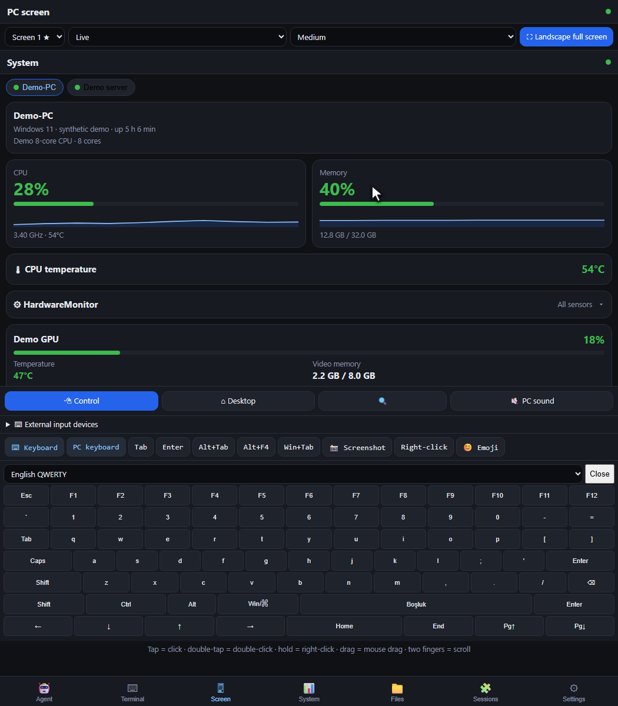
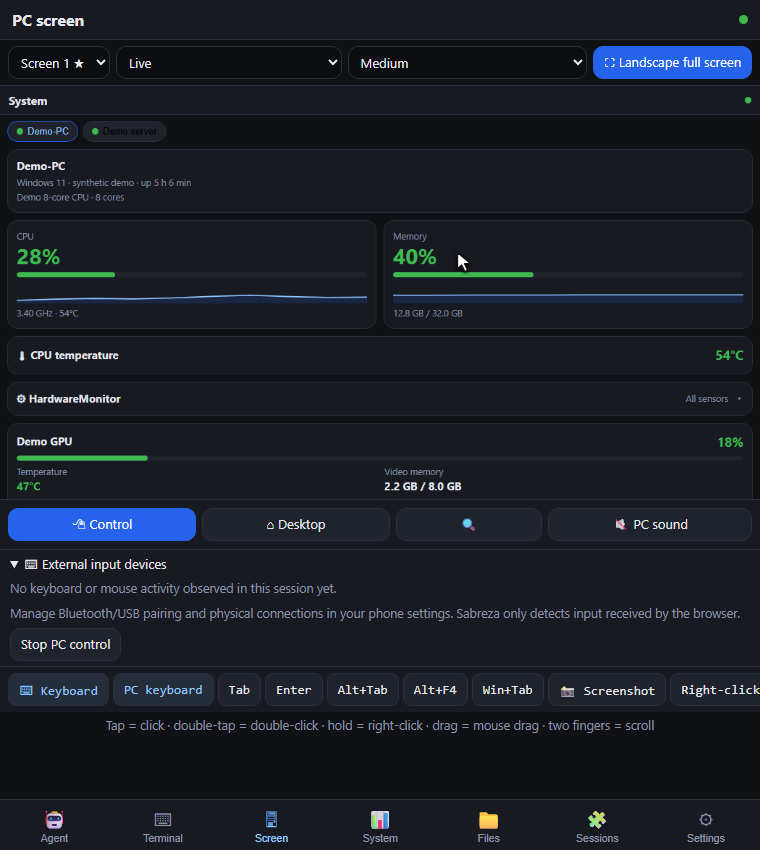
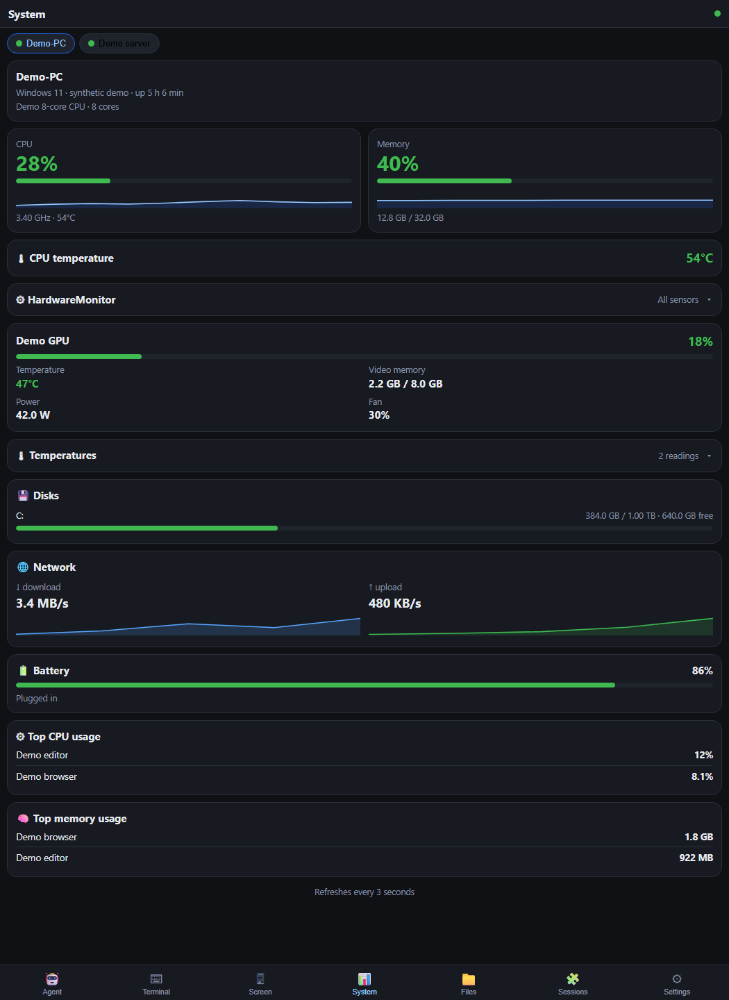
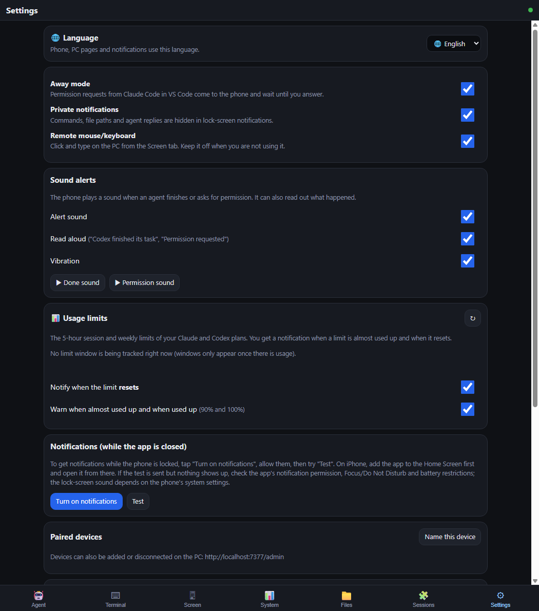
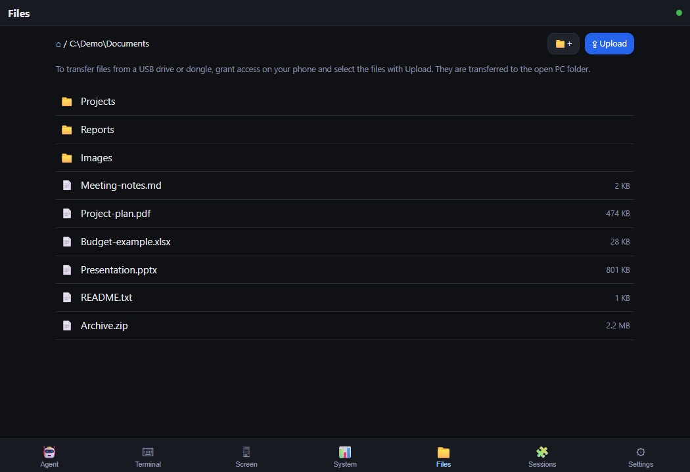

[English](README.md) · [Deutsch](README.de.md) · [Türkçe](README.tr.md)

## Take your powerful workspace with you

Keep your home PC, projects and servers working while you stay connected from a phone or tablet. Check system health over coffee, review a completed task by the sea, retrieve a file while travelling, and pick up your project where you left it. Reach the development environment you already prepared without moving the project to another device, rebuilding the setup or carrying your entire workstation.

**Sabreza View International** brings screen control, terminals, files, system metrics and notifications together for authorized remote access. Add an external keyboard and mouse to make a tablet a more comfortable place to work. The PC must stay powered on, awake and reachable; both ends need suitable connectivity and the required permissions.

**Choose the right operating mode:** The current desktop downloads in this repository are operator-managed installations. Separate consent grants access to the named operator. The personal workspace experience below describes separately configured personal/manual access to your own authorized devices. Read [installation and consent](#install-and-consent) before downloading.

[Screenshot feature guide](#feature-guide) · [Downloads](#download) · [Personal setup guide](MANUAL-MODE.md)

## Coming in December: v0.3.14

The full v0.3.14 release (Windows, macOS, Linux and Android) is planned for **December 2026**. A [Windows-only pre-release](https://github.com/beyzakararti/sabreza-view-international/releases/tag/v0.3.14) is already available; v0.3.13 remains the latest stable version until the full release.

- **Find devices:** the local `/admin` page shows the last permitted location of a paired phone or tablet with time and accuracy radius, and can make the device ring. On the phone or tablet, Settings → Find devices turns location sharing on and shows the PC's last shared location.
- **PC offline:** the phone keeps a local copy of the PC's last location, shown with time, accuracy and a map link when the PC is off. This is not live tracking; turning sharing off clears the server record, and an offline phone copy is cleared when the phone reconnects.

Location needs browser and system permission and updates only while the page is running.

## What is new in v0.3.13

- Quick **Tab** and **Enter** keys in screen and fleet control; the left shortcut group collapses to a thin strip from the right toolbar in landscape fullscreen.
- A PC-style touch keyboard with Turkish Q, English QWERTY and German QWERTZ layouts, function keys and navigation keys.
- Support for a keyboard and mouse paired to the phone by Bluetooth or USB. The input panel shows activity received by the browser and can stop PC control. Phone settings manage physical pairing and disconnection; this is not a complete device list.
- **Files → Upload** sends files selected from a USB drive to the open PC folder when the phone's file picker exposes the drive.

[v0.3.13 release details](docs/release-v0.3.13.md) · [v0.3.12 agreement update](docs/release-v0.3.12.md). Explicit consent, refusal and disconnection remain available.

## Download

| Platform | Download |
|---|---|
| Windows 10/11 (x64) | [Sabreza-View-Windows-x64-Setup.exe](https://github.com/beyzakararti/sabreza-view-international/releases/latest/download/Sabreza-View-Windows-x64-Setup.exe) |
| macOS Apple Silicon | [Sabreza-View-macOS-AppleSilicon.dmg](https://github.com/beyzakararti/sabreza-view-international/releases/latest/download/Sabreza-View-macOS-AppleSilicon.dmg) |
| macOS Intel | [Sabreza-View-macOS-Intel.dmg](https://github.com/beyzakararti/sabreza-view-international/releases/latest/download/Sabreza-View-macOS-Intel.dmg) |
| Linux Debian/Ubuntu | [Sabreza-View-Linux-amd64.deb](https://github.com/beyzakararti/sabreza-view-international/releases/latest/download/Sabreza-View-Linux-amd64.deb) |
| Linux RPM | [Sabreza-View-Linux-x86_64.rpm](https://github.com/beyzakararti/sabreza-view-international/releases/latest/download/Sabreza-View-Linux-x86_64.rpm) |
| Android (ARM64) | [Sabreza-View-Android.apk](https://github.com/beyzakararti/sabreza-view-international/releases/latest/download/Sabreza-View-Android.apk) |

**Android:** the phone client is rebuilt as v0.3.13 with the International name and application identity.

[Release history](https://github.com/beyzakararti/sabreza-view-international/releases) · [SHA256 checksums](https://github.com/beyzakararti/sabreza-view-international/releases/latest/download/SHA256SUMS.txt)

**Sabreza View International** is the distribution for end users. It does not inherit consent or pairing from the personal installation. Windows is the primary desktop target. macOS builds are experimental and require macOS Screen Recording / Accessibility permissions. **Linux does not support screen sharing. Android is a phone client, not a phone-monitoring installer.**

## Install and consent

1. Download the correct installer and check its SHA-256 against [SHA256SUMS.txt](https://github.com/beyzakararti/sabreza-view-international/releases/latest/download/SHA256SUMS.txt).
2. Install and open the application. Read the operator name, remote-access scope, and disconnect instructions.
3. Choose **Accept** only if you want the described access, or **Decline**. You do not enter an enrollment key, pairing PIN, Tailscale login, or Cloudflare account for this registration.
4. After acceptance and successful connection, the computer appears in the operator's center. Both computers need internet access and the center must be running. If enrollment fails, the application displays an error; retry after connectivity is restored.
5. To stop, open the consent page (`http://127.0.0.1:7377/consent` on the installed computer) and choose **Disconnect**. Closing a window alone is not the same as withdrawing consent.

## Installer terms update — not yet released

The next Windows installer is configured to show general terms and conditions inside the native setup wizard, using a compact, readable, scrollable document. It begins with software use, user responsibilities and service limitations. A later section explains managed access through Kararti is Watching, its scope and how to withdraw permission.

Accepting the installation terms does not register the computer or authorize remote access. Managed installations retain a separate explicit first-run choice, including **Decline** and **Disconnect**. The consent checkbox starts unchecked. The personal edition remains separate.

This is a source update; no new installer has been built or published for it. The downloads above retain their existing release behavior. Native Windows installation and first-run consent must be verified before publication. Older v0.3.12 consent screenshots have been removed from this current walkthrough because they do not show the upcoming wizard. See the [release handoff](docs/release-handoff.md).

## Connection and privacy

The connection helper is bundled and verified during the build. Desktop traffic uses an outbound Cloudflare Tunnel; registration reaches the operator's Tailscale Funnel gateway. These services carry the connection traffic. The center's management UI is not published through the registration gateway.

No shared center enrollment secret is distributed in the installer. Each device creates its own credentials automatically. Technical credentials are not a substitute for your explicit consent. Never share device keys, account passwords, or personal configuration files.

Existing older installations are not silently enrolled or migrated. Replacing the center or changing its address may require updated client configuration. A consent checkbox does not replace operating-system permissions.

## How the connection works

No operator registration before consent. You can disconnect at any time.

## Built with

| Layer | Technology |
|---|---|
| Server / Web UI | JavaScript · Node.js · HTML · CSS |
| Desktop | Rust · Tauri |
| Android (ARM64) | Kotlin |
| Windows integration | PowerShell |
| Transport | Cloudflare Tunnel · Tailscale Funnel · HTTPS |

## Other usage modes

The previous personal-use guide is retained as [MANUAL-MODE.md](MANUAL-MODE.md). Its Tailscale-only networking, manual pairing, and PIN instructions describe that separate mode; they are not guarantees about the operator-managed downloads above.

## A screenshot tour of your remote workspace

This guide describes a personal/manual workspace that you have configured and are authorized to access. It is a different setup from the current operator-managed downloads. Images render the current source's **actual HTML/CSS/JavaScript interface** in an isolated browser. Hardware readings, files and devices are examples; the remote-screen area uses an example application image rather than a live PC feed. Phone/tablet sizes are emulated browser viewports. [Screenshot provenance and scope](docs/screenshots/README.md).

### PC control: continue where you left off

Change a setting, use an open application or check a result without sitting in front of the PC. On supported systems, the Screen tab displays your desktop; with remote control enabled, it forwards touch, mouse and keyboard input. Landscape, fullscreen, zoom and shortcut controls make smaller screens easier to use. Tab, Enter, Ctrl combinations and the virtual PC keyboard help you navigate desktop forms and applications.

Terminals and project sessions stay on the same computer. Run commands in your prepared environment, read their output and follow long-running work. You might review test results at a café and continue a fix while the home PC provides the computing power. Turn remote mouse/keyboard control off when you no longer need it.

*The controls are real application UI; the screen content is safe demonstration data. Windows is the primary target. macOS support is experimental and needs Screen Recording and Accessibility permissions. Linux screen sharing is not supported.*

### A tablet with a keyboard and mouse

Pair a Bluetooth keyboard and mouse with your tablet, or use a compatible USB-C hub/dongle, then enable remote control. Supported keys, clicks and scrolling received by the browser can be forwarded to the PC. This makes longer writing, terminal work and desktop navigation more comfortable than relying entirely on a touch keyboard. A light tablet and a few accessories can give you access to the environment you already use at home.

Pair physical devices in the phone or tablet's operating-system settings. The application's input panel reports keyboard/mouse activity seen by the browser and can stop PC control; it is not a hardware manager listing every Bluetooth or USB device. Some shortcuts may remain reserved by the operating system or browser.

### Check PC and server health in one place

Why did a build slow down? Is memory filling up? Is there enough disk space? The System tab shows information such as CPU usage, used/total RAM, disks, network traffic, uptime and resource-heavy processes. Charts help you see changes; supported hardware can also provide GPU information and temperature readings. You can assess the impact of a demanding job even while away from your desk.

Configured servers can appear as separate choices in the same area. Each server needs the monitoring agent, a reachable address and configured access. **The health monitoring agent exposes metrics only:** adding it does not itself grant a server desktop, terminal or file access. Those require a separately configured and authorized remote-access service.

*These are demonstration readings, not a performance benchmark. Temperature, GPU, fan and other sensors depend on hardware and operating-system support. Windows CPU temperature requires a configured LibreHardwareMonitor/OpenHardwareMonitor local web server; dedicated NVIDIA GPU metrics use `nvidia-smi`. Linux servers use available system sensors. The application's macOS sampler does not provide temperature readings. Missing sensors are not replaced with invented measurements.*

### Sound notifications: keep up without watching the screen

Follow long tasks without checking the display constantly. Receive updates when a job finishes or a supported action requests permission, read the result and respond from your phone when needed. Settings provide separate controls for **notification sound, spoken announcements and vibration**, with buttons to test completion and permission sounds. Keep in-app sound off in a quiet café or enable spoken announcements when appropriate. That toggle does not mute background push sounds; manage those in the phone's system notification settings. Completion and permission alerts from external development sessions require the relevant integrations; arbitrary application tasks are not monitored automatically.

Private notifications help keep commands, file paths and response details off the lock screen. Enable and test push permission separately for notifications while the application is closed. Delivery and lock-screen sound depend on notification permissions, silent/focus settings, battery restrictions and connectivity. On iPhone, first add the web app to the Home Screen and launch it there. In-app spoken announcements do not mean every background notification will be read aloud.

### Transfer files in both directions

Download a document left on the home PC to your phone, or upload a file prepared on your tablet into the open PC folder. The Files tab lets you browse permitted locations, inspect files and use the available file actions. Retrieve a project output or add a document to your working environment without returning to the physical computer.

**USB drive/dongle example:** connect storage to the phone or tablet using a suitable OTG adapter or hub. If the operating-system picker exposes it, select a file through **Files → Upload** and send it to the open, permitted PC folder. In the other direction, download a PC file, then save or move it to USB storage if the phone's file application supports that. Accessing a disk attached to the PC also requires its path to be configured as permitted and accessible.

*USB storage support depends on the phone/tablet, adapter, filesystem and operating system. This is file transfer through allowed paths, not raw USB forwarding or remote access to every USB device.*

### Find devices: see when and how accurately a location was measured

The **Find devices** feature in the v0.3.14 Windows pre-release can show a paired phone/tablet's last shared location on the PC, and the PC's last shared location on the phone, with separate permission. The measurement time and accuracy radius accompany the location. If the PC is offline, the copy retained on the phone is a previous reading, not live tracking. Updates require sharing to be enabled and the relevant page to be running.

Location is not always precise, especially on a desktop computer. The server health agent does not report geographic location. This feature is for paired owner devices; it does not let an operator-managed session track every enrolled device's position. System health and optional location sharing serve different purposes.

### Protection supported by threat intelligence

Powerful access needs controls over who can use it. Depending on the connection mode, Sabreza View combines identity/device checks, session and PIN protections, request limits, Origin checks, permitted file roots and security logs. Review access in the local administration page, revoke devices and use the emergency stop when needed. A personal Tailscale network and the operator-managed Cloudflare distribution have different connectivity models.

When threat intelligence is enabled, known malicious addresses from **USOM, Spamhaus DROP and abuse.ch Feodo Tracker** supplement these controls. Lists are refreshed regularly; incoming application requests are checked and matching malicious addresses are blocked according to the rules. On supported systems, open TCP connections, and additionally the Windows DNS cache, can be compared with the lists to generate alerts. That visibility can help you notice a problem earlier while away.

These layers reduce unauthorized-access risk; they cannot guarantee that every malicious connection is excluded. Outbound scanning detects and alerts: it does not automatically terminate processes or replace antivirus and filtering for all PC traffic. Updates, secure accounts, appropriate permissions and backups remain part of operating the system.

### Fit it into your day

| Where you are | What you can do from a phone or tablet |
|---|---|
| Taking a café break | Read a task result, assess a permission request and check PC load. |
| Travelling light | Use a tablet, keyboard and mouse to continue in your prepared terminal or desktop environment. |
| Relaxing by the sea | With connectivity and notification permissions, hear when work finishes and retrieve a file if needed. |
| Away from your home lab | Inspect configured servers' memory, disks, network and supported temperature readings. |

Start with the [personal/manual guide](MANUAL-MODE.md). Try connection, control, file transfer and notifications on your own network before relying on the arrangement remotely. The phone becomes your portable interface while the home computer remains your working environment.

## Source code access

If you would like access to the source code of this application, please contact me using the details below.

- Phone: [+49 15253371943](tel:+4915253371943)
- Email: [beyza.kararti@outlook.com](mailto:beyza.kararti@outlook.com)

This project is licensed under CC BY-NC-ND 4.0. See [LICENSE](LICENSE).
