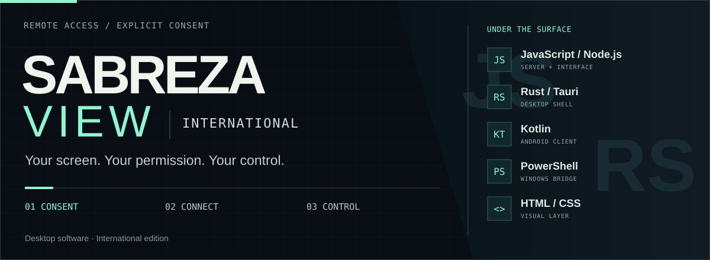

[English](README.md) · [Deutsch](README.de.md) · [Türkçe](README.tr.md)

## What is new in v0.3.10

Blue-gray colors, clearer keyboard focus, larger touch controls and reduced-motion support. The PC server must be updated for iPhone clients to receive the new interface. These international installers are separate from personal installations.

## Download

| Platform | Download |
|---|---|
| Windows 10/11 (x64) | [Sabreza-View-Windows-x64-Setup.exe](https://github.com/beyzakararti/sabreza-view-international/releases/latest/download/Sabreza-View-Windows-x64-Setup.exe) |
| macOS Apple Silicon | [Sabreza-View-macOS-AppleSilicon.dmg](https://github.com/beyzakararti/sabreza-view-international/releases/latest/download/Sabreza-View-macOS-AppleSilicon.dmg) |
| macOS Intel | [Sabreza-View-macOS-Intel.dmg](https://github.com/beyzakararti/sabreza-view-international/releases/latest/download/Sabreza-View-macOS-Intel.dmg) |
| Linux Debian/Ubuntu | [Sabreza-View-Linux-amd64.deb](https://github.com/beyzakararti/sabreza-view-international/releases/latest/download/Sabreza-View-Linux-amd64.deb) |
| Linux RPM | [Sabreza-View-Linux-x86_64.rpm](https://github.com/beyzakararti/sabreza-view-international/releases/latest/download/Sabreza-View-Linux-x86_64.rpm) |
| Android | [Sabreza-View-Android.apk](https://github.com/beyzakararti/sabreza-view-international/releases/latest/download/Sabreza-View-Android.apk) |

**Android:** the APK remains the published v0.3.8 phone client, unchanged and checksum-verified; it is not a newly built v0.3.10 APK.

[Release history](https://github.com/beyzakararti/sabreza-view-international/releases) · [SHA256 checksums](https://github.com/beyzakararti/sabreza-view-international/releases/latest/download/SHA256SUMS.txt)

The installer may display the product name **sabreza-view-lab**. This release uses a separate application identity from the old personal installation; it does not inherit its consent or pairing. Windows is the primary desktop target. macOS builds are experimental and require macOS Screen Recording / Accessibility permissions. **Linux does not support screen sharing. Android is a phone client, not a phone-monitoring installer.**

## Install and consent

1. Download the correct installer and check its SHA-256 against [SHA256SUMS.txt](https://github.com/beyzakararti/sabreza-view-international/releases/latest/download/SHA256SUMS.txt).
2. Install and open the application. Read the operator name, remote-access scope, and disconnect instructions.
3. Choose **Accept** only if you want the described access, or **Decline**. You do not enter an enrollment key, pairing PIN, Tailscale login, or Cloudflare account for this registration.
4. After acceptance and successful connection, the computer appears in the operator's center. Both computers need internet access and the center must be running. If enrollment fails, the application displays an error; retry after connectivity is restored.
5. To stop, open the consent page (`http://127.0.0.1:7376/consent` on the installed computer) and choose **Disconnect**. Closing a window alone is not the same as withdrawing consent.

## Connection and privacy

The connection helper is bundled and verified during the build. Desktop traffic uses an outbound Cloudflare Tunnel; registration reaches the operator's Tailscale Funnel gateway. These services carry the connection traffic. The center's management UI is not published through the registration gateway.

No shared center enrollment secret is distributed in the installer. Each device creates its own credentials automatically. Technical credentials are not a substitute for your explicit consent. Never share device keys, account passwords, or personal configuration files.

Existing older installations are not silently enrolled or migrated. Replacing the center or changing its address may require updated client configuration. A consent checkbox does not replace operating-system permissions.

## How the connection works

No operator registration before consent. You can disconnect at any time.

## Built with

| Layer | Technology |
|---|---|
| Server / Web UI | JavaScript · Node.js · HTML · CSS |
| Desktop | Rust · Tauri |
| Android | Kotlin |
| Windows integration | PowerShell |
| Transport | Cloudflare Tunnel · Tailscale Funnel · HTTPS |

## Other usage modes

The previous personal-use guide is retained as [MANUAL-MODE.md](MANUAL-MODE.md). Its Tailscale-only networking, manual pairing, and PIN instructions describe that separate mode; they are not guarantees about the operator-managed downloads above.

## Source code access

If you would like access to the source code of this application, please contact me using the details below.

- Phone: [+49 15253371943](tel:+4915253371943)
- Email: [beyza.kararti@outlook.com](mailto:beyza.kararti@outlook.com)

This project is licensed under CC BY-NC-ND 4.0. See [LICENSE](LICENSE).
