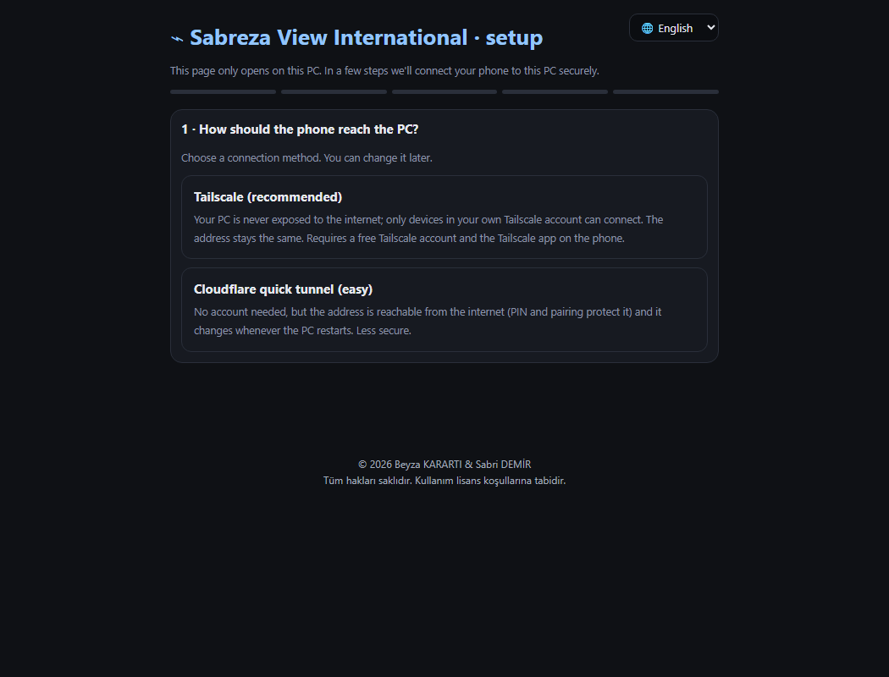
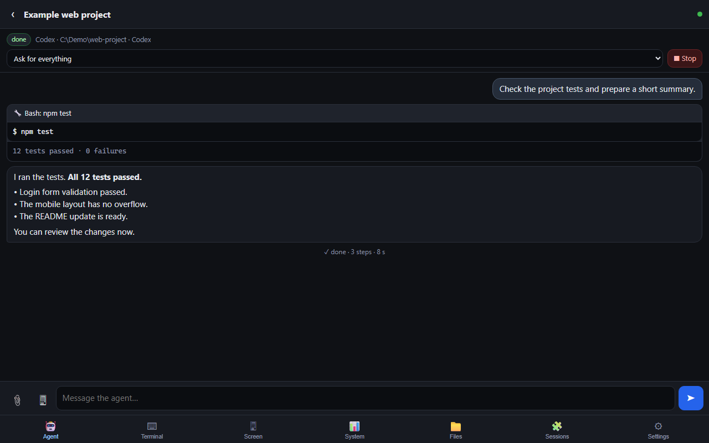
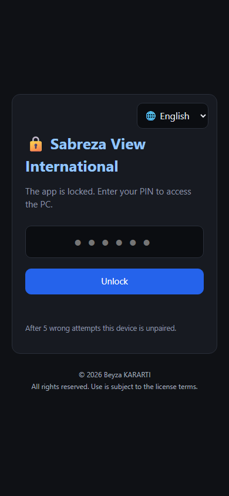
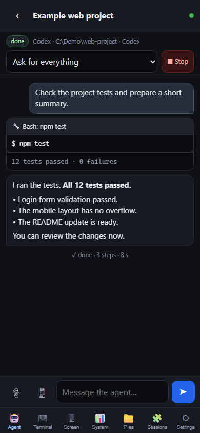

[English](README.md) · [Deutsch](README.de.md) · [Türkçe](README.tr.md)

## Coming in December: v0.3.14

The full v0.3.14 release (Windows, macOS, Linux and Android) is planned for **December 2026**. A [Windows-only pre-release](https://github.com/beyzakararti/sabreza-view-international/releases/tag/v0.3.14) is already available; v0.3.13 remains the latest stable version until the full release.

- **Find devices:** the local `/admin` page shows the last permitted location of a paired phone or tablet with time and accuracy radius, and can make the device ring. On the phone or tablet, Settings → Find devices turns location sharing on and shows the PC's last shared location.
- **PC offline:** the phone keeps a local copy of the PC's last location, shown with time, accuracy and a map link when the PC is off. This is not live tracking; turning sharing off deletes the stored location.

Location needs browser and system permission and updates only while the page is running.

## What is new in v0.3.13

- Quick **Tab** and **Enter** keys in screen and fleet control; the left shortcut group collapses to a thin strip from the right toolbar in landscape fullscreen.
- A PC-style touch keyboard with Turkish Q, English QWERTY and German QWERTZ layouts, function keys and navigation keys.
- Support for a keyboard and mouse paired to the phone by Bluetooth or USB. The input panel shows activity received by the browser and can stop PC control. Phone settings manage physical pairing and disconnection; this is not a complete device list.
- **Files → Upload** sends files selected from a USB drive to the open PC folder when the phone's file picker exposes the drive.

[v0.3.13 release details](docs/release-v0.3.13.md) · [v0.3.12 agreement update](docs/release-v0.3.12.md). Explicit consent, refusal and disconnection remain available.

## Download

| Platform | Download |
|---|---|
| Windows 10/11 (x64) | [Sabreza-View-Windows-x64-Setup.exe](https://github.com/beyzakararti/sabreza-view-international/releases/latest/download/Sabreza-View-Windows-x64-Setup.exe) |
| macOS Apple Silicon | [Sabreza-View-macOS-AppleSilicon.dmg](https://github.com/beyzakararti/sabreza-view-international/releases/latest/download/Sabreza-View-macOS-AppleSilicon.dmg) |
| macOS Intel | [Sabreza-View-macOS-Intel.dmg](https://github.com/beyzakararti/sabreza-view-international/releases/latest/download/Sabreza-View-macOS-Intel.dmg) |
| Linux Debian/Ubuntu | [Sabreza-View-Linux-amd64.deb](https://github.com/beyzakararti/sabreza-view-international/releases/latest/download/Sabreza-View-Linux-amd64.deb) |
| Linux RPM | [Sabreza-View-Linux-x86_64.rpm](https://github.com/beyzakararti/sabreza-view-international/releases/latest/download/Sabreza-View-Linux-x86_64.rpm) |
| Android (ARM64) | [Sabreza-View-Android.apk](https://github.com/beyzakararti/sabreza-view-international/releases/latest/download/Sabreza-View-Android.apk) |

**Android:** the phone client is rebuilt as v0.3.13 with the International name and application identity.

[Release history](https://github.com/beyzakararti/sabreza-view-international/releases) · [SHA256 checksums](https://github.com/beyzakararti/sabreza-view-international/releases/latest/download/SHA256SUMS.txt)

**Sabreza View International** is the distribution for end users. It does not inherit consent or pairing from the personal installation. Windows is the primary desktop target. macOS builds are experimental and require macOS Screen Recording / Accessibility permissions. **Linux does not support screen sharing. Android is a phone client, not a phone-monitoring installer.**

## Install and consent

1. Download the correct installer and check its SHA-256 against [SHA256SUMS.txt](https://github.com/beyzakararti/sabreza-view-international/releases/latest/download/SHA256SUMS.txt).
2. Install and open the application. Read the operator name, remote-access scope, and disconnect instructions.
3. Choose **Accept** only if you want the described access, or **Decline**. You do not enter an enrollment key, pairing PIN, Tailscale login, or Cloudflare account for this registration.
4. After acceptance and successful connection, the computer appears in the operator's center. Both computers need internet access and the center must be running. If enrollment fails, the application displays an error; retry after connectivity is restored.
5. To stop, open the consent page (`http://127.0.0.1:7377/consent` on the installed computer) and choose **Disconnect**. Closing a window alone is not the same as withdrawing consent.

## Installer terms update — not yet released

The next Windows installer is configured to show general terms and conditions inside the native setup wizard, using a compact, readable, scrollable document. It begins with software use, user responsibilities and service limitations. A later section explains managed access through Kararti is Watching, its scope and how to withdraw permission.

Accepting the installation terms does not register the computer or authorize remote access. Managed installations retain a separate explicit first-run choice, including **Decline** and **Disconnect**. The consent checkbox starts unchecked. The personal edition remains separate.

This is a source update; no new installer has been built or published for it. The downloads above retain their existing release behavior. Native Windows installation and first-run consent must be verified before publication. Older v0.3.12 consent screenshots have been removed from this current walkthrough because they do not show the upcoming wizard. See the [release handoff](docs/release-handoff.md).

## Connection and privacy

The connection helper is bundled and verified during the build. Desktop traffic uses an outbound Cloudflare Tunnel; registration reaches the operator's Tailscale Funnel gateway. These services carry the connection traffic. The center's management UI is not published through the registration gateway.

No shared center enrollment secret is distributed in the installer. Each device creates its own credentials automatically. Technical credentials are not a substitute for your explicit consent. Never share device keys, account passwords, or personal configuration files.

Existing older installations are not silently enrolled or migrated. Replacing the center or changing its address may require updated client configuration. A consent checkbox does not replace operating-system permissions.

## How the connection works

No operator registration before consent. You can disconnect at any time.

## Built with

| Layer | Technology |
|---|---|
| Server / Web UI | JavaScript · Node.js · HTML · CSS |
| Desktop | Rust · Tauri |
| Android (ARM64) | Kotlin |
| Windows integration | PowerShell |
| Transport | Cloudflare Tunnel · Tailscale Funnel · HTTPS |

## Other usage modes

The previous personal-use guide is retained as [MANUAL-MODE.md](MANUAL-MODE.md). Its Tailscale-only networking, manual pairing, and PIN instructions describe that separate mode; they are not guarantees about the operator-managed downloads above.

## PC and phone views — personal/manual mode

The wizard, PIN and control screens below belong to separately configured personal/manual use. They are not extra steps for the operator-managed International installation above. See the [personal/manual guide](MANUAL-MODE.md).

Phone screenshots use a 390 × 844 mobile browser viewport; they are not captures from a physical iPhone or Android device. Conversations, file paths and test results are illustrative and contain no personal data.

### Setup wizard: choosing a connection method

### PC: a sample session

| Phone: PIN entry | Phone: a sample session |
|---|---|
|  |  |

## Source code access

If you would like access to the source code of this application, please contact me using the details below.

- Phone: [+49 15253371943](tel:+4915253371943)
- Email: [beyza.kararti@outlook.com](mailto:beyza.kararti@outlook.com)

This project is licensed under CC BY-NC-ND 4.0. See [LICENSE](LICENSE).
