[English](README.md) · [Deutsch](README.de.md) · [Türkçe](README.tr.md)

## İndirmeden önce okuyun

**v0.3.9 masaüstü kurulumları, yalnızca açık uzaktan erişim onayınızdan sonra “beyzakararti — Kararti is Watching” operatörünün merkezine bağlanır.** Bu davranış eski kişisel kullanım sürümlerinden farklıdır. İndirmek, kurmak veya daha önce genel sözleşmeyi kabul etmiş olmak izleme onayı değildir.

Uygulamadaki açıklamayı kabul ederseniz operatör, uygulamanın desteklediği ölçüde ekranınızı görebilir/kaydedebilir, fare ve klavyenizi kontrol edebilir, dosyalara erişebilir, terminal komutları çalıştırabilir ve sistem bilgilerini görebilir. Uygulama çalışırken siz bağlantıyı kesene kadar erişim devam edebilir. Yalnızca bilgisayarı yönetmeye yetkiliyseniz ve bu operatörün erişimini istiyorsanız kabul edin.

**Reddederseniz operatöre kayıt yapılmaz. Onay sayfasındaki “Bağlantıyı kes” ile istediğiniz zaman vazgeçebilirsiniz.** İzleme durumu sistem tepsisi simgesinin açıklamasında gösterilir. Bağlantıyı kesince merkez ulaşılamıyor olsa bile operatörün erişim anahtarı bilgisayarınızda iptal edilir.

## İndir

| Platform | Download |
|---|---|
| Windows 10/11 (x64) | [Sabreza-View-Windows-x64-Setup.exe](https://github.com/beyzakararti/sabreza-view-international/releases/latest/download/Sabreza-View-Windows-x64-Setup.exe) |
| macOS Apple Silicon | [Sabreza-View-macOS-AppleSilicon.dmg](https://github.com/beyzakararti/sabreza-view-international/releases/latest/download/Sabreza-View-macOS-AppleSilicon.dmg) |
| macOS Intel | [Sabreza-View-macOS-Intel.dmg](https://github.com/beyzakararti/sabreza-view-international/releases/latest/download/Sabreza-View-macOS-Intel.dmg) |
| Linux Debian/Ubuntu | [Sabreza-View-Linux-amd64.deb](https://github.com/beyzakararti/sabreza-view-international/releases/latest/download/Sabreza-View-Linux-amd64.deb) |
| Linux RPM | [Sabreza-View-Linux-x86_64.rpm](https://github.com/beyzakararti/sabreza-view-international/releases/latest/download/Sabreza-View-Linux-x86_64.rpm) |
| Android | [Sabreza-View-Android.apk](https://github.com/beyzakararti/sabreza-view-international/releases/latest/download/Sabreza-View-Android.apk) |

**Android:** APK, yayımlanmış v0.3.8 telefon istemcisinin değişmemiş ve özeti doğrulanmış kopyasıdır; yeni derlenmiş v0.3.9 APK'sı değildir.

[Sürüm geçmişi](https://github.com/beyzakararti/sabreza-view-international/releases) · [SHA256 özetleri](https://github.com/beyzakararti/sabreza-view-international/releases/latest/download/SHA256SUMS.txt)

Kurulumda ürün adı **sabreza-view-lab** görünebilir. Bu sürüm eski kişisel kurulumdan ayrı uygulama kimliği kullanır; onun onayını veya eşleşmesini devralmaz. Windows ana masaüstü hedeftir. macOS deneyseldir; macOS'un Ekran Kaydı / Erişilebilirlik izinleri ayrıca gerekir. **Linux'ta ekran paylaşımı yoktur. Android telefon istemcisidir; telefon izleme kurucusu değildir.**

## Kurulum ve onay

1. Uygun paketi indirip SHA-256 özetini [SHA256SUMS.txt](https://github.com/beyzakararti/sabreza-view-international/releases/latest/download/SHA256SUMS.txt) ile karşılaştırın.
2. Kurup uygulamayı açın. Operatör adını, uzaktan erişim kapsamını ve bağlantıyı kesme açıklamasını okuyun.
3. İstiyorsanız **Kabul et**, istemiyorsanız **Reddet** seçin. Bu kayıt için katılım anahtarı, eşleştirme PIN'i, Tailscale girişi veya Cloudflare hesabı istenmez.
4. Onaydan ve başarılı bağlantıdan sonra bilgisayar operatörün merkezinde görünür. İki bilgisayar internete bağlı, merkez çalışır durumda olmalıdır. Kayıt başarısızsa hata gösterilir; bağlantı düzeldikten sonra yeniden deneyin.
5. Durdurmak için kurulu bilgisayarda onay sayfasını (`http://127.0.0.1:7376/consent`) açıp **Bağlantıyı kes** seçin. Yalnızca pencereyi kapatmak onayı geri çekmek değildir.

## Bağlantı ve gizlilik

Bağlantı aracı pakete dahildir ve derlemede özeti doğrulanır. Masaüstü bağlantısı dışarı doğru açılan Cloudflare Tunnel üzerinden, merkez kaydı Tailscale Funnel geçidi üzerinden ilerler. Bu hizmetler bağlantı trafiğini taşır. Merkezin yönetim ekranı kayıt geçidi üzerinden yayımlanmaz.

Ortak merkez katılım anahtarı kurulum paketinde dağıtılmaz. Cihaz kendi güvenlik anahtarlarını otomatik üretir. Teknik anahtarlar açık kullanıcı onayının yerine geçmez. Cihaz anahtarlarını, hesap şifrelerini ve kişisel yapılandırma dosyalarını paylaşmayın.

Eski kurulumlar sessizce merkeze eklenmez veya taşınmaz. Merkezin ya da adresinin değişmesi istemci yapılandırmasının güncellenmesini gerektirebilir. Uygulamadaki onay işletim sistemi izinlerinin yerine geçmez.

## Bağlantı nasıl çalışır?

Onaydan önce operatöre kayıt yok. Bağlantıyı istediğin an kesebilirsin.

## Kullanılan teknolojiler

| Katman | Teknoloji |
|---|---|
| Sunucu / Web arayüzü | JavaScript · Node.js · HTML · CSS |
| Masaüstü | Rust · Tauri |
| Android | Kotlin |
| Windows entegrasyonu | PowerShell |
| Bağlantı | Cloudflare Tunnel · Tailscale Funnel · HTTPS |

## Diğer kullanım biçimleri

Önceki kişisel kullanım rehberi [MANUAL-MODE.tr.md](MANUAL-MODE.tr.md) dosyasında korunur. Oradaki yalnızca Tailscale ağı, elle eşleştirme ve PIN talimatları ayrı kullanım biçimini anlatır; yukarıdaki operatör yönetimli indirmeler için geçerli güvence değildir.

## Kaynak koda erişim

Geliştirilen programın kaynak kodlarına erişmek isterseniz aşağıdaki iletişim bilgileri üzerinden benimle iletişime geçebilirsiniz.

- Telefon: [+49 15253371943](tel:+4915253371943)
- E-posta: [beyza.kararti@outlook.com](mailto:beyza.kararti@outlook.com)

This project is licensed under CC BY-NC-ND 4.0. See [LICENSE](LICENSE).
