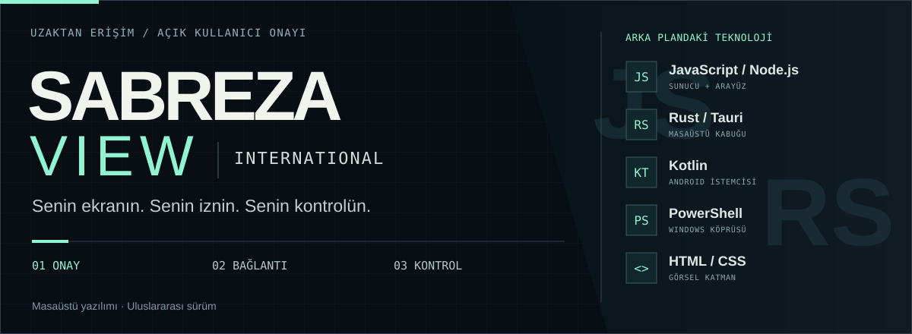
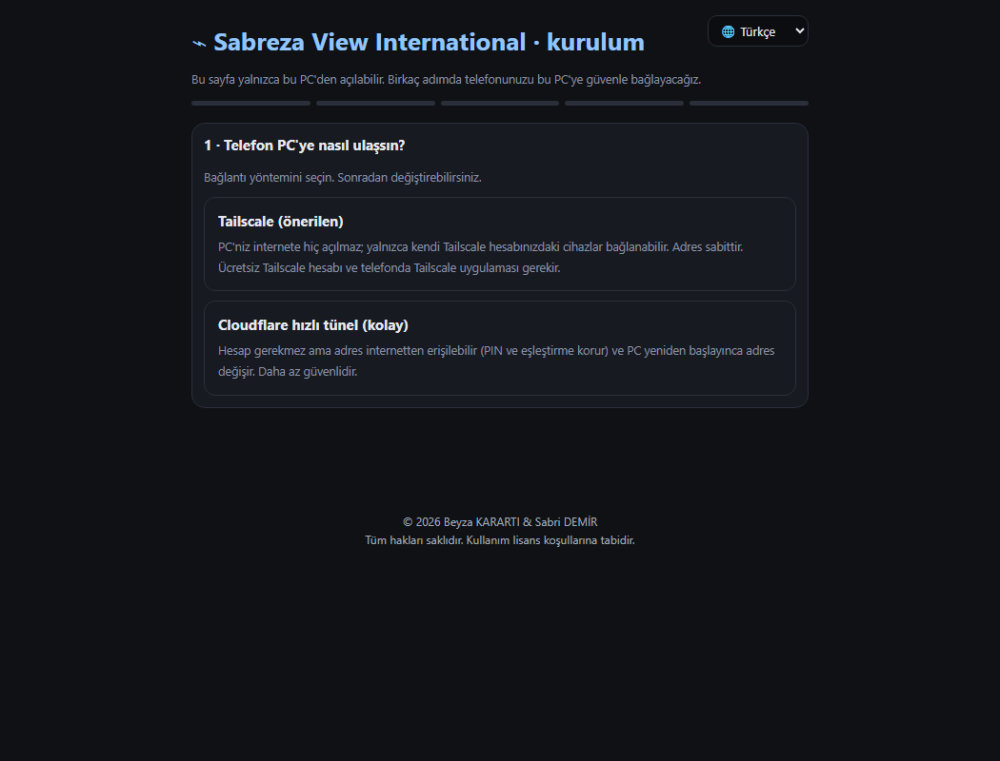
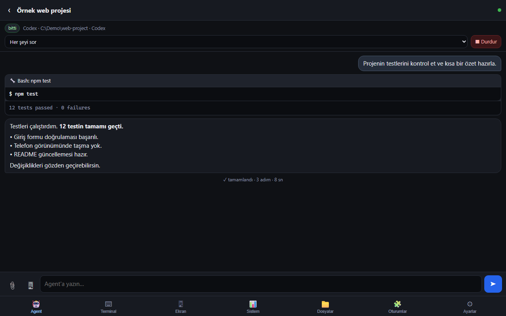
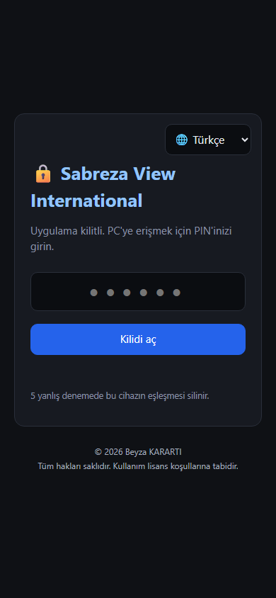
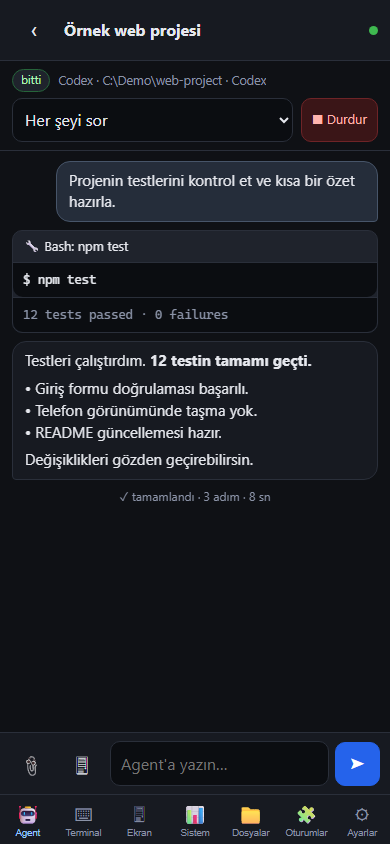

[English](README.md) · [Deutsch](README.de.md) · [Türkçe](README.tr.md)

## Aralıkta geliyor: v0.3.14

v0.3.14'ün tam sürümü (Windows, macOS, Linux ve Android) **Aralık 2026** için planlanıyor. [Yalnızca Windows ön sürümü](https://github.com/beyzakararti/sabreza-view-international/releases/tag/v0.3.14) şimdiden indirilebilir; tam sürüm çıkana kadar son kararlı sürüm v0.3.13'tür.

- **Cihazları bul:** Yerel `/admin` sayfası eşleşmiş telefon/tabletin son izinli konumunu zaman ve doğruluk yarıçapıyla gösterir ve cihazı çaldırabilir. Telefonda/tablette Ayarlar → Cihazları bul'dan konum paylaşımı açılır ve PC'nin son paylaşılan konumu görülür.
- **PC çevrimdışıyken:** Telefon PC'nin son konumunun yerel kopyasını tutar; PC kapalıyken zaman, doğruluk ve harita bağlantısıyla gösterir. Canlı takip değildir; paylaşım kapatılınca kayıtlı konum silinir.

Konum için tarayıcı ve sistem izni gerekir; yalnızca sayfa çalışırken güncellenir.

## v0.3.13 yenilikleri

- Ekran ve filo kontrolüne hızlı **Tab** ve **Enter** tuşları eklendi. Yatay tam ekranda soldaki tuşlar sağdaki araç çubuğundan ince bir şeride daraltılabilir.
- PC tarzı sanal klavye Türkçe Q, İngilizce QWERTY ve Almanca QWERTZ düzenlerini; işlev ve gezinme tuşlarını içerir.
- Telefona Bluetooth veya USB ile önceden eşleştirilmiş klavye ve fare PC kontrolünde kullanılabilir. Panel yalnızca tarayıcının gördüğü girişleri gösterir ve PC kontrolünü kapatabilir. Fiziksel eşleştirme ve bağlantıyı kesme telefon ayarlarındadır; panel tam cihaz listesi değildir.
- Telefonun dosya seçicisinde USB bellek görünüyorsa **Dosyalar → Yükle** ile seçilen dosyalar açık PC klasörüne aktarılabilir.

[v0.3.13 sürüm ayrıntıları](docs/release-v0.3.13.md) · [v0.3.12 sözleşme güncellemesi](docs/release-v0.3.12.md). Açık onay, reddetme ve bağlantıyı kesme seçenekleri korunur.

## İndirmeden önce okuyun

**v0.3.13 masaüstü kurulumları, yalnızca açık uzaktan erişim onayınızdan sonra “beyzakararti — Kararti is Watching” operatörünün merkezine bağlanır.** Bu davranış eski kişisel kullanım sürümlerinden farklıdır. İndirmek, kurmak veya daha önce genel sözleşmeyi kabul etmiş olmak izleme onayı değildir.

Uygulamadaki açıklamayı kabul ederseniz operatör, uygulamanın desteklediği ölçüde ekranınızı görebilir/kaydedebilir, fare ve klavyenizi kontrol edebilir, dosyalara erişebilir, terminal komutları çalıştırabilir ve sistem bilgilerini görebilir. Uygulama çalışırken siz bağlantıyı kesene kadar erişim devam edebilir. Yalnızca bilgisayarı yönetmeye yetkiliyseniz ve bu operatörün erişimini istiyorsanız kabul edin.

**Reddederseniz operatöre kayıt yapılmaz. Onay sayfasındaki “Bağlantıyı kes” ile istediğiniz zaman vazgeçebilirsiniz.** İzleme durumu sistem tepsisi simgesinin açıklamasında gösterilir. Bağlantıyı kesince merkez ulaşılamıyor olsa bile operatörün erişim anahtarı bilgisayarınızda iptal edilir.

## İndir

| Platform | Download |
|---|---|
| Windows 10/11 (x64) | [Sabreza-View-Windows-x64-Setup.exe](https://github.com/beyzakararti/sabreza-view-international/releases/latest/download/Sabreza-View-Windows-x64-Setup.exe) |
| macOS Apple Silicon | [Sabreza-View-macOS-AppleSilicon.dmg](https://github.com/beyzakararti/sabreza-view-international/releases/latest/download/Sabreza-View-macOS-AppleSilicon.dmg) |
| macOS Intel | [Sabreza-View-macOS-Intel.dmg](https://github.com/beyzakararti/sabreza-view-international/releases/latest/download/Sabreza-View-macOS-Intel.dmg) |
| Linux Debian/Ubuntu | [Sabreza-View-Linux-amd64.deb](https://github.com/beyzakararti/sabreza-view-international/releases/latest/download/Sabreza-View-Linux-amd64.deb) |
| Linux RPM | [Sabreza-View-Linux-x86_64.rpm](https://github.com/beyzakararti/sabreza-view-international/releases/latest/download/Sabreza-View-Linux-x86_64.rpm) |
| Android (ARM64) | [Sabreza-View-Android.apk](https://github.com/beyzakararti/sabreza-view-international/releases/latest/download/Sabreza-View-Android.apk) |

**Android:** telefon istemcisi International adı ve uygulama kimliğiyle v0.3.13 olarak yeniden derlendi.

[Sürüm geçmişi](https://github.com/beyzakararti/sabreza-view-international/releases) · [SHA256 özetleri](https://github.com/beyzakararti/sabreza-view-international/releases/latest/download/SHA256SUMS.txt)

**Sabreza View International**, kullanıcılar için dağıtılan sürümdür. Kişisel kurulumun onayını veya eşleşmesini devralmaz. Windows ana masaüstü hedeftir. macOS deneyseldir; macOS'un Ekran Kaydı / Erişilebilirlik izinleri ayrıca gerekir. **Linux'ta ekran paylaşımı yoktur. Android telefon istemcisidir; telefon izleme kurucusu değildir.**

## Kurulum ve onay

1. Uygun paketi indirip SHA-256 özetini [SHA256SUMS.txt](https://github.com/beyzakararti/sabreza-view-international/releases/latest/download/SHA256SUMS.txt) ile karşılaştırın.
2. Kurup uygulamayı açın. Operatör adını, uzaktan erişim kapsamını ve bağlantıyı kesme açıklamasını okuyun.
3. İstiyorsanız **Kabul et**, istemiyorsanız **Reddet** seçin. Bu kayıt için katılım anahtarı, eşleştirme PIN'i, Tailscale girişi veya Cloudflare hesabı istenmez.
4. Onaydan ve başarılı bağlantıdan sonra bilgisayar operatörün merkezinde görünür. İki bilgisayar internete bağlı, merkez çalışır durumda olmalıdır. Kayıt başarısızsa hata gösterilir; bağlantı düzeldikten sonra yeniden deneyin.
5. Durdurmak için kurulu bilgisayarda onay sayfasını (`http://127.0.0.1:7377/consent`) açıp **Bağlantıyı kes** seçin. Yalnızca pencereyi kapatmak onayı geri çekmek değildir.

## Kurulum sözleşmesi güncellemesi — henüz yayımlanmadı

Sonraki Windows kurucusu, genel kullanım koşullarını kurulum sihirbazının içinde küçük, okunabilir ve kaydırılabilir bir metin olarak gösterecek şekilde yapılandırıldı. Metin programın kullanımı, kullanıcı sorumlulukları ve hizmet sınırlarıyla başlar. Kararti is Watching üzerinden yönetilen erişim, erişimin kapsamı ve onayı geri çekme yöntemi sonraki bir bölümde açıklanır.

Kurulum koşullarını kabul etmek bilgisayarı merkeze kaydetmez ve uzaktan erişim izni vermez. Yönetilen kurulumlarda ilk açılıştaki ayrı ve açık onay, **Reddet** ve **Bağlantıyı kes** seçenekleri korunur. Onay kutusu başlangıçta seçili değildir. Kişisel sürüm ayrı kalır.

Bu bir kaynak güncellemesidir; bu değişiklik için yeni kurucu derlenmedi veya yayımlanmadı. Yukarıdaki indirmeler mevcut sürüm davranışını korur. Yayımdan önce gerçek Windows kurulum akışı ve ilk açılış onayı doğrulanmalıdır. Eski v0.3.12 onay ekranları yeni sihirbazı göstermediğinden güncel anlatımdan çıkarıldı. Bkz. [yayın devri](docs/release-handoff.md).

## Bağlantı ve gizlilik

Bağlantı aracı pakete dahildir ve derlemede özeti doğrulanır. Masaüstü bağlantısı dışarı doğru açılan Cloudflare Tunnel üzerinden, merkez kaydı Tailscale Funnel geçidi üzerinden ilerler. Bu hizmetler bağlantı trafiğini taşır. Merkezin yönetim ekranı kayıt geçidi üzerinden yayımlanmaz.

Ortak merkez katılım anahtarı kurulum paketinde dağıtılmaz. Cihaz kendi güvenlik anahtarlarını otomatik üretir. Teknik anahtarlar açık kullanıcı onayının yerine geçmez. Cihaz anahtarlarını, hesap şifrelerini ve kişisel yapılandırma dosyalarını paylaşmayın.

Eski kurulumlar sessizce merkeze eklenmez veya taşınmaz. Merkezin ya da adresinin değişmesi istemci yapılandırmasının güncellenmesini gerektirebilir. Uygulamadaki onay işletim sistemi izinlerinin yerine geçmez.

## Bağlantı nasıl çalışır?

Onaydan önce operatöre kayıt yok. Bağlantıyı istediğin an kesebilirsin.

## Kullanılan teknolojiler

| Katman | Teknoloji |
|---|---|
| Sunucu / Web arayüzü | JavaScript · Node.js · HTML · CSS |
| Masaüstü | Rust · Tauri |
| Android (ARM64) | Kotlin |
| Windows entegrasyonu | PowerShell |
| Bağlantı | Cloudflare Tunnel · Tailscale Funnel · HTTPS |

## Diğer kullanım biçimleri

Önceki kişisel kullanım rehberi [MANUAL-MODE.tr.md](MANUAL-MODE.tr.md) dosyasında korunur. Oradaki yalnızca Tailscale ağı, elle eşleştirme ve PIN talimatları ayrı kullanım biçimini anlatır; yukarıdaki operatör yönetimli indirmeler için geçerli güvence değildir.

## PC ve telefon görünümü — kişisel/manual kullanım

Aşağıdaki sihirbaz, PIN ve kontrol ekranları ayrı yapılandırılan kişisel/manual kullanıma aittir. Yukarıdaki operatör yönetimli International kurulumu için ek adımlar değildir. Ayrıntılar: [kişisel/manual kullanım rehberi](MANUAL-MODE.tr.md).

Telefon görselleri 390 × 844 boyutunda mobil tarayıcı görünümüdür; fiziksel iPhone veya Android ekran kaydı değildir. Konuşmalar, dosya yolları ve test sonuçları örnektir; kişisel veriler içermez.

### Kurulum sihirbazı: bağlantı yöntemini seçme

### PC: örnek bir oturum

| Telefon: PIN girişi | Telefon: örnek bir oturum |
|---|---|
|  |  |

## Kaynak koda erişim

Geliştirilen programın kaynak kodlarına erişmek isterseniz aşağıdaki iletişim bilgileri üzerinden benimle iletişime geçebilirsiniz.

- Telefon: [+49 15253371943](tel:+4915253371943)
- E-posta: [beyza.kararti@outlook.com](mailto:beyza.kararti@outlook.com)

This project is licensed under CC BY-NC-ND 4.0. See [LICENSE](LICENSE).
