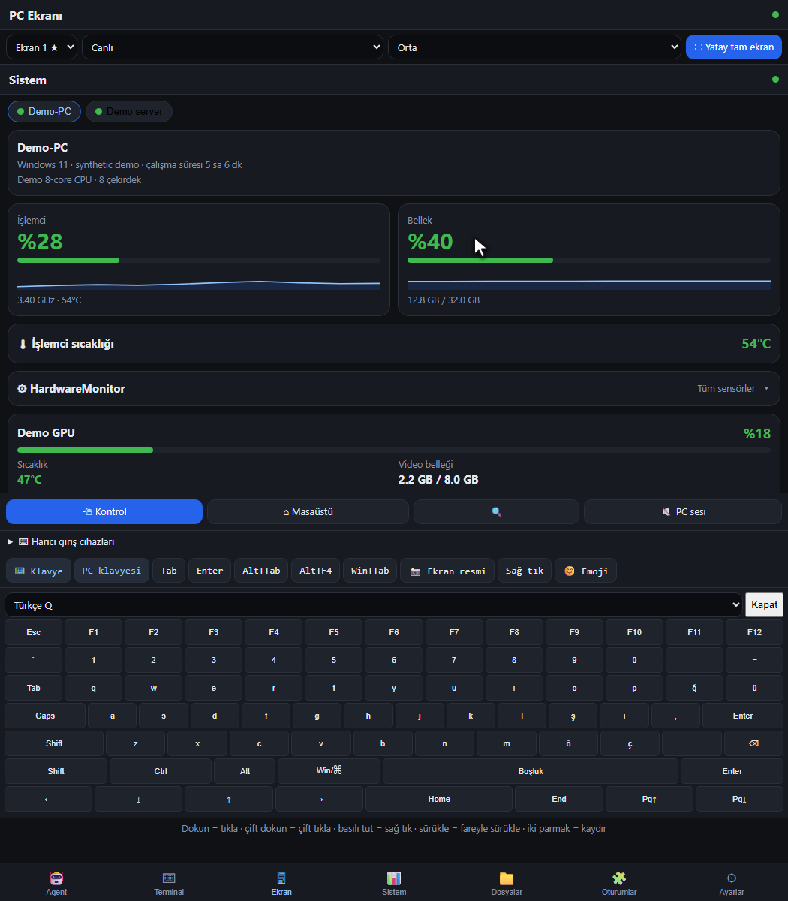
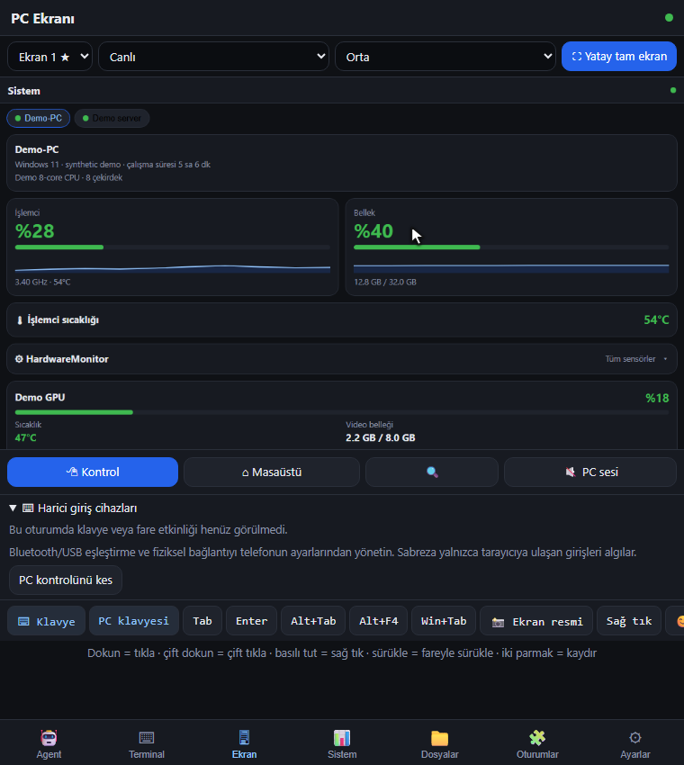
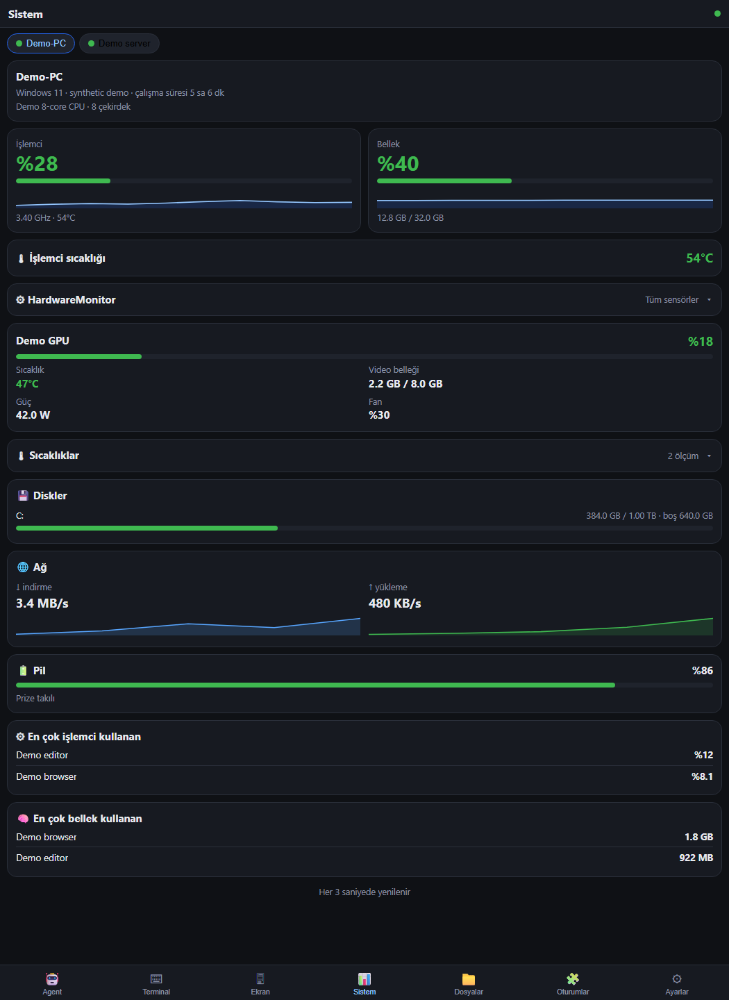
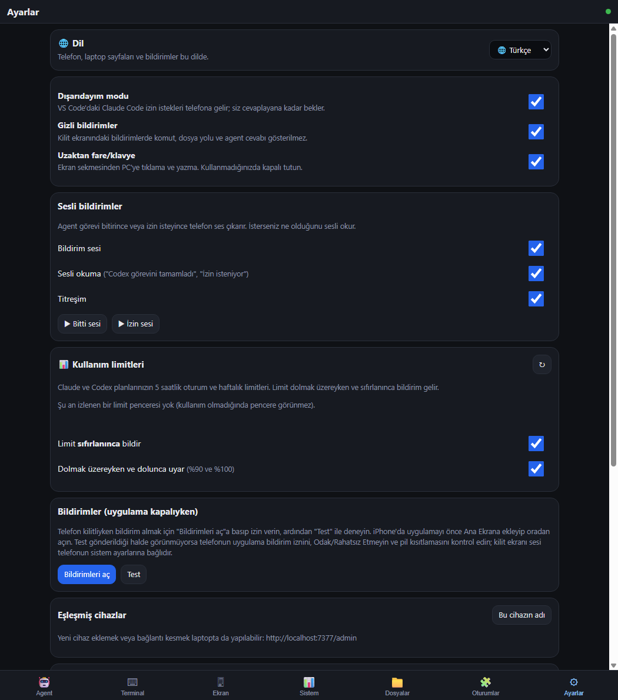
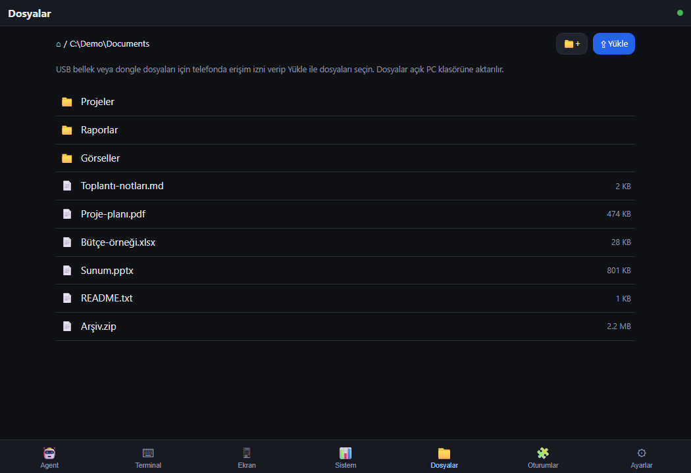

[English](README.md) · [Deutsch](README.de.md) · [Türkçe](README.tr.md)

## Güçlü çalışma alanınız her yerde yanınızda

Evdeki güçlü PC'niz, projeleriniz ve sunucularınız çalışmaya devam ederken siz telefonunuz veya tabletinizle bağlantıda kalın. Kafede bir kahve molasında sistem durumuna bakın, deniz kenarında tamamlanan görevin sonucunu okuyun, seyahatte gerekli dosyayı alın ve projenize kaldığınız yerden devam edin. Projeyi başka bir cihaza taşımadan, geliştirme ortamını yeniden kurmadan ve tüm ekipmanı yanınızda götürmeden, hazır çalışma alanınıza uzaktan ulaşın.

**Sabreza View International**, yetkili uzaktan erişim için ekran kontrolünü, terminali, dosyaları, sistem ölçümlerini ve bildirimleri bir araya getirir. Harici klavye ve fareyle tabletinizi daha rahat bir çalışma noktasına dönüştürebilirsiniz. PC'nin açık, uyanık ve erişilebilir olması; iki tarafta uygun internet bağlantısı ve gerekli izinlerin bulunması gerekir.

**Dağıtım biçimine dikkat:** Bu repodaki mevcut masaüstü indirmeleri operatör yönetimli kurulumlardır; ayrı onaydan sonra belirtilen operatöre erişim verir. Aşağıdaki kişisel çalışma deneyimi, kendi yetkili cihazlarınız için ayrıca yapılandırılan kişisel/manual kullanımı anlatır. İndirmeden önce [kurulum ve onay](#kurulum-ve-onay) bölümünü okuyun.

[Ekran görüntüleriyle kullanım rehberi](#ozellik-rehberi) · [İndirmeler](#indir) · [Kişisel kullanım kurulumu](MANUAL-MODE.tr.md)

## 36 saniyede Sabreza View

**[Tanıtım filmini tarayıcıda izle · 1080p · 36 saniye](https://beyzakararti.github.io/sabreza-view-international/watch/)**

Evde son görevlerini bırak, dışarıdayken projenin durumunu gör ve gerektiğinde yetkili çalışma alanına bağlan. Film; yapay zekâyla oluşturulmuş kurmaca yaşam sahnelerini, örnek verilerle gerçek uygulama arayüzünü birleştirir. Kişisel kullanım senaryosudur; indirmelerin erişim ve onay koşullarını aşağıdan inceleyin. Film dili İngilizcedir. [Altyazılar ve web sitesinde kullanım](docs/media/README.md).

## Aralıkta geliyor: v0.3.14

v0.3.14'ün tam sürümü (Windows, macOS, Linux ve Android) **Aralık 2026** için planlanıyor. [Yalnızca Windows ön sürümü](https://github.com/beyzakararti/sabreza-view-international/releases/tag/v0.3.14) şimdiden indirilebilir; tam sürüm çıkana kadar son kararlı sürüm v0.3.13'tür.

- **Cihazları bul:** Yerel `/admin` sayfası eşleşmiş telefon/tabletin son izinli konumunu zaman ve doğruluk yarıçapıyla gösterir ve cihazı çaldırabilir. Telefonda/tablette Ayarlar → Cihazları bul'dan konum paylaşımı açılır ve PC'nin son paylaşılan konumu görülür.
- **PC çevrimdışıyken:** Telefon PC'nin son konumunun yerel kopyasını tutar; PC kapalıyken zaman, doğruluk ve harita bağlantısıyla gösterir. Canlı takip değildir; paylaşım kapatılınca sunucudaki kayıt silinir, çevrimdışı telefondaki kopya yeniden bağlantı kurulduğunda temizlenir.

Konum için tarayıcı ve sistem izni gerekir; yalnızca sayfa çalışırken güncellenir.

## v0.3.13 yenilikleri

- Ekran ve filo kontrolüne hızlı **Tab** ve **Enter** tuşları eklendi. Yatay tam ekranda soldaki tuşlar sağdaki araç çubuğundan ince bir şeride daraltılabilir.
- PC tarzı sanal klavye Türkçe Q, İngilizce QWERTY ve Almanca QWERTZ düzenlerini; işlev ve gezinme tuşlarını içerir.
- Telefona Bluetooth veya USB ile önceden eşleştirilmiş klavye ve fare PC kontrolünde kullanılabilir. Panel yalnızca tarayıcının gördüğü girişleri gösterir ve PC kontrolünü kapatabilir. Fiziksel eşleştirme ve bağlantıyı kesme telefon ayarlarındadır; panel tam cihaz listesi değildir.
- Telefonun dosya seçicisinde USB bellek görünüyorsa **Dosyalar → Yükle** ile seçilen dosyalar açık PC klasörüne aktarılabilir.

[v0.3.13 sürüm ayrıntıları](docs/release-v0.3.13.md) · [v0.3.12 sözleşme güncellemesi](docs/release-v0.3.12.md). Açık onay, reddetme ve bağlantıyı kesme seçenekleri korunur.

## İndirmeden önce okuyun

**v0.3.13 masaüstü kurulumları, yalnızca açık uzaktan erişim onayınızdan sonra “beyzakararti — Kararti is Watching” operatörünün merkezine bağlanır.** Bu davranış eski kişisel kullanım sürümlerinden farklıdır. İndirmek, kurmak veya daha önce genel sözleşmeyi kabul etmiş olmak izleme onayı değildir.

Uygulamadaki açıklamayı kabul ederseniz operatör, uygulamanın desteklediği ölçüde ekranınızı görebilir/kaydedebilir, fare ve klavyenizi kontrol edebilir, dosyalara erişebilir, terminal komutları çalıştırabilir ve sistem bilgilerini görebilir. Uygulama çalışırken siz bağlantıyı kesene kadar erişim devam edebilir. Yalnızca bilgisayarı yönetmeye yetkiliyseniz ve bu operatörün erişimini istiyorsanız kabul edin.

**Reddederseniz operatöre kayıt yapılmaz. Onay sayfasındaki “Bağlantıyı kes” ile istediğiniz zaman vazgeçebilirsiniz.** İzleme durumu sistem tepsisi simgesinin açıklamasında gösterilir. Bağlantıyı kesince merkez ulaşılamıyor olsa bile operatörün erişim anahtarı bilgisayarınızda iptal edilir.

## İndir

| Platform | Download |
|---|---|
| Windows 10/11 (x64) | [Sabreza-View-Windows-x64-Setup.exe](https://github.com/beyzakararti/sabreza-view-international/releases/latest/download/Sabreza-View-Windows-x64-Setup.exe) |
| macOS Apple Silicon | [Sabreza-View-macOS-AppleSilicon.dmg](https://github.com/beyzakararti/sabreza-view-international/releases/latest/download/Sabreza-View-macOS-AppleSilicon.dmg) |
| macOS Intel | [Sabreza-View-macOS-Intel.dmg](https://github.com/beyzakararti/sabreza-view-international/releases/latest/download/Sabreza-View-macOS-Intel.dmg) |
| Linux Debian/Ubuntu | [Sabreza-View-Linux-amd64.deb](https://github.com/beyzakararti/sabreza-view-international/releases/latest/download/Sabreza-View-Linux-amd64.deb) |
| Linux RPM | [Sabreza-View-Linux-x86_64.rpm](https://github.com/beyzakararti/sabreza-view-international/releases/latest/download/Sabreza-View-Linux-x86_64.rpm) |
| Android (ARM64) | [Sabreza-View-Android.apk](https://github.com/beyzakararti/sabreza-view-international/releases/latest/download/Sabreza-View-Android.apk) |

**Android:** telefon istemcisi International adı ve uygulama kimliğiyle v0.3.13 olarak yeniden derlendi.

[Sürüm geçmişi](https://github.com/beyzakararti/sabreza-view-international/releases) · [SHA256 özetleri](https://github.com/beyzakararti/sabreza-view-international/releases/latest/download/SHA256SUMS.txt)

**Sabreza View International**, kullanıcılar için dağıtılan sürümdür. Kişisel kurulumun onayını veya eşleşmesini devralmaz. Windows ana masaüstü hedeftir. macOS deneyseldir; macOS'un Ekran Kaydı / Erişilebilirlik izinleri ayrıca gerekir. **Linux'ta ekran paylaşımı yoktur. Android telefon istemcisidir; telefon izleme kurucusu değildir.**

## Kurulum ve onay

1. Uygun paketi indirip SHA-256 özetini [SHA256SUMS.txt](https://github.com/beyzakararti/sabreza-view-international/releases/latest/download/SHA256SUMS.txt) ile karşılaştırın.
2. Kurup uygulamayı açın. Operatör adını, uzaktan erişim kapsamını ve bağlantıyı kesme açıklamasını okuyun.
3. İstiyorsanız **Kabul et**, istemiyorsanız **Reddet** seçin. Bu kayıt için katılım anahtarı, eşleştirme PIN'i, Tailscale girişi veya Cloudflare hesabı istenmez.
4. Onaydan ve başarılı bağlantıdan sonra bilgisayar operatörün merkezinde görünür. İki bilgisayar internete bağlı, merkez çalışır durumda olmalıdır. Kayıt başarısızsa hata gösterilir; bağlantı düzeldikten sonra yeniden deneyin.
5. Durdurmak için kurulu bilgisayarda onay sayfasını (`http://127.0.0.1:7377/consent`) açıp **Bağlantıyı kes** seçin. Yalnızca pencereyi kapatmak onayı geri çekmek değildir.

## Kurulum sözleşmesi güncellemesi — henüz yayımlanmadı

Sonraki Windows kurucusu, genel kullanım koşullarını kurulum sihirbazının içinde küçük, okunabilir ve kaydırılabilir bir metin olarak gösterecek şekilde yapılandırıldı. Metin programın kullanımı, kullanıcı sorumlulukları ve hizmet sınırlarıyla başlar. Kararti is Watching üzerinden yönetilen erişim, erişimin kapsamı ve onayı geri çekme yöntemi sonraki bir bölümde açıklanır.

Kurulum koşullarını kabul etmek bilgisayarı merkeze kaydetmez ve uzaktan erişim izni vermez. Yönetilen kurulumlarda ilk açılıştaki ayrı ve açık onay, **Reddet** ve **Bağlantıyı kes** seçenekleri korunur. Onay kutusu başlangıçta seçili değildir. Kişisel sürüm ayrı kalır.

Bu bir kaynak güncellemesidir; bu değişiklik için yeni kurucu derlenmedi veya yayımlanmadı. Yukarıdaki indirmeler mevcut sürüm davranışını korur. Yayımdan önce gerçek Windows kurulum akışı ve ilk açılış onayı doğrulanmalıdır. Eski v0.3.12 onay ekranları yeni sihirbazı göstermediğinden güncel anlatımdan çıkarıldı. Bkz. [yayın devri](docs/release-handoff.md).

## Bağlantı ve gizlilik

Bağlantı aracı pakete dahildir ve derlemede özeti doğrulanır. Masaüstü bağlantısı dışarı doğru açılan Cloudflare Tunnel üzerinden, merkez kaydı Tailscale Funnel geçidi üzerinden ilerler. Bu hizmetler bağlantı trafiğini taşır. Merkezin yönetim ekranı kayıt geçidi üzerinden yayımlanmaz.

Ortak merkez katılım anahtarı kurulum paketinde dağıtılmaz. Cihaz kendi güvenlik anahtarlarını otomatik üretir. Teknik anahtarlar açık kullanıcı onayının yerine geçmez. Cihaz anahtarlarını, hesap şifrelerini ve kişisel yapılandırma dosyalarını paylaşmayın.

Eski kurulumlar sessizce merkeze eklenmez veya taşınmaz. Merkezin ya da adresinin değişmesi istemci yapılandırmasının güncellenmesini gerektirebilir. Uygulamadaki onay işletim sistemi izinlerinin yerine geçmez.

## Bağlantı nasıl çalışır?

Onaydan önce operatöre kayıt yok. Bağlantıyı istediğin an kesebilirsin.

## Kullanılan teknolojiler

| Katman | Teknoloji |
|---|---|
| Sunucu / Web arayüzü | JavaScript · Node.js · HTML · CSS |
| Masaüstü | Rust · Tauri |
| Android (ARM64) | Kotlin |
| Windows entegrasyonu | PowerShell |
| Bağlantı | Cloudflare Tunnel · Tailscale Funnel · HTTPS |

## Diğer kullanım biçimleri

Önceki kişisel kullanım rehberi [MANUAL-MODE.tr.md](MANUAL-MODE.tr.md) dosyasında korunur. Oradaki yalnızca Tailscale ağı, elle eşleştirme ve PIN talimatları ayrı kullanım biçimini anlatır; yukarıdaki operatör yönetimli indirmeler için geçerli güvence değildir.

## Ekran görüntüleriyle kullanım rehberi

Bu bölüm, kişisel/manual olarak yapılandırılmış ve erişmeye yetkili olduğunuz bir çalışma alanını anlatır. Mevcut operatör yönetimli indirmelerle aynı kurulum akışı değildir. Görseller güncel kaynak kodun **gerçek HTML/CSS/JavaScript arayüzünden**, yalıtılmış bir tarayıcıda alınmıştır. Donanım değerleri, dosyalar ve cihazlar örnektir; uzaktan ekran alanı da canlı bir PC yayını yerine örnek bir uygulama görüntüsü kullanır. Mobil/tablet boyutları tarayıcıda benzetilmiştir. [Görsellerin kaynağı ve kapsamı](docs/screenshots/README.md).

### PC yönetimi: projenize kaldığınız yerden devam edin

Bir ayarı değiştirmek, açık bir uygulamayı kullanmak veya çalışma sonucunu görmek için fiziksel olarak PC'nin başında olmanız gerekmez. Ekran sekmesi, desteklenen sistemlerde masaüstünüzü gösterir; uzaktan kontrol açıkken dokunma, fare ve klavye girişlerini PC'ye iletir. Yatay görünüm, tam ekran, yakınlaştırma ve hızlı tuşlar küçük ekranda çalışmayı kolaylaştırır. Tab, Enter, Ctrl kombinasyonları ve sanal PC klavyesi sayesinde masaüstündeki formlar ve uygulamalar arasında ilerleyebilirsiniz.

Terminal ve proje oturumları aynı bilgisayarda kalır. Evden çıkmadan hazırladığınız ortamda komutları çalıştırabilir, çıktıları okuyabilir ve uzun süren işlerin durumunu takip edebilirsiniz. Örneğin kafede bir test sonucunu inceleyip düzeltmeye devam ederken asıl işlem gücü evdeki PC'nizde çalışır. Kullanmadığınızda uzaktan fare/klavye kontrolünü kapatabilirsiniz.

*Gerçek kontrol arayüzü; ekran içeriği güvenli tanıtım verisidir. Windows ana hedeftir; macOS gerekli ekran kaydı ve erişilebilirlik izinlerine bağlı ve deneyseldir. Linux'ta ekran paylaşımı desteklenmez.*

### Tablet, harici klavye ve fareyle daha rahat çalışın

Tabletinize Bluetooth klavye/fare bağlayın veya uyumlu bir USB-C hub/dongle kullanın; ardından uzaktan kontrolü açın. Tarayıcının aldığı desteklenen tuş, tıklama ve kaydırma girişleri PC'ye iletilir. Böylece uzun metin yazarken, terminalde çalışırken veya masaüstü arayüzlerinde dolaşırken yalnızca dokunmatik klavyeye bağlı kalmazsınız. Hafif bir tablet ve birkaç aksesuarla kendi masaüstü ortamınıza erişebilirsiniz.

Fiziksel cihazları telefon/tabletin işletim sistemi üzerinden eşleştirirsiniz. Uygulamadaki giriş paneli tarayıcının gördüğü klavye/fare etkinliğini gösterir ve PC kontrolünü durdurabilir; tüm Bluetooth/USB cihazlarını tarayan bir donanım yöneticisi değildir. Bazı tuşlar işletim sistemi veya tarayıcı tarafından ayrılabilir.

### PC ve sunucu sağlığını tek yerden izleyin

Bir derleme neden yavaşladı? Bellek doluyor mu? Diskte yer kalmış mı? Sistem sekmesinde CPU kullanımı, kullanılan/toplam RAM, diskler, ağ trafiği, çalışma süresi ve en çok kaynak tüketen işlemler gibi verileri inceleyebilirsiniz. Grafikler değişimi görmeyi kolaylaştırır; desteklenen donanımda ekran kartı bilgileri ve sıcaklık ölçümleri de görünür. Uzakta olsanız da yoğun bir işin PC üzerindeki etkisini değerlendirebilirsiniz.

Eklediğiniz sunucuların sağlık verileri de aynı bölümde ayrı seçimlerle gösterilebilir. Sunucuda izleme ajanının kurulması, adresin ulaşılabilir olması ve erişimin yapılandırılması gerekir. **Sağlık izleme ajanı yalnızca ölçüm sunar:** bu bağlantı tek başına sunucu masaüstü, terminal veya dosyalarına tam erişim vermez. Bunlar için ilgili uzaktan erişim hizmetinin ayrıca kurulup yetkilendirilmesi gerekir.

*Ekrandaki değerler tanıtım içindir, gerçek performans ölçümü değildir. Sıcaklık, GPU, fan ve diğer sensörler donanım/işletim sistemi desteğine bağlıdır. Windows işlemci sıcaklığı için LibreHardwareMonitor/OpenHardwareMonitor yerel web sunucusu yapılandırılmalıdır; ayrı NVIDIA GPU ölçümleri `nvidia-smi` kullanır. Linux sunucularında mevcut sistem sensörleri kullanılır. Bu uygulamanın macOS örnekleyicisinde sıcaklık ölçümü yoktur. Sensör bulunmayan cihaz için ölçüm uydurulmaz.*

### Sesli bildirimler: ekrana bakmadan işinizden haberdar olun

Uzun bir görev sürerken ekranı sürekli kontrol etmek zorunda kalmayın. Görev bittiğinde veya desteklenen bir işlem izin istediğinde bildirimleri takip edin; sonucu okuyup gerektiğinde telefonunuzdan yanıt verin. Ayarlar bölümünde **bildirim sesi, sesli okuma ve titreşimi ayrı ayrı** yönetebilir, bitiş ve izin seslerini test edebilirsiniz. Kafede uygulama içi sesi kapatabilir; uygun bir ortamda sesli okumayı seçebilirsiniz. Bu düğme arka plan push sesini kapatmaz; onu telefonun sistem bildirim ayarlarından yönetin. Harici geliştirme oturumlarının bitiş ve izin bildirimleri ilgili entegrasyonların kurulmasını gerektirir; her programın işi otomatik izlenmez.

Gizli bildirimler seçeneği, kilit ekranında komut, dosya yolu ve yanıt ayrıntılarını gizlemeye yardımcı olur. Uygulama kapalıyken bildirim almak için push iznini ayrıca açıp test edin. Kilit ekranında ses ve teslimat; telefonun bildirim izinlerine, sessiz/odak moduna, pil kısıtlamalarına ve bağlantıya bağlıdır. iPhone web uygulamasında önce Ana Ekrana ekleyip oradan açmak gerekir. Uygulama içi sesli okuma, arka plandaki her bildirimin sesli okunacağı anlamına gelmez.

### Dosyalarınız iki yönde de ulaşılabilir olsun

Evdeki PC'de kalan bir belgeyi telefonunuza indirin; tabletinizde hazırladığınız bir dosyayı açık PC klasörüne yükleyin. Dosyalar sekmesinde izin verilen klasörler arasında gezebilir, dosyaları inceleyebilir ve desteklenen işlemleri yapabilirsiniz. Böylece proje çıktısı almak veya bir belgeyi çalışma ortamınıza eklemek için fiziksel olarak PC'ye dönmeniz gerekmez.

**USB bellek/dongle ile örnek akış:** Belleği telefonunuza veya tabletinize uygun OTG adaptörü ya da hub ile takın. İşletim sisteminin dosya seçicisi belleği gösteriyorsa **Dosyalar → Yükle** üzerinden dosyayı seçerek PC'deki açık, izinli klasöre gönderin. Ters yönde PC'deki dosyayı indirin; telefonun dosya uygulaması destekliyorsa USB belleğe kaydedin veya taşıyın. PC'ye bağlı bir diskin içeriğine erişmek de o yolun uygulamada izinli ve erişilebilir olmasına bağlıdır.

*USB depolama desteği telefon/tablet, adaptör, dosya sistemi ve işletim sistemine bağlıdır. Bu özellik ham USB yönlendirmesi veya her USB cihazına uzaktan erişim değildir; aktarım uygulamanın izinli dosya yolları üzerinden yapılır.*

### Cihazları bul: son konumu zamanı ve doğruluğuyla görün

v0.3.14 Windows ön sürümündeki **Cihazları bul** özelliği, ayrı izinle eşleşmiş telefon/tabletin son paylaşılan konumunu PC'de; PC'nin son paylaşılan konumunu ise telefonda gösterebilir. Ölçüm zamanı ve doğruluk yarıçapı birlikte sunulur. PC çevrimdışıyken telefonda kalan son konum kopyası önceki ölçümdür; canlı takip değildir. Konum güncellemesi paylaşım açıkken ve ilgili sayfa çalışırken yapılır.

Konum her zaman kesin değildir; özellikle masaüstü bilgisayarda yaklaşık olabilir. Sunucu sağlık ajanı coğrafi konum bildirmez. Bu özellik eşleşmiş cihaz sahibine yöneliktir; operatör yönetimli oturumlara tüm bağlı cihazları konumdan izleme yetkisi sağlamaz. Böylece sistem sağlığı ölçümleri ile isteğe bağlı konum paylaşımını birbirinden ayırabilirsiniz.

### Tehdit istihbaratıyla desteklenen koruma katmanları

Uzaktan erişimin güçlü olması kadar kimin erişebildiğini denetlemek de önemlidir. Sabreza View; bağlantı türüne göre kimlik ve cihaz kontrolleri, oturum/PIN koruması, istek sınırları, Origin kontrolleri, izinli dosya yolları ve güvenlik kayıtları gibi katmanları birlikte kullanır. Yerel yönetim ekranından erişimleri gözden geçirebilir, cihazları çıkarabilir ve gerektiğinde acil durdurmayı kullanabilirsiniz. Kişisel Tailscale kurulumunun ağ kapsamı ile operatör yönetimli Cloudflare dağıtımının bağlantı modeli farklıdır.

Tehdit istihbaratı etkin olduğunda **USOM, Spamhaus DROP ve abuse.ch Feodo Tracker** kaynaklarından gelen bilinen zararlı adresler kullanılır. Listeler düzenli güncellenir; uygulamaya gelen bağlantılar denetlenir ve kurallara uyan zararlı adresler engellenir. Desteklenen sistemlerde açık TCP bağlantıları, Windows'ta ayrıca DNS önbelleği karşılaştırılarak şüpheli eşleşmeler için alarm üretilebilir. Bu görünürlük, uzak olduğunuzda da bir sorunu daha erken fark etmenize yardımcı olur.

Bu katmanlar yetkisiz erişim riskini azaltır; tüm kötü niyetli trafiği kesin olarak dışarıda tutma garantisi vermez. Giden bağlantı taraması tespit ve uyarı işlevindedir; süreçleri otomatik sonlandırmaz ve PC'nin bütün trafiğini filtreleyen bir antivirüs yerine geçmez. Güncellemeler, güçlü hesap güvenliği, doğru izinler ve yedekler kullanımın parçası olmalıdır.

### Güne nasıl uyarlanır?

| Bulunduğunuz yer | Telefon veya tabletle yapabilecekleriniz |
|---|---|
| Kafede kısa mola | Görev sonucunu okuyun, gereken izni değerlendirin ve PC'nin yükünü kontrol edin. |
| Seyahatte hafif çalışma | Tablet, klavye ve fareyle hazır projenize bağlanıp terminal veya masaüstü üzerinden devam edin. |
| Deniz kenarında dinlenirken | Bağlantı ve bildirim izinleri uygunsa işin bitişini öğrenin, gerektiğinde dosyayı alın. |
| Ev laboratuvarından uzaktayken | Yapılandırılmış sunucuların bellek, disk, ağ ve desteklenen sıcaklık verilerini inceleyin. |

Başlangıç için [kişisel/manual rehberi](MANUAL-MODE.tr.md) izleyin. Önce kendi ağınızda bağlantı, kontrol, dosya ve bildirim işlevlerini deneyin; sonra uzaktan kullanacağınız düzeni hazırlayın. Telefonunuz taşınabilir arayüz, evdeki bilgisayarınız ise asıl çalışma ortamınız olarak kalır.

## Kaynak koda erişim

Geliştirilen programın kaynak kodlarına erişmek isterseniz aşağıdaki iletişim bilgileri üzerinden benimle iletişime geçebilirsiniz.

- Telefon: [+49 15253371943](tel:+4915253371943)
- E-posta: [beyza.kararti@outlook.com](mailto:beyza.kararti@outlook.com)

This project is licensed under CC BY-NC-ND 4.0. See [LICENSE](LICENSE).
