<p align="center"></p>

<p align="center">
  <a href="README.md">🇬🇧 English</a> · <a href="README.de.md">🇩🇪 Deutsch</a> · <b>🇹🇷 Türkçe</b>
</p>

---

Açık bıraktığınız bir **PC'ye veya sunucuya** telefondan ya da tabletten, farklı internetlerde bile bağlanıp kontrol edersiniz: terminal, agentlar, ekran, dosyalar ve canlı sistem durumu. Telefon **bir kez eşleştirilir**, sonra şifre sormadan bağlanır. Bağlantıyı makineden istediğiniz an kesersiniz.

Uygulama **Türkçe, İngilizce ve Almanca** kullanılabilir. Dili istediğiniz an değiştirebilirsiniz (bkz. [Dil](#dil)).

🔒 **Güvenlik temel tasarımdır.** PC internete açılmaz (Tailscale ile yalnızca sizin cihazlarınız bağlanır). Her cihaz PC'den eşleştirilir, PIN kilidi ve saldırı engelleme çalışır, her işlem kayda geçer. Ayrıntılar aşağıdaki [Güvenlik katmanları](#guvenlik) bölümünde.

## Kaynak koda erişim

Geliştirilen programın kaynak kodlarına erişmek isterseniz aşağıdaki iletişim bilgileri üzerinden benimle iletişime geçebilirsiniz.

- Telefon: [+49 15253371943](tel:+4915253371943)
- E-posta: [beyza.kararti@outlook.com](mailto:beyza.kararti@outlook.com)

## İçindekiler

- [İndir](#indir)
- [Neler yapar](#neler-yapar)
- [Nasıl çalışır?](#nasil-calisir)
- [Nerelerde işe yarar](#kullanim-alanlari)
- [Kurulum](#kurulum)
- [Telefonu eşleştirme](#eslestirme)
- [Dil](#dil)
- [Güvenlik katmanları](#guvenlik)
- [Neyi korur, neyi korumaz](#guvenlik-sinirlari)
- [macOS ve Linux](#macos-linux)
- [Kilit ekranı ve sunucu izleme](#kilit-sunucu)
- [Bilinmesi gerekenler](#bilinmesi-gerekenler)

<a id="indir"></a>

## ⬇️ İndir

| Cihaz | Dosya | Not |
|---|---|---|
| 🪟 **Windows 10/11** (PC) | [**Sabreza-View-Windows-x64-Setup.exe**](https://github.com/beyzakararti/sabreza-view-international/releases/latest/download/Sabreza-View-Windows-x64-Setup.exe) | Önerilen, günlük kullanımda |
| 🤖 **Android** (telefon) | [**Sabreza-View-Android.apk**](https://github.com/beyzakararti/sabreza-view-international/releases/latest/download/Sabreza-View-Android.apk) | Günlük kullanımda |
| 🍏 **iPhone / iPad** | *Dosya gerekmez* | Safari'den ana ekrana eklenen web uygulaması kullanılır ([nasıl](#iphone)) |
| 🍎 **macOS** Apple Silicon (PC) | [Sabreza-View-macOS-AppleSilicon.dmg](https://github.com/beyzakararti/sabreza-view-international/releases/latest/download/Sabreza-View-macOS-AppleSilicon.dmg) | Deneysel ([ayrıntılar](#macos-linux)) |
| 🍎 **macOS** Intel (PC) | [Sabreza-View-macOS-Intel.dmg](https://github.com/beyzakararti/sabreza-view-international/releases/latest/download/Sabreza-View-macOS-Intel.dmg) | Deneysel |
| 🐧 **Linux** (PC) | [.deb](https://github.com/beyzakararti/sabreza-view-international/releases/latest/download/Sabreza-View-Linux-amd64.deb) · [.rpm](https://github.com/beyzakararti/sabreza-view-international/releases/latest/download/Sabreza-View-Linux-x86_64.rpm) | Yalnızca terminal ve agentlar, ekran paylaşımı yok |

Tüm sürümler, sürüm notları ve özetler: **[Releases](https://github.com/beyzakararti/sabreza-view-international/releases)**. Kurmadan önce [dosyaları doğrulayabilirsiniz](#dogrula).

<a id="neler-yapar"></a>

## Neler yapar

| Sekme | Ne yapar |
|---|---|
| 🤖 **Agent** | PC'de **Claude Code** veya **Codex** agent'ı başlatır ya da sürdürür. Kendi ayarlarınız, MCP sunucularınız, CLAUDE.md / AGENTS.md dosyalarınız yüklenir. Telefondan **görsel/PDF/belge** yükleyebilir, **PC'deki dosyaları** ekleyebilirsiniz. |
| 🔐 **İzinler** | Agent bir komut çalıştırmak, dosya değiştirmek ya da size soru sormak istediğinde telefona kart düşer: *İzin ver / Hep izin ver / Reddet (+not)*. Telefon **sesli uyarır** (izin için ısrarcı bip, görev bitince yaklaşık 3 saniyelik melodi, isteğe bağlı sesli okuma ve titreşim). Uygulama kapalıyken de sesli push bildirimi gelir. |
| ⌨ **Terminal** | PC'de gerçek terminaller. **AI ▾** menüsü kurulu olan tüm terminal AI'larını (Claude Code, Codex, Gemini CLI, Copilot, Aider, …) seçtiğiniz klasörde başlatır. |
| 🖥 **Ekran** | PC ekranının canlı görüntüsü. **🖱 Kontrol** açıkken dokunduğunuz yer fareyle tıklanır: dokun = tıkla, çift dokun = çift tıkla, basılı tut = sağ tık, sürükle = fareyle sürükle, iki parmakla kaydır = tekerlek, **iki parmağı açıp kapa = yakınlaştır** (6 kata kadar). **⌨ Klavye** telefon klavyesini açar; yazdığınız her harf (Türkçe karakterler dahil) anında PC'ye gider. Ctrl/Alt/Shift kombinasyonları ve kısayol tuşları hazır. **Yatay tam ekran** telefonu yan çevirir, tarayıcı çubuklarını gizler ve PC ekranı tüm telefonu doldurur; ekran uyumaz. **Harici klavye ve fare** (Bluetooth veya USB) doğrudan çalışır. **🔇 PC sesi** PC'nin sesini telefonda çalar (Windows). |
| 📊 **Sistem** | PC'nin **canlı sağlık penceresi**: işlemci ve bellek (son birkaç dakikanın grafiğiyle), ekran kartı (kullanım, sıcaklık, video belleği, güç), sıcaklıklar, diskler, ağ hızı, pil, en çok işlemci/bellek kullanan programlar. PC'de eklediğiniz sunucular üstte sekme olarak görünür. |
| 📁 **Dosyalar** | PC'deki dosyalara göz atma, önizleme, indirme, telefondan PC'ye yükleme, dosyayı agent'a ekleme. |
| 🧩 **Oturumlar** | VS Code'daki Claude Code oturumlarının canlı durumu ve PC'deki **tüm Claude Code + Codex geçmişi** (masaüstü uygulaması, VS Code, CLI). Herhangi bir oturumu telefondan devam ettirebilir ya da PC'de açabilirsiniz. |
| ⚙ **Ayarlar** | Dil, dışarıdayım modu, uzaktan kontrol, sesli bildirimler, **kullanım limitleri** (Claude ve Codex 5 saatlik oturum ve haftalık limitler, yüzde çubuğu ve sıfırlanma saati), push bildirimleri, eşleşmiş cihazlar, güvenlik kaydı, acil durdurma. |

**Her AI telefonunuzu kullanabilir (MCP).** Uygulama, PC'deki AI araçlarına (Claude Code, Codex, Gemini CLI, Qwen, Cursor, Windsurf) küçük bir MCP sunucusu ekleyebilir. Böylece herhangi bir agent `phone_notify` ile telefona bildirim gönderir ("görev bitti"), `phone_ask` ile size soru sorup cevabı bekler, `phone_approve` ile riskli bir işlemden önce onay ister. Bkz. [kurulumun 5. adımı](#ai-baglanti).

<a id="nasil-calisir"></a>

## Nasıl çalışır?

Aşağıdaki küçük simülasyon (30 saniyelik döngü) sistemin çalışmasını ve güvenlik katmanlarını gösterir: telefondan giden istek dört kapıdan geçer, saldırgan PC'yi göremez, yabancı hesap ve tarama araçları kapıda döner, çalınan telefon PIN'siz girişte silinir, agent izin isterken telefon sesli uyarır, iş bitince melodiyle haber verir.



<a id="kullanim-alanlari"></a>

## Nerelerde işe yarar

| Durum | Nasıl yardımcı olur |
|---|---|
| **Uzun süren bir AI görevi var** (büyük refactor, test düzeltme, proje kurulumu) | Görevi verip dışarı çıkarsınız. Bitince telefon melodiyle haber verir, sonucu telefondan okur ve yeni komut verirsiniz. |
| **Kullanım limitiniz doldu ya da dolmak üzere** (Claude/Codex 5 saatlik oturum, haftalık) | Ayarlar sekmesinde yüzde ve sıfırlanma saati görünür. Limit %90'a ve %100'e gelince uyarı, **sıfırlandığı anda** da "✅ limit sıfırlandı" bildirimi ve melodi gelir. |
| **Agent bir komut çalıştırmak ister** | Onay kartı telefona düşer ve ısrarcı bir bip çalar. Komutu görüp tek dokunuşla izin verir ya da reddedersiniz. Agent siz karar verene kadar bekler. |
| **Yoldasınız, kafedesiniz, derstesiniz** | Evdeki PC'nin terminalinde komut çalıştırır, log okur, bir hatanın nedenine bakar, agent'a "şunu düzelt" dersiniz. |
| **Birden fazla AI kullanıyorsunuz** | Claude Code ve Codex'i sohbet ekranından, kurulu diğer terminal AI'larını (Gemini CLI, Aider vb.) ortak terminalden başlatırsınız. MCP köprüsü sayesinde hepsi telefona bildirim, soru ve onay isteği gönderebilir. |
| **PC'de bir şey takıldı** (donmuş pencere, bekleyen bir onay kutusu) | Ekran sekmesinde PC'yi canlı görür, yan çevirip tam ekran yapar, dokunarak tıklar ya da klavyeyle yazarsınız. |
| **Bir dosya lazım ya da PC'ye atmanız gerekiyor** | Dosyalar sekmesinden belgeyi indirir, telefondaki fotoğrafı, PDF'i PC'ye yükler ya da doğrudan agent'a eklersiniz. |

<a id="kurulum"></a>

## Kurulum

**Her kişi kendi PC'sine, kendi Tailscale hesabıyla bağlanır.** Başkasının hesabına ihtiyacınız yoktur, kimsenin de sizinkine ihtiyacı yoktur: Tailscale hesabı, cihazlarınızın bulunduğu kapalı ağın anahtarıdır.

### 1. Tailscale (PC ve telefon)

1. PC'ye **ve** telefona [Tailscale](https://tailscale.com/download) kurun, ikisinde de **aynı hesapla** giriş yapın (Google, Microsoft, Apple ya da GitHub, hangisini isterseniz).
2. Tailscale yönetim sayfasında **DNS → HTTPS Certificates** özelliğini açın (MagicDNS açık olmalı).

> Tailscale kişisel kullanım için ücretsiz plan sunar (güncel koşullara bakın). Uygulamanın kendisi için abonelik gerekmez; yalnızca kullandığınız AI araçlarının kendi hesabı gerekir.

### 2. PC (Windows)

1. **Sabreza-View-Windows-x64-Setup.exe** dosyasını indirip çalıştırın. Windows "bilinmeyen yayıncı" uyarısı verirse **Ek bilgi → Yine de çalıştır** deyin (kurulum dosyası henüz kod imzalı değildir).
2. Uygulama ilk açılışta **kurulum sihirbazını** açar (sağ üstte dil seçimi). **Tailscale**'i seçin, kontroller yeşil olunca devam edin ve bir **PIN** belirleyin. Erişim otomatik olarak sizin Tailscale hesabınıza kilitlenir.
3. Uygulama pencereyi kapatsanız da sağ alttaki **tepsi simgesinden** çalışmaya devam eder ve Windows'la birlikte başlar. Tepsi simgesine sağ tıklayınca *aç*, *bu PC'nin paneli (telefon eşleştir)*, *oturum açılınca başlat* ve *çıkış* seçenekleri çıkar.

### 3. Telefon

- **Android:** **Sabreza-View-Android.apk** dosyasını kurun (sorulursa bu kaynaktan kuruluma izin verin). Uygulamayı açın, **QR kodu tara**'ya basıp sihirbazdaki QR'ı okutun, PIN'i girin. Uygulama kapalıyken bildirim almak için telefona **[ntfy](https://ntfy.sh/)** (UnifiedPush) kurun; Google hizmeti olmayan telefonlarda da çalışır.
- <a id="iphone"></a>**iPhone / iPad (iOS 16.4+):** Ayrı uygulama gerekmez. **Safari**'de PC'nin adresini açın (sihirbazda ve PC panelinde yazar, ör. `https://pc-adi.….ts.net`) → Paylaş → **Ana Ekrana Ekle**. Ana ekrandaki simgeden açıp sihirbazdaki 8 haneli kodu, ardından PIN'i girin, sonra Ayarlar → **Bildirimleri aç**.

### 4. Hazır

Sihirbazı kapatabilirsiniz. PC paneli (**http://localhost:7373/admin**, yalnızca PC'nin kendisinden açılır) yeni eşleştirme kodu oluşturduğunuz, PIN'i ve kilit süresini değiştirdiğiniz, cihazları görüp bağlantısını kestiğiniz ve yasakları kaldırdığınız yerdir.

<a id="ai-baglanti"></a>

### 5. Claude Code / Codex bildirimleri (isteğe bağlı)

VS Code'daki Claude Code oturumlarının telefonda canlı görünmesi (ve Codex'in biten görevleri bildirmesi), ayrıca her AI aracının MCP üzerinden telefona yazabilmesi için PC'de PowerShell'de bir kez şunu çalıştırın (varsayılan kurulum klasörü `%LOCALAPPDATA%\sabreza-view-apps`):

```powershell
$app = "$env:LOCALAPPDATA\sabreza-view-apps"
& "$app\bundle\node\node.exe" "$app\bundle\app\bin\install-hooks.js"
& "$app\bundle\node\node.exe" "$app\bundle\app\bin\install-mcp.js"
```

İkisi de değiştirdikleri ayar dosyalarını önce yedekler. Ardından açık Claude Code / Codex oturumlarını yeniden başlatın.

### Güncelleme

Yeni `…-Setup.exe` eskisinin üzerine kurulur; ayarlar, PIN ve eşleşmiş telefonlar korunur. Kurmadan önce tepsiden **Çıkış** yapın ve Claude Code / Codex / Gemini pencerelerini kapatın (açıkken uygulamanın `node.exe` dosyasını kullandıkları için kurulum onun üzerine yazamaz). Android'de yeni APK eskisinin üzerine kurulur, iPhone kendiliğinden güncellenir.

<a id="dogrula"></a>

### İndirilen dosyayı doğrulama (önerilir)

Her sürümde `SHA256SUMS.txt` bulunur. İndirdiğiniz dosyanın özetini karşılaştırın:

```powershell
Get-FileHash .\Sabreza-View-Windows-x64-Setup.exe -Algorithm SHA256
```

```bash
shasum -a 256 Sabreza-View-macOS-AppleSilicon.dmg   # macOS / Linux: sha256sum
```

Değer `SHA256SUMS.txt` dosyasındakinden farklıysa dosyayı kurmayın.

<a id="eslestirme"></a>

## Telefonu eşleştirme (bir kez)

1. PC'de **http://localhost:7373/admin** sayfasını açın (ya da tepsi menüsü → *bu PC'nin paneli*) ve eşleştirme kodu oluşturun.
2. QR'ı telefonla okutun (Android uygulamasında **QR kodu tara**). Okutamazsanız 8 haneli kodu girin.
3. Bildirimleri ayarlayın: Ayarlar → **Bildirimleri aç** → **Test**.

Artık şifre sorulmaz. **Bağlantıyı kesmek** için PC panelinde cihazın yanındaki "Bağlantıyı kes" düğmesine basın; telefonun açık bağlantısı da anında kapanır.

> MAC adresiyle sınırlama internet üzerinden mümkün değil: MAC adresi yalnızca aynı yerel ağda görünür, modemden dışarı çıkmaz. Eşleştirme aynı işi daha güvenli yapar; telefona tahmin edilemeyen 256 bitlik bir cihaz anahtarı yazılır.

<a id="dil"></a>

## 🌐 Dil

Telefon uygulaması, PC sayfaları, push bildirimleri ve tepsi menüsü **Türkçe, English (İngilizce) ve Deutsch (Almanca)** kullanılabilir.

- **Telefonda:** Ayarlar → **🌐 Dil**. Eşleştirme ve PIN ekranlarının üstünde de dil seçimi vardır.
- **PC'de:** panelin ve kurulum sihirbazının sağ üstündeki dil menüsü.
- Seçim tüm kurulum için geçerlidir: telefon, PC sayfaları, bildirimler ve tepsi menüsü birlikte değişir.
- Yeni kurulum, PC'nin işletim sistemi dilinde başlar (Türkçe veya Almanca değilse İngilizce). Önceki sürümden güncellenen kurulumlar Türkçe kalır.

<a id="guvenlik"></a>

## 🔒 Güvenlik katmanları

Uygulama PC'nizin terminaline, ekranına ve dosyalarına uzaktan erişim verdiği için güvenlik, temel tasarımdır. Tek bir korumaya güvenilmez; aşağıdaki katmanlar üst üste çalışır, birini aşan sıradakine takılır.

1. **Ağ: PC internete açılmaz.** Tailscale modunda (önerilen) uygulama internetten görünmez; yalnızca aynı Tailscale hesabına giriş yapmış cihazlar bağlanabilir ve telefonla PC arasındaki trafik uçtan uca şifrelidir (WireGuard). Tailscale'in herkese açık yayın özelliği (Funnel) kapalıdır. Sunucu yalnızca `127.0.0.1` üzerinde dinler; modemde port açılmaz, yerel ağdan da doğrudan erişilemez.
2. **Hesap kilidi.** Her istek Tailscale'in eklediği kimlik bilgisiyle gelir. İzinli listede olmayan hesap reddedilir; Tailscale ağınıza başka biri eklense ya da bir cihaz paylaşılsa bile giremez.
3. **Uygulama güvenlik duvarı.** Yalnızca bilinen adreslere yanıt verir (DNS rebinding engellenir); saldırı araçlarını (sqlmap, nikto, nmap…) ve `/.env`, `/.git`, `/wp-login` gibi deneme yollarını görür görmez **1 saat yasaklar**; bir IP'den 10 dakikada 20 şüpheli istek gelirse o IP'yi otomatik yasaklar; istek ve WebSocket mesajlarına sınır koyar; bozuk yolları engeller. Yasaklar PC panelinde görünür ve oradan kaldırılır, her yasakta telefona alarm gider. Tailscale modunda kendi cihazlarınız asla yasaklanmaz.
4. **Tehdit istihbaratı.** Uygulama her gün resmi ve herkese açık zararlı adres listelerini indirir: **T.C. Siber Güvenlik Başkanlığı (USOM)**, **Spamhaus DROP** ve **abuse.ch Feodo Tracker**. Listedeki IP'lerden gelen istekler kapıda reddedilir; PC'deki açık bağlantılar (Windows'ta DNS önbelleği de) 5 dakikada bir listelerle karşılaştırılır, PC'deki bir program listedeki bir adrese bağlanırsa programın adıyla birlikte yüksek öncelikli bir alarm gelir. Uygulama bu kaynaklara yalnızca listeleri indirmek için bağlanır; bağlantı bilgileriniz hiçbir yere gönderilmez.
5. **Cihaz kimliği.** Yeni cihaz yalnızca PC'de üretilen tek kullanımlık koddan eşleşebilir (10 dakika geçerli; IP başına 5, toplamda 20 hatadan sonra 15 dakika kilit). Telefona tahmin edilemez 256 bitlik bir anahtar yazılır; sunucuda yalnızca özeti (SHA-256) tutulur, çerez `HttpOnly`, `Secure` ve `SameSite=Strict`'tir. Anahtar oluşturulduğu işletim sistemine ve tarayıcı ailesine bağlıdır; başka yerde kullanılırsa eşleşme silinir ve alarm gider. PC paneli yalnızca PC'nin kendisinden açılır.
6. **Uygulama PIN'i.** Yalnızca PC'den belirlenir ve yalnızca scrypt özeti olarak saklanır. Eşleşmiş telefon belirlenen süre (varsayılan 10 dakika; 30 dk, 1, 4 veya 24 saat seçilebilir) işlem yapılmazsa kilitlenir; PIN girilmeden sunucu hiçbir erişim vermez. PIN tek başına işe yaramaz, eşleşmiş cihaz anahtarı da gerekir; **5 yanlış denemede o cihazın eşleşmesi otomatik silinir**. Telefonda "Şimdi kilitle" düğmesi vardır.
7. **Yetki sınırları.** Dosya erişimi ayarlanan klasörlerle sınırlıdır (`..` veya sembolik link ile dışarı çıkılamaz). `.ssh`, `AppData` (tarayıcı şifreleri ve çerezleri), Claude, Codex ve GitHub giriş token'ları ve uygulamanın kendi veri klasörü listelenmez; `.env`, özel anahtar ve parola kasası dosyaları listelenir ama açılamaz. **Uzaktan fare ve klavye varsayılan olarak kapalıdır.** "Her şeyi sor" modunda siz onaylamadan hiçbir işlem yapılmaz.
8. **İzleme ve alarmlar.** Yeni cihaz eşleşmesi, yanlış PIN, yasaklanan IP ve çalıntı çerez denemesinde diğer cihazlarınıza bildirim gider. Her giriş, komut, izin kararı ve dosya erişimi **kurcalanmaya dayanıklı bir kayda** yazılır (her satır bir öncekinin özetini içerir). **Gizli bildirimler** (varsayılan açık) kilit ekranında komut, dosya yolu ve agent cevabını göstermez. 🚨 **Acil durdur** tüm cihazları atar, terminalleri ve agentları kapatır.

<a id="guvenlik-sinirlari"></a>

## Neyi korur, neyi korumaz

**Korur:**
- İnternetten gelen saldırganlara, tarama botlarına ve aynı Wi-Fi'deki başka cihazlara karşı (PC dışarıdan görünmez).
- Telefonunuz kaybolursa ya da çalınırsa: PIN, 5 hatada cihazı silme ve PC'den tek tıkla bağlantı kesme.
- Çalınmış bir çerezin başka cihazda kullanılmasına, kayıt dosyasının sonradan değiştirilmesine ve gizli anahtarların sızmasına karşı.

**Korumaz, dikkat edilmesi gerekenler:**
- **PC'nize zararlı yazılım bulaştıysa** hiçbir uygulama koruyamaz. İşletim sistemini ve antivirüsü güncel tutun.
- **Tailscale hesabınız anahtardır.** Hesap GitHub ya da Google ile bağlıysa o hesapta iki adımlı doğrulamayı açın; Tailscale yönetim panelinde "device approval" (yeni cihaz onayı) özelliğini açın. Hesabı ele geçiren biri ağa cihaz ekleyebilir; yine de eşleştirme kodu ve PIN olmadan giremez.
- **Telefonun ekran kilidi şarttır.** Uygulama PIN'i işlem yapılmadan geçen süreden sonra devreye girer; bu sürede kilidi açık bir telefon kullanılabilir. Telefondan ayrılırken "Şimdi kilitle"ye basın.
- **Uzaktan fare/klavye ve "Hep izin ver"** güçlüdür. Kullanmadığınız zaman uzaktan kontrolü kapalı tutun, izin modunu "Her şeyi sor"da bırakın; "Hiç sorma" modu agent'a onaysız komut çalıştırma yetkisi verir.
- **Tailscale'in koordinasyon sunucusu** cihaz adlarınızı, IP'lerinizi ve ne zaman çevrimiçi olduğunuzu bilir; trafiğin içeriğini göremez.
- **Cloudflare modunda** (isteğe bağlı, daha kolay ama daha az güvenli) şifre Cloudflare'in sunucusunda çözülür. En yüksek güvenlik için Tailscale kullanın.

**Bilmesi gerekenler:** Bu uygulama telefona PC'nin terminalini, dosyalarını ve ekranını açar; sonuçlarından kurulumu yapan kişi sorumludur. Kendi PC'nizi başkasının kullanmasına açmayın: başka birinin telefonunu kendi panelinizle eşleştirmek, ona PC'nizde tam yetki vermek demektir.

<a id="macos-linux"></a>

## macOS ve Linux

Telefon arayüzü her yerde aynıdır; PC'nin türüne göre kısayol tuşları ve kabuk listesi kendiliğinden değişir.

| Özellik | Windows | macOS | Linux |
|---|---|---|---|
| Agent (Claude Code, Codex), geçmiş, izin kartları | ✅ | ✅ | ✅ |
| Terminal | PowerShell, cmd, Git Bash | zsh, bash | bash, sh |
| Dosyalar, PIN, güvenlik duvarı, limit bildirimleri, MCP | ✅ | ✅ | ✅ |
| Ekran görüntüsü | ✅ | ✅ (**Ekran Kaydı** izni gerekir) | – |
| Fare ve klavye kontrolü | ✅ | ✅ (`cliclick` ve **Erişilebilirlik** izni gerekir) | – |
| PC sesini telefonda dinleme | ✅ | – | – |
| Oturum açılınca başlatma | ✅ | ✅ | ✅ |

**macOS (deneysel):** macOS'a özgü kısımlar yazıldı ve benzetmeyle test edildi, ancak henüz gerçek bir Mac'te uçtan uca denenmedi. `.dmg` noter onaylı değildir: uygulamayı *Uygulamalar* klasörüne taşıdıktan sonra ilk seferde sağ tıklayıp **Aç** deyin (ya da `xattr -dr com.apple.quarantine "/Applications/sabreza-view-apps.app"`). Fare/klavye için `cliclick` kurun (`brew install cliclick`) ve uygulamayı Sistem Ayarları → Gizlilik ve Güvenlik → **Ekran ve Sistem Ses Kaydı** ile **Erişilebilirlik** bölümlerine ekleyin. MacBook kapağı kapanınca uyur; kapağı açık bırakıp ekran parlaklığını kısmak en basit yoldur.

**Linux:** terminal, agentlar, dosyalar ve bildirimler çalışır; ekran paylaşımı yoktur.

<a id="kilit-sunucu"></a>

## Kilit ekranı ve sunucu izleme

### Windows kilitliyken (Win+L) telefondan şifre/PIN girmek

Windows kilit ekranı korumalı bir masaüstünde çalışır; normal programlar onu göremez. Küçük yardımcıyı PowerShell'de **bir kez** kurun (Windows yönetici onayı ister):

```powershell
$app = "$env:LOCALAPPDATA\sabreza-view-apps"
& "$app\bundle\node\node.exe" "$app\bundle\app\bin\lockscreen.js"
```

PC kilitlenince **Ekran** sekmesi kilit ekranını gösterir; **🖱 Kontrol → ⌨** ile PIN'inizi veya şifrenizi yazıp Enter'a basarsınız. Durumu görmek için komutun sonuna `status`, kaldırmak için `remove` ekleyin. Yardımcı yalnızca PC gerçekten kilitliyken komut kabul eder, Windows'un "Evet/Hayır" (UAC) pencerelerine dokunmaz ve tek karakterler (şifre) hiçbir zaman kayda yazılmaz.

### Sistem sekmesine sunucu eklemek

Sunucuda yalnızca Node.js 20+ ve uygulamanın kurulum klasöründeki iki dosya gerekir (aynı düzende kopyalayın): `bundle\app\bin\monitor-agent.js` ve `bundle\app\server\sysinfo.js`. Çalıştırın:

```
node bin/monitor-agent.js --port 7430
```

Ajan bir **token** üretip yazdırır. PC panelinde (**http://localhost:7373/admin → İzlenen sunucular**) sunucunun adresini (ör. `http://100.x.y.z:7430`) ve token'ı girin. Sunucu eklemek ve silmek yalnızca PC'den yapılabilir; böylece çalınan bir telefon bu PC'yi istediği adrese bağlayamaz. Tailscale gibi özel bir ağ kullanın, ajanı HTTPS olmadan internete açmayın.

**Windows'ta işlemci sıcaklığı:** Windows bunu kendiliğinden vermez. [LibreHardwareMonitor](https://github.com/LibreHardwareMonitor/LibreHardwareMonitor)'ü açıp *Options → Remote Web Server → Run* derseniz Sistem sekmesi otomatik okur (Windows Güvenlik Duvarı'nda 8085 portunu dışarıya açmayın).

<a id="bilinmesi-gerekenler"></a>

## Bilinmesi gerekenler

- PC'nin **açık, uykuda olmayan ve internete bağlı** olması gerekir. Uygulama çalışırken Windows uykuya geçmez; laptop kapağı kapanınca uyumaması için *Güç Seçenekleri → kapağı kapatma eylemi: hiçbir şey yapma* seçin. Windows Update yeniden başlattıktan sonra uygulama ancak oturum açınca yeniden çalışır.
- Limit bilgisi sorgulanırken **token harcanmaz**. Limitler yalnızca abonelikte (claude.ai / ChatGPT hesabı) gösterilir; API anahtarıyla kullanımda plan limiti yoktur.
- Fare/klavye kontrolü açıkken Ekran sekmesinde yazdığınız her tuş PC'ye gider; F5, Ctrl+R gibi tarayıcı kısayolları da PC'ye gönderilir. Kullanmadığınızda 🖱 ile kontrolü kapatın.
- Telefon ve tablet aynı PC'ye aynı anda bağlı olabilir.
